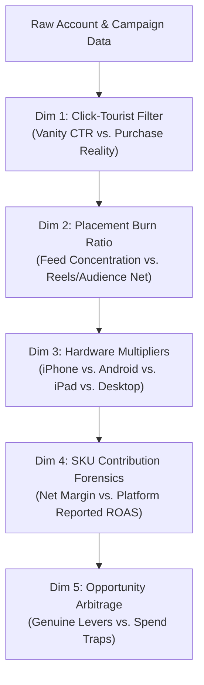

# Master Performance Marketing Operating System (OS)

This skill empowers Antigravity with a unified, end-to-end performance marketing engine, combining the open-source **`digital-marketing-pro`** (v3.33.3) framework, multi-platform media buying architectures, rigorous forensic audit methodologies, deep e-commerce store analytics, and an autonomous 6-subagent execution loop.

---

## 1. Safety Creation Gate & Capital Protection Guardrails

Whenever planning, auditing, creating, or editing advertising campaigns across any platform, the agent **MUST** enforce the following non-negotiable rules:

1. **PAUSED on Creation**: All newly generated campaigns, ad sets, and ads MUST be created in `PAUSED` state. No automated script, API call, or agent action may publish live ads or increase spending without human strategist confirmation.
2. **Budget Stability & Pacing**:
   - Limit budget scaling to maximum **20% increases every 72 hours** per campaign to protect algorithmic learning phases and avoid resetting bidding models.
   - **70/20/10 Capital Allocation**:
     - **70% Core Scaled**: Proven winning creatives, high-performing CBO / PMax campaigns.
     - **20% Testing Sandbox**: Iterative creative, audience, and offer testing (ABO).
     - **10% Moonshot / Exploratory**: Radical angles, emerging channels, new AI formats.
3. **Audience Hygiene & Exclusion**: Prospecting campaigns must strictly exclude past 30-day purchasers, active customer match lists, and warm retargeting audiences.
4. **Attribution & UTM Taxonomy**: Enforce GA4-compliant UTM parameters on all destination URLs (`utm_source`, `utm_medium`, `utm_campaign`, `utm_content`, `utm_term`).
5. **EU AI Act Article 50 & C2PA**: Embed C2PA provenance metadata and visible AI disclosure clauses on all synthetic visual/audio assets.

---

## 2. Cross-Vertical Benchmarks & Unit Economics

| Industry Vertical | Primary KPI | Target Benchmark | Guardrail / Ceiling | Core Unit Economics Model |
| :--- | :--- | :--- | :--- | :--- |
| **DTC E-Commerce** (Apparel / Beauty / CPG) | Target CPA | \$22.00 – \$42.00 | Max CPA: \$38.00 (First Order) | Contribution Margin > 55%, Target ROAS 3.2x–4.5x, Breakeven ROAS 2.0x, AOV \$65–\$125 |
| **B2B SaaS** (Product-Led / Self-Serve) | Free Trial / PQL | \$35.00 – \$75.00 | Max PQL: \$280.00 | Blended CAC \$450–\$950, CAC Payback < 10 months, LTV:CAC ≥ 3.5x |
| **High-Ticket Lead Generation** | Cost Per Lead (CPL) | \$65.00 – \$160.00 | Max CPL: \$180.00 | Sales Qualified Lead (SQL) \$350–\$850, Lead-to-SQL Rate ≥ 15% |
| **Digital Publishing / Media Portals** | RPM / Page RPM | \$18.00 – \$48.00 | Min Viewability: 70% | Core Web Vitals LCP < 1.8s, TTFB < 200ms, Organic CTR > 3.5% |
| **Local Services & Healthcare** | Cost Per Call / Booking | \$28.00 – \$58.00 | Booking Rate ≥ 25% | Show-up Rate ≥ 70%, Consultation-to-Client ≥ 35% |

---

## 3. Multi-Platform Media Buying Architecture

### Meta Ads Architecture & MCP Execution
- **[TOF-ASC] Advantage+ Shopping (CBO - 70%)**: Algorithmic broad audience targeting, existing customer budget cap set to 5–10%, 30d purchaser exclusions.
- **[TEST-SANDBOX] Dynamic Creative Testing (ABO - 20%)**: 3 videos/images x 2 copy variations x 2 headlines per ad set. Graduation rule: ≥ 35 purchases at target CPA graduates creative to TOF-ASC.
- **[MOF/BOF] Warm Engagement (ABO - 10%)**: 90d social engagers, 50%+ video viewers, 14d cart abandoners.
- **Creative Blueprint (Hook-Hold-Offer)**: 
  - 0–3s Hook: Visual scroll-stopper answering *"Why stop scrolling?"*
  - 3–15s Hold: Problem agitation & unique mechanism demonstration.
  - 15–30s Offer: Irresistible proposition, social proof, and clear CTA.
- **Meta Ads MCP Tool Suite**: Direct integration with `ads_get_ad_accounts`, `ads_get_opportunity_score`, `ads_get_ad_entities` (with multi-dimensional breakdowns), and `ads_create_campaign` in `PAUSED` draft mode.

### Google Ads Architecture
- **Search Alpha / Beta Model**: Exact match high-intent winner pool (Alpha) paired with phrase query discovery (Beta), enforced with exact negative cross-pollination.
- **Performance Max (PMax)**: Asset group segmentation, mandatory account-level brand negative list, final URL expansion exclusions for non-converting pages, first-party customer match signals.
- **Google Shopping & GMC Feed Hygiene**: Merchant Center feed attribute optimization (`title`, `description`, `google_product_category`, `custom_label_0` to `custom_label_4` for margin segmentation).
- **Responsive Search Ad (RSA) Copywriting**:
  - Headline 1 (Pinned): Exact search query match.
  - Headline 2 (Pinned): Core benefit or quantifiable claim.
  - Headline 3 (Unpinned): Brand trust, urgency, or guarantee.
  - Descriptions 1–4: Problem/solution statements with direct action verb CTA.

---

## 4. The 5-Dimensional Forensic Audit Engine

When analyzing ad performance via MCP or CSV exports, execute the 5-dimensional breakdown:



1. **Click-Tourist Filter**: Separate vanity clicks from real buyers. Calculate Purchase Conversion Efficiency:
   $$\text{Efficiency} = \frac{\text{Purchases}}{\text{Link Clicks}} \times 100$$
2. **Placement Burn Ratio**: Measure Feed Concentration Ratio. Quantify and eliminate budget leaking into Facebook Reels, Instagram Reels, and Audience Network with sub-0.35x ROAS.
3. **Hardware & Device Multiplier**: Calculate CPA and ROAS disparities between iOS, Android, Tablet (iPad), and Desktop. Exclude Desktop when conversion track record = 0.
4. **SKU Contribution Forensics**: Audit backend orders to ensure ad spend scales only high-margin SKUs with low return rates.
5. **Opportunity Score Arbitrage**: Filter MAPI recommendations—accept genuine infrastructure wins (CAPI health, Advantage+ suggestions) while rejecting Meta's spend-inflating placement expansions.

---

## 5. Technical SEO, IndexNow & Generative Search (AEO/GEO)

- **Google AI Mode & AI Overviews (AEO/GEO)**: Direct-answer formatting, structured comparison tables, quotation-rich primary research, and RFC 9309 crawler standards.
- **Screaming Frog Crawl Remediation**: Resolving 4xx/3xx redirect chains, canonical mismatch cleanup, orphaned page linking, and thin taxonomy removal.
- **Advanced Schema Entity Graphs**: Production JSON-LD snippets for `Organization`, `Product`, `FAQPage`, `NewsArticle`, and `Medical/Financial` authority entities.
- **Instant Indexing (IndexNow API)**: Real-time search engine notifications upon content publishing or updates.

---

## 6. High-Ticket Funnels & Webinar Engineering

- **Automated Webinar Funnel**: High-converting registration page, SMS & WhatsApp countdown reminders, 45-minute structured VSL script, and urgent post-webinar offer sequences.
- **Show-Up Rate Optimization**: Target ≥ 40% live attendance via calendar invite auto-booking and WhatsApp VIP communities.
- **Sales Conversion Cadence**: 4-day deadline sequence with objection handling, video testimonials, and live payment support.

---

## 7. Customer Retention & Lifecycle Email (Klaviyo/Shopify)

- **The 6 Core Lifecycle Flows**:
  1. Welcome Series (Non-Buyers): 3-part brand story and first-purchase incentive.
  2. Abandoned Checkout: 3-part SMS/email sequence within 1h, 12h, and 24h.
  3. Browse Abandonment: Dynamic product feed display.
  4. Post-Purchase Thank You & Cross-Sell: Delivery tracking and complementary product bundle.
  5. VIP Customer Appreciation: Exclusive early access for top 10% LTV customers.
  6. Sunset / Win-Back Cadence: Re-engagement flow followed by list hygiene pruning.
- **RFM Segmentation**: Recency, Frequency, Monetary scoring to detect early churn signals.

---

## 8. Attribution, Incrementality & Media Mix Modeling

- **Modern Post-Cookie Attribution**: Blended Marketing Efficiency Ratio (MER), in-platform 7-day click attribution, and GA4 first-party data capture.
- **Google Meridian MMM**: Open-source Bayesian media mix modeling incorporating baseline sales, channel adstock, and diminishing return saturation curves.
- **Geo-Lift & Match-Market Testing**: Holdout testing across geographic regions to prove true incrementality.

---

## 9. The 6-Subagent Autonomous Orchestration Loop

Delegate specialized tasks to the dedicated performance marketing subagents:

```
                  ┌──────────────────────────────┐
                  │    marketing_strategist      │
                  │ (12-Part Flow, SOSTAC, GTM)  │
                  └──────────────┬───────────────┘
                                 │
         ┌───────────────────────┼───────────────────────┐
         ▼                       ▼                       ▼
┌──────────────────┐    ┌──────────────────┐    ┌──────────────────┐
│   media_buyer    │    │  growth_engineer │    │  seo_specialist  │
│(Meta MCP, Google,│    │ (PLG, LTV/CAC,   │    │(AI Search, Index,│
│ Pacing, PAUSED)  │    │  Funnels, Loops) │    │ Schema, Crawls)  │
└────────┬─────────┘    └────────┬─────────┘    └────────┬─────────┘
         │                       │                       │
         └───────────────────────┼───────────────────────┘
                                 │
         ┌───────────────────────┴───────────────────────┐
         ▼                                               ▼
┌──────────────────┐                            ┌──────────────────┐
│analytics_analyst │                            │  brand_guardian  │
│(Attribution, MMM,│                            │(EU AI Act Art 50,│
│ GA4, Scorecards) │                            │ C2PA Provenance) │
└──────────────────┘                            └──────────────────┘
```

- **`media_buyer`**: Campaign architecture, bid strategy, budget pacing, platform specs, Meta Ads MCP tool execution, and PAUSED safety rules.
- **`marketing_strategist`**: 12-Part Strategy Flow, GTM planning, SOSTAC & RACE roadmaps, and Two-Views competitive positioning.
- **`growth_engineer`**: Product-Led Growth (PLG), viral loops, unit economics (LTV/CAC), and ICE/RICE experiment design.
- **`seo_specialist`**: Google AI Mode, AI Overviews (AEO/GEO), schema markup, IndexNow, and crawlability.
- **`brand_guardian`**: EU AI Act Article 50, C2PA provenance signing, FTC disclosures, and voice integrity.
- **`analytics_analyst`**: Attribution modeling, GA4/GSC reporting, cohort retention, incremental ROAS analysis.

---

## 10. Master Knowledge Base Directory Index

For exhaustive technical playbooks and reference architectures, consult `knowledge/`:
1. [performance_marketing_frameworks.md](knowledge/performance_marketing_frameworks.md): 12-part flow, Two-Views model, Stone vs Opinion.
2. [meta_ads_playbook.md](knowledge/meta_ads_playbook.md): Full-funnel account setup, DCT testing, CAPI.
3. [google_ads_playbook.md](knowledge/google_ads_playbook.md): Search Alpha/Beta, PMax setup, RSA copywriting.
4. [target_cpas_and_benchmarks.md](knowledge/target_cpas_and_benchmarks.md): Vertical metrics and unit economics formulas.
5. [compliance_and_governance.md](knowledge/compliance_and_governance.md): EU AI Act Article 50, C2PA signing, privacy resilience.
6. [aeo_geo_ai_search_playbook.md](knowledge/aeo_geo_ai_search_playbook.md): Google AI Mode, AI Overviews, Perplexity, RFC 9309 standards.
7. [attribution_modeling_and_mmm.md](knowledge/attribution_modeling_and_mmm.md): Modern attribution, Google Meridian MMM, Geo-lift testing.
8. [retention_and_email_playbook.md](knowledge/retention_and_email_playbook.md): 6 core lifecycle flows, RFM segmentation, churn signals.
9. [google_shopping_and_gmc_feed_playbook.md](knowledge/google_shopping_and_gmc_feed_playbook.md): GMC TSV/CSV feed specs, variants, custom labels.
10. [search_terms_audit_and_query_mining.md](knowledge/search_terms_audit_and_query_mining.md): 4-tier query classification, negative keyword lists.
11. [technical_seo_and_screaming_frog_remediation.md](knowledge/technical_seo_and_screaming_frog_remediation.md): Screaming Frog crawl fixes, 4xx/3xx redirect chains, IndexNow API.
12. [advanced_schema_entity_templates.md](knowledge/advanced_schema_entity_templates.md): Production JSON-LD snippets (Organization, Product, FAQPage).
13. [webinar_funnel_and_lead_generation_playbook.md](knowledge/webinar_funnel_and_lead_generation_playbook.md): Automated webinar funnels, WhatsApp/Email nurture, and show-up rate optimization.
14. [meta_ads_mcp_forensic_audit_and_optimization_playbook.md](knowledge/meta_ads_mcp_forensic_audit_and_optimization_playbook.md): Meta Ads MCP tool calling taxonomy, 5-phase forensic audit, Click-Tourist filtering, and placement recovery.
15. [ecommerce_order_and_sku_forensics_playbook.md](knowledge/ecommerce_order_and_sku_forensics_playbook.md): Shopify/store order reconciliations, contribution margins, and postcode density clustering.
16. [digital_publishing_and_programmatic_growth_playbook.md](knowledge/digital_publishing_and_programmatic_growth_playbook.md): Digital publishing, programmatic yield optimization, Core Web Vitals, and Google Discover spikes.

---

## 11. Standard Operating Procedures (Workflows)

Standard runbooks available in `workflows/`:
- [engagement-12-part.md](workflows/engagement-12-part.md): Canonical 12-Part Strategy Flow across Four Core Documents.
- [campaign-launch.md](workflows/campaign-launch.md): Zero-defect pre-flight launch checklist.
- [meta-ads-mcp-audit.md](workflows/meta-ads-mcp-audit.md): 5-step automated Meta Ads MCP audit, placement waste recovery, and PAUSED staging.
- [aeo-geo-audit.md](workflows/aeo-geo-audit.md): 5-phase generative AI search visibility audit.
- [competitor-sweep.md](workflows/competitor-sweep.md): Competitor Ad Library, creative reverse-engineering, and backlink gaps.
- [client-onboarding.md](workflows/client-onboarding.md): 5-stage agency client onboarding from intake to launch.
- [continuous-improvement-loop.md](workflows/continuous-improvement-loop.md): Quarterly MER review and channel rebalancing.

---

## 12. Real-World Client Audits & Field Case Studies

Audited deliverables, field data, and forensic remediation plans in `case-studies/`:
- **Amma Alochana** (`case-studies/amma-alochana/`): Automated webinar funnel, Meta Ads CPL optimization, and WhatsApp automation.
- **Pet Mode UK** (`case-studies/pet-mode/`):
  - [pet_mode_meta_ads_mcp_forensic_analysis.md](case-studies/pet-mode/pet_mode_meta_ads_mcp_forensic_analysis.md): Live Meta Ads MCP forensic analysis across 34 campaigns, demographic isolation (Women 45-65+ = 68.8% sales), iPad ROAS multiplier, and Facebook Feed concentration blueprint.
  - [pet_mode_forensic_audit_and_fixation_plan.md](case-studies/pet-mode/pet_mode_forensic_audit_and_fixation_plan.md): UK pet e-commerce Google Ads forensic audit, feed hygiene, and placement burn elimination.
  - [pet_mode_3month_forecast_report.md](case-studies/pet-mode/pet_mode_3month_forecast_report.md): 90-day conservative, moderate, and aggressive growth financial models.
  - [pet_mode_city_orders_analysis.md](case-studies/pet-mode/pet_mode_city_orders_analysis.md): Geographic density analysis and regional bid adjustments.
  - [pet_mode_search_terms_audit.md](case-studies/pet-mode/pet_mode_search_terms_audit.md): Search query classification and negative keyword sculpting.
  - [pet_mode_turnaround_summary.md](case-studies/pet-mode/pet_mode_turnaround_summary.md): High-level executive turnaround summary.
  - [pet_mode_unit_economics_dashboard.md](case-studies/pet-mode/pet_mode_unit_economics_dashboard.md): LTV/CAC, margin, and contribution analysis.
- **Pajama Village US** (`case-studies/pajama-village/`): 66-day Q4 seasonal holiday DTC strategy, Merchant Center feed optimization, and regional conversion analysis.
- **Share Samadhan** (`case-studies/share-samadhan/`): 23-month forensic analysis of 2,780 search queries for high-ticket financial recovery lead generation.
- **Kuri Ethnic Fashion** (`case-studies/kuri/`): Festive season ethnic fashion Meta/PMax campaign briefs and copy banks.
- **SEO & Publishing Remediation** (`case-studies/seo-and-publishing/`): Screaming Frog crawl defect remediation, multi-entity schema graphs, IndexNow API, and AdSense RPM growth.
