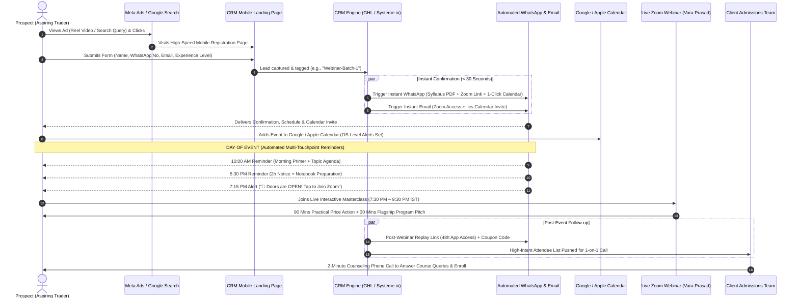

# Performance Marketing & Automated Webinar Funnel Proposal
**Client:** Amma Alochana Trading Academy  
**Founder & Trainer:** Vara Prasad ([@varaprasad_46](https://www.instagram.com/varaprasad_46/?hl=en)) | App: [`co.sansa.pwiko`](https://play.google.com/store/apps/details?id=co.sansa.pwiko)  
**Objective:** High-Velocity Lead Generation & Maximizing Live Zoom Webinar Attendance for the 3-Month Trading Program  
**Core Deliverable:** End-to-End Campaign Setup, CRM Landing Page, Automated Email/WhatsApp Multi-Touchpoint Funnel, and Ongoing Media Buying  

---

## 1. Executive Summary & Scope Boundary

This strategic execution proposal is engineered to solve the primary student acquisition bottleneck for **Amma Alochana Trading Academy**: consistently filling live Zoom masterclasses with pre-qualified Telugu-speaking prospects at a realistic, measured acquisition cost.

### Clear Boundary of Responsibilities & KPIs

To ensure operational clarity and mutual accountability, performance is strictly measured against **Top-of-Funnel and Attendance KPIs**:

| Scope Dimension | Marketing Team Deliverables (Our Defined KPIs) | Client Team Responsibilities (Admissions & Closing) |
| :--- | :--- | :--- |
| **Primary Metric** | **Cost Per Lead (CPL) & Live Webinar Attendees** | **Course Sales & Enrollment Conversions** |
| **Traffic & Ads** | Meta Ads (85%) & Google Search (15%) campaign management, audience targeting, and budget pacing | Recording raw vertical video footage per provided scripts |
| **Tech & Landing Page** | High-speed mobile landing page, CRM integration, lead forms, and pixel/CAPI tracking | Providing logo, brand assets, and course curriculum details |
| **Automation & Reminders** | Automated instant confirmation, 1-click calendar sync (.ics), and 3 day-of reminders (WhatsApp + Email) | Hosting the live 2-hour interactive Zoom session (7:30 PM) |
| **Post-Event Handoff** | Automated 48-hour replay distribution to registered leads | Placing 1-on-1 counseling calls to attendees to finalize batch sales |

> [!IMPORTANT]
> **Performance KPI Guarantee:**  
> Our KPI commitment is to generate high-intent registered leads at target CPL (₹75–₹150 in Month 1) and deliver qualified attendees (30–50 attendees in Month 1) into the live Zoom room via automated calendar syncing and multi-touchpoint reminders. Whether an attendee ultimately enrolls into the paid 3-month course depends on the client’s presentation, live pitch, pricing, and phone counseling, and is therefore outside the marketing agency KPI scope.

---

## 2. End-to-End Automated Webinar Funnel Architecture

---

## 3. Marketing Performance KPIs & Delivery Benchmarks

Our ongoing optimization is measured against strict performance thresholds:

| Performance Metric | Month 1 Benchmark (Pilot) | Month 2 Benchmark (Scaled) | Strategic Meaning |
| :--- | :--- | :--- | :--- |
| **Cost Per Lead (CPL)** | **₹75.00 – ₹150.00** | **₹65.00 – ₹120.00** | Cost to acquire a verified registration with phone and email. |
| **Total Registered Leads** | **200 – 400 Leads** | **500 – 900 Leads** | Total registrations captured via landing page form. |
| **Live Webinar Attendees** | **30 – 50 Attendees** | **80 – 150 Attendees** | Registered attendees who join the live Zoom room. |
| **Calendar Sync Rate** | **25% – 35%** | **30% – 40%** | Registrants who add the event to Google/Apple Calendar. |
| **WhatsApp Delivery Rate** | **95% – 99%** | **96% – 99%** | Verified delivery of syllabus PDF and reminder alerts. |
| **Email Open Rate** | **30% – 42%** | **32% – 45%** | Event schedule and reminder email engagement. |

---

## 4. Client Video Creative Engine (For Vara Prasad)

The client records raw vertical videos (9:16) on a smartphone following our scripts. Our team handles editing, sound enhancement, dynamic Telugu/English subtitles, graphic callouts, and ad deployment.

### Script 1: "The Telegram Tip Trap" (Duration: 35–45s)
* **[0:00–0:05] Hook:** *"మీరు కూడా టెలిగ్రామ్ ఛానెల్స్, వాట్సాప్ టిప్స్ నమ్మి వేలల్లో, లక్షల్లో నష్టపోయారా?"*  
  *(Have you also lost hard-earned money trusting anonymous Telegram tips?)*
* **[0:05–0:20] Problem:** *"90% మంది ట్రేడర్స్ ఎందుకు ఫెయిల్ అవుతారో తెలుసా? వాళ్ళు ప్రైస్ యాక్షన్ చార్ట్స్ నేర్చుకోకుండా గ్యాంబ్లింగ్ చేస్తారు! టిప్స్ ఇచ్చేవాళ్ళు మీ క్యాపిటల్‌ను ఎప్పటికీ కాపాడలేరు."*  
  *(Do you know why 90% of retail traders fail? They gamble without understanding price action!)*
* **[0:20–0:35] Solution:** *"ఈ ఆదివారం రాత్రి 7:30 PM కు జరిగే నా ఫ్రీ లైవ్ జూమ్ మాస్టర్‌క్లాస్‌లో స్టాక్ మార్కెట్, MCX కమోడిటీ, ఫారెక్స్, క్రిప్టో — నాలుగు మార్కెట్లలో ప్రైస్ యాక్షన్ మరియు రిస్క్ మేనేజ్‌మెంట్ లైవ్‌గా నేర్పిస్తున్నాను."*  
  *(This Sunday at 7:30 PM on Zoom, I am teaching live price action and risk management across all 4 markets: Stocks, MCX, Forex, and Crypto.)*
* **[0:35–0:45] CTA:** *"కింద ఉన్న లింక్ క్లిక్ చేసి మీ ఉచిత సీట్‌ను ఇప్పుడే రిజిస్టర్ చేసుకోండి. సిలబస్ మరియు జూమ్ లింక్ మీ వాట్సాప్‌కు వెంటనే వస్తుంది!"*  
  *(Click the link below to reserve your free seat. Syllabus & Zoom link will be sent to your WhatsApp immediately!)*

### Script 2: "The 7:30 PM Evening Solution" (Duration: 30–35s)
* **[0:00–0:05] Hook:** *"జాబ్ లేదా బిజినెస్ చేస్తూ స్టాక్ మార్కెట్ నేర్చుకోవడానికి టైమ్ దొరకట్లేదా?"*  
  *(Working a full-time job and struggling to find time to master trading?)*
* **[0:05–0:20] Solution:** *"మీ కోసమే అమ్మ ఆలోచన ట్రేడింగ్ అకాడమీలో డైలీ ఈవినింగ్ 7:30 PM నుండి 8:30 PM వరకు లైవ్ ఇంటరాక్టివ్ జూమ్ క్లాసెస్ ఉంటాయి. ఒకవేళ క్లాస్ మిస్ అయినా, మా అఫీషియల్ మొబైల్ యాప్‌లో 24x7 రికార్డింగ్స్ అందుబాటులో ఉంటాయి. 36 రోజుల లైవ్ ట్రైనింగ్ + 2 నెలల ప్రాక్టీస్."*  
  *(That's why we conduct live classes daily from 7:30 PM to 8:30 PM. Missed a class? Watch 24x7 recordings inside our mobile app. 36 live days + 2 months live market practice.)*
* **[0:20–0:35] CTA:** *"ఈ ఆదివారం లైవ్ వెబినార్‌లో పాల్గొని మీ సందేహాలు నివృత్తి చేసుకోండి. ఇప్పుడే కింద క్లిక్ చేసి రిజిస్టర్ చేసుకోండి!"*  
  *(Join our live webinar this Sunday and clarify all your questions. Click below to register!)*

---

## 5. Automated Reminder & Calendar Integration Copy Templates

### 5.1 Instant WhatsApp Confirmation
> *నమస్తే [Name] గారు! 🙏*  
> *అమ్మ ఆలోచన ట్రేడింగ్ అకాడమీ లైవ్ మాస్టర్‌క్లాస్‌కు మీ రిజిస్ట్రేషన్ కన్ఫర్మ్ అయ్యింది!*  
>   
> *📅 తేదీ: ఈ ఆదివారం, [Date]*  
> *⏰ సమయం: రాత్రి 7:30 PM నుండి 9:30 PM IST*  
> *💻 వేదిక: Zoom Live (లింక్ క్రింద ఉంది)*  
> *👉 Zoom లింక్: [Custom Zoom URL]*  
>   
> *🎁 మీ ఉచిత గిఫ్ట్:*  
> *మీరు కోరిన '3-నెలల కంప్లీట్ కోర్స్ సిలబస్ & క్యాండిల్‌స్టిక్ చీట్‌షీట్ PDF' ఇక్కడ డౌన్‌లోడ్ చేసుకోండి: [PDF Link]*  
>   
> *ముఖ్య గమనిక: లైవ్ క్లాస్ మిస్ అవ్వకుండా ఉండటానికి మీ క్యాలెండర్‌లో ఇప్పుడే యాడ్ చేసుకోండి: [1-Click Calendar Link]*  
> *— వరప్రసాద్, అమ్మ ఆలోచన ట్రేడింగ్ అకాడమీ*

### 5.2 Day-of-Event Reminders (3 Touchpoints)
1. **10:00 AM (Morning Primer - WhatsApp & Email):**  
   *"ఈరోజు రాత్రి 7:30 PM కు లైవ్ మాస్టర్‌క్లాస్ ప్రారంభం కాబోతోంది. లైవ్ మార్కెట్ చార్ట్ ఎనాలసిస్ & ప్రైస్ యాక్షన్ నేర్చుకోవడానికి సిద్ధంగా ఉండండి. జూమ్ లింక్: [Link]"*
2. **5:30 PM (2-Hour Alert - WhatsApp & Email):**  
   *"కేవలం 2 గంటల్లో క్లాస్ ప్రారంభం! నోట్‌బుక్ సిద్ధం చేసుకోండి. జూమ్ రూమ్ పరిమితి 100 మంది మాత్రమే. జూమ్ లింక్: [Link]"*
3. **7:15 PM (15-Minute Urgent Notice - WhatsApp & SMS):**  
   *"🚨 Doors are OPEN! జూమ్ రూమ్ ఓపెన్ అయ్యింది. వరప్రసాద్ గారు లైవ్ సెషన్ స్టార్ట్ చేస్తున్నారు. వెంటనే ఇక్కడ క్లిక్ చేసి జాయిన్ అవ్వండి: [Direct Zoom Link]"*

### 5.3 Post-Webinar Replay (9:30 PM)
> *"లైవ్ సెషన్‌లో పాల్గొన్నందుకు ధన్యవాదాలు! క్లాస్ రికార్డింగ్ మా అఫీషియల్ యాప్‌లో 48 గంటలు అందుబాటులో ఉంటుంది. కొత్త బ్యాచ్ కోసం స్పెషల్ డిస్కౌంట్ కూపన్ కోడ్: `AMMA500`. ఎన్‌రోల్ లింక్: [Link]"*

---

## 6. Monthly Lead & Attendance Volume Projections

| Performance Dimension | Month 1: Pilot Launch | Month 2: Scale Expansion | Strategic Meaning |
| :--- | :--- | :--- | :--- |
| **Monthly Media Ad Spend** | **₹30,000** (₹1,000/day) | **₹60,000** (₹2,000/day) | Paid directly by client to ad platforms |
| **Channel Split** | Meta 85% (₹25,500) / Google 15% (₹4,500) | Meta 85% (₹51,000) / Google 15% (₹9,000) | Core lead gen + high-intent search |
| **Target Cost Per Lead (CPL) [Our KPI]** | **₹75 – ₹150** | **₹65 – ₹120** | Realistic cost per verified registration |
| **Total Registered Leads [Our KPI]** | **200 – 400 Leads** | **500 – 900 Leads** | Prospects who fill the landing page form |
| **Calendar Sync Rate (Est. 30%)** | ~60 – 120 Leads | ~150 – 270 Leads | Registrants who sync to phone calendar |
| **Live Webinar Attendees [Our KPI]** | **30 – 50 Attendees** | **80 – 150 Attendees** | **Live participants joined in the Zoom room** |
| **Post-Webinar Replay Viewers (48h)** | ~50 – 90 Viewers | ~120 – 220 Viewers | Warm leads consuming session replay |
| **Client Closing Opportunity** | *Client's cohort to pitch & enroll* | *Expanded cohort to pitch & enroll* | Course sales are the client's responsibility |

---

## 7. Fast 5-Day Launch Checklist

- [ ] **Day 1: Deploy CRM Landing Page & Form**  
  Build high-speed mobile registration page with custom domain and calendar sync widget.
- [ ] **Day 2: Client Video Delivery**  
  Share Scripts 1 & 2 with Vara Prasad. Client records and uploads raw 9:16 vertical footage.
- [ ] **Day 3: Video Post-Production & Campaign Build**  
  Add dynamic captions and hook graphics. Build Meta and Google campaigns in **`PAUSED`** state.
- [ ] **Day 4: WhatsApp & Email Automation Configuration**  
  Set up instant confirmation, calendar trigger, 3-touchpoint day-of reminders, and 48-hour replay drips.
- [ ] **Day 5: Pre-Flight Test & Live Ad Launch**  
  Run end-to-end test submission, verify WhatsApp/Email delivery, and launch live ads with the ₹1,000/day pilot budget!

---

## 8. Commercial Terms & Pricing Structure

### 8.1 Client-Provided Costs & Infrastructure Checklist
The client will directly provide and pay for the following third-party operational tools and budgets:
* **Advertisement Cost (Media Ad Spend):** ₹30,000 for Month 1 (paid directly by the client to Meta and Google Ads Manager via business debit/credit card).
* **CRM Platform Subscription:** Provided by client (e.g. GoHighLevel, Systeme.io, or TeleCRM).
* **Custom Domain & SSL:** Provided by client (e.g. `ammaalochana.com` or subdomain `masterclass.ammaalochana.com`).
* **WhatsApp Business API / Messaging Credits:** Provided by client (Wati / Interakt / AiSensy / Meta Cloud API).
* **Zoom Account:** Licensed Zoom Pro / Webinar account provided by client for hosting live classes.

---

### 8.2 Marketing Agency Service Fees

#### Component 1: One-Time Full Setup Fee
A comprehensive turnkey setup covering all technical, creative, and tracking foundations before ad launch:
* **Meta Ads Architecture Setup**: Pixel setup, Conversions API (CAPI) server tracking, custom conversions, and audience building (AP + Telangana + Hyderabad + Bangalore).
* **Google Ads Setup**: High-intent Search campaign, negative keyword lists, conversion tracking, and RSA ad copy.
* **CRM & Landing Page Engine**: Mobile-first registration landing page, lead form, domain connection, and SSL configuration.
* **Automated Communication Workflows**:
  - Instant WhatsApp confirmation + PDF syllabus delivery workflow.
  - Confirmation email setup with 1-click calendar sync integration (`.ics` generation for Google/Apple/Outlook Calendar).
  - 3-touchpoint automated reminder sequence on the day of the event (10 AM, 5:30 PM, 7:15 PM).
  - Post-webinar 48-hour replay access delivery workflow.
* **Creative Post-Production**: Editing of raw client-shot video footage, adding dynamic bilingual subtitles, hook graphics, and creative formatting.
* **End-to-End QA Testing**: Full test submission to verify lead ingestion, pixel firing, and automated WhatsApp/Email delivery.

**One-Time Setup Fee:** `₹ __________________` *(To be added)*

---

#### Component 2: Ongoing Monthly Lead Generation & Maintenance Retainer
Ongoing media buying, optimization, and system maintenance:
* Daily management of Meta Ads and Google Ads campaigns.
* Continuous A/B testing of ad hooks, audiences, and ad copies.
* Budget pacing and scaling adherence (≤ 20% increases every 72 hours).
* CRM lead pipeline hygiene, workflow monitoring, and webhook uptime maintenance.
* Negative keyword query mining on Google Ads to eliminate wasted ad spend.
* Weekly performance reporting (Total Leads, CPL, Calendar Syncs, and Webinar Attendees).

**Monthly Management Retainer:** `₹ __________________ / Month` *(To be added)*