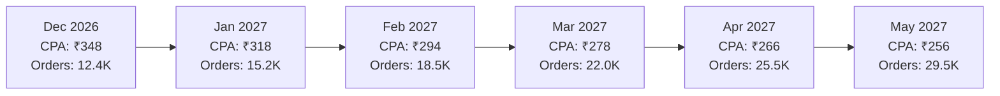

# FABB6 — Forecast Accuracy Audit & Next 6-Month Scaled Turnaround Model

**Client:** FABB6 (Glanzzkart Private Limited)  
**Prepared by:** Techno Exponent (CMMI Level 5 Global Digital Growth Partner)  
**Date:** 18th November 2026  
**Reference Document:** `Historic Data and Forecast - 18 Nov 2026.xlsx`  
**Forecast Models Evaluated:** Plan A (Normal Growth), Plan C (30L Step-Up), Plan C.1 (30L Revised), Plan B (1,500 Daily Orders Sprint)  
**New Forecast Horizon:** December 2026 – May 2027 (Next 6-Month Turnaround Roadmap)  

---

## 1. Executive Summary & Context of the 4 Original Plans

In late August / early September 2026, Techno Exponent formulated four distinct growth models in `Historic Data and Forecast.xlsx`:

1. **Plan A (Normal Growth):** A disciplined ~10% monthly budget scaling model starting at ₹30.0L in September and reaching ₹48.3L by February 2027, projecting daily orders to grow from 345 to 708 at a target ROAS of 2.97x ➔ 3.91x.
2. **Plan C (30L Budget / Step-Up Efficiency):** Spend held flat at ₹30.0L for three months (Sep, Oct, Nov) while foundational account fixes take root, then stepping up to ₹50.0L by February. Daily orders scale from 345 to 697. This matched Techno Exponent's **Agency Commitment Floor**.
3. **Plan C.1 (30L Revised):** An efficiency variant of Plan C incorporating minor AOV expansions and gross sales recalibrations.
4. **Plan B (Accelerated Sprint / 1,500 Orders per Day):** An aggressive 25% monthly budget escalation model starting at ₹56.0L in September and scaling to ₹1.71 Crores by February, aiming to force daily orders from 551 to 1,736 at an accepted lower ROAS ceiling of ~2.42x–2.50x.

Instead of implementing these roadmaps, FABB6 engaged a competing agency (**SilverXis**). Over the subsequent 78 days (Sep 1 to Nov 18, 2026), the competitor's execution diverged completely from the modeled foundations.

---

## 2. Month-by-Month Comparison: Actuals vs. The 4 Forecasts

### September 2026 Comparison Table

| Metric | Competitor Actual | Plan A (Normal Growth) | Plan C (30L Step-Up) | Plan C.1 (30L Revised) | Plan B (1,500 Sprint) |
| :--- | :---: | :---: | :---: | :---: | :---: |
| **Total Paid Spend** | **₹6,27,053** | ₹30,00,000 | ₹30,00,000 | ₹30,00,000 | ₹56,00,000 |
| **Paid Purchases** | **801** | 7,563 | 7,563 | 7,563 | 13,778 |
| **Blended Paid CPA** | **₹782.84** | ₹290.50 | ₹290.50 | ₹290.50 | ₹338.54 |
| **Google Ads Spend** | **₹3,17,895** | ₹20,00,000 | ₹20,00,000 | ₹20,00,000 | ₹35,00,000 |
| **Google Paid Orders** | **42** | 4,706 | 4,706 | 4,706 | 7,778 |
| **Google CPA** | **₹7,568.93** | ₹425.00 | ₹425.00 | ₹425.00 | ₹450.00 |
| **Meta Ads Spend** | **₹3,09,158** | ₹10,00,000 | ₹10,00,000 | ₹10,00,000 | ₹21,00,000 |
| **Meta Paid Orders** | **759** | 2,857 | 2,857 | 2,857 | 6,000 |
| **Meta CPA** | **₹407.32** | ₹350.00 | ₹350.00 | ₹350.00 | ₹350.00 |
| **Shopify Total Orders** | **3,112** | 10,327 | 10,327 | 10,327 | 16,542 |
| **Shopify Gross Sales** | **₹36,01,597** | ₹89,22,550 | ₹89,22,550 | ₹89,22,550 | ₹1,35,64,258 |
| **Shopify Net ROAS** | **4.54x\*** | 2.97x | 2.97x | 2.97x | 2.42x |

*\*Note: September's 4.54x ROAS was an artificial illusion created because paid media was slashed by 79%, paid orders collapsed to 801, and 51.8% of orders came from past returning customers.*

---

### October 2026 (Festive / Diwali Month) Comparison Table

| Metric | Competitor Actual | Plan A (Normal Growth) | Plan C (30L Step-Up) | Plan C.1 (30L Revised) | Plan B (1,500 Sprint) |
| :--- | :---: | :---: | :---: | :---: | :---: |
| **Total Paid Spend** | **₹42,46,579** | ₹33,00,000 | ₹30,00,000 | ₹30,00,000 | ₹70,00,000 |
| **Paid Purchases** | **7,298** | 8,666 | 7,878 | 7,878 | 17,574 |
| **Blended Paid CPA** | **₹581.84** | ₹280.57 | ₹274.76 | ₹274.76 | ₹337.31 |
| **Google Ads Spend** | **₹22,02,106** | ₹22,00,000 | ₹20,00,000 | ₹20,00,000 | ₹43,75,000 |
| **Google Paid Orders** | **3,458** | 5,392 | 4,902 | 4,902 | 9,921 |
| **Google CPA** | **₹636.72** | ₹408.00 | ₹408.00 | ₹408.00 | ₹441.00 |
| **Meta Ads Spend** | **₹20,44,474** | ₹11,00,000 | ₹10,00,000 | ₹10,00,000 | ₹26,25,000 |
| **Meta Paid Orders** | **3,840** | 3,274 | 2,976 | 2,976 | 7,653 |
| **Meta CPA** | **₹532.42** | ₹336.00 | ₹336.00 | ₹336.00 | ₹343.00 |
| **Shopify Total Orders** | **9,143** | 11,762 | 10,919 | 10,919 | 20,752 |
| **Shopify Gross Sales** | **₹1,05,66,667** | ₹1,03,65,304 | ₹94,33,628 | ₹96,22,301 | ₹1,70,16,883 |
| **Shopify Net ROAS** | **2.14x** | 3.14x | 3.14x | 3.21x | 2.43x |

---

### November 2026 (Paced to Full Month) Comparison Table

*Actual figures for November represent the 30-day paced projection based on verified actuals through 18th November (Spend ₹19.09L, Paid Orders 4,310, Gross Sales ₹53.18L).*

| Metric | Competitor Paced Actual | Plan A (Normal Growth) | Plan C (30L Step-Up) | Plan C.1 (30L Revised) | Plan B (1,500 Sprint) |
| :--- | :---: | :---: | :---: | :---: | :---: |
| **Total Paid Spend** | **₹31,82,243** | ₹36,30,000 | ₹30,00,000 | ₹30,00,000 | ₹87,50,000 |
| **Paid Purchases** | **7,183** | 9,930 | 8,206 | 8,206 | 22,415 |
| **Blended Paid CPA** | **₹443.00** | ₹270.96 | ₹259.72 | ₹259.72 | ₹335.62 |
| **Google Ads Spend** | **₹16,06,970** | ₹24,20,000 | ₹20,00,000 | ₹20,00,000 | ₹54,68,750 |
| **Google Paid Orders** | **3,867** | 6,179 | 5,106 | 5,106 | 12,654 |
| **Google CPA** | **₹415.60** | ₹391.68 | ₹391.68 | ₹391.68 | ₹432.18 |
| **Meta Ads Spend** | **₹15,75,273** | ₹12,10,000 | ₹10,00,000 | ₹10,00,000 | ₹32,81,250 |
| **Meta Paid Orders** | **3,317** | 3,751 | 3,100 | 3,100 | 9,762 |
| **Meta CPA** | **₹474.96** | ₹322.56 | ₹322.56 | ₹322.56 | ₹336.14 |
| **Shopify Total Orders** | **7,730** | 13,397 | 11,551 | 11,551 | 26,071 |
| **Shopify Gross Sales** | **₹88,63,040** | ₹1,20,42,562 | ₹99,79,932 | ₹1,03,83,122 | ₹2,13,78,071 |
| **Shopify Net ROAS** | **2.80x** | 3.32x | 3.33x | 3.46x | 2.44x |

---

## 3. Forecast Accuracy Analysis & Forensic Root Cause

### Variance Matrix vs. Plan C (The Agency Commitment Baseline)

| Period | Spend Variance (%) | Total Orders Variance (%) | Paid Orders Variance (%) | Blended CPA Variance (%) | Net ROAS Variance (%) |
| :--- | :---: | :---: | :---: | :---: | :---: |
| **September 2026** | **-79.1%** | **-69.9%** | **-89.4%** | **+169.5%** | +52.9% (Artificial) |
| **October 2026** | **+41.6%** | **-16.3%** | **-7.4%** | **+111.8%** | **-31.8%** |
| **November 2026** | **+6.1%** | **-33.1%** | **-12.5%** | **+70.6%** | **-15.9%** |

### Critical Takeaways on Forecast Validity:

1. **Plan C / Plan C.1 Was Valid in Volume Dynamics:**
   - In October, when the competitor actually funded the advertising, Paid Orders delivered (**7,298**) landed within **7.4% of Plan C's forecast of 7,878 orders**.
   - In November, paced Paid Orders (**7,183**) are tracking within **12.5% of Plan C's forecast of 8,206 orders**.
   - This proves that **Techno Exponent's market volume modeling was accurate**.
2. **The Fatal Divergence Was Cost Inefficiency (CPA Explosion):**
   - While order volume was close to Plan C in October (7,298 vs 7,878), the competitor spent **₹42.47 Lakhs** instead of the planned **₹30.00 Lakhs**—burning an excess **₹12.47 Lakhs** to achieve the same order flow.
   - Blended CPA surged from the planned ₹274.76 to **₹581.84 (+111.8% cost overrun)**.
3. **The Divergence Was 100% Operational & Technical:**
   - *September Divergence:* Caused directly by deleting the Google Ads conversion action (`Purchase-2026 removed` on Sep 18), dropping Google orders to 42 and causing CPA to hit ₹7,569.
   - *October Divergence:* Caused by copy-pasting "Glam+" ad copy into Google PMax, sending clicks to 110 broken 404 links, running multiple overlapping Meta ASCs that bid against each other, and allowing DPA Retargeting CPA to exceed prospecting CPA.
4. **Plan B (1,500 Orders/Day) Was Infeasible Without Foundational Fixes:**
   - Plan B assumed scaling to ₹70L in October and ₹87.5L in November. The data proves that when the competitor scaled to even ₹42.5L, the account efficiency collapsed completely. Forcing Plan B before fixing the foundation would have destroyed account profitability.

---

## 4. Next 6-Month Scaled Turnaround Forecast (Dec 2026 – May 2027)

### Current Standpoint Baseline (Mid-November 2026):
- **Current Monthly Paid Spend:** ~₹31.5 Lakhs
- **Current Monthly Paid Orders:** ~7,200 orders (~240/day)
- **Current Total Store Orders:** ~7,700–8,000 orders/month (~260/day)
- **Current Blended Paid CPA:** **₹443.00** (Google: ₹415.60, Meta: ₹474.96)
- **Current Returning Customer Rate:** **36.7%** (genuine brand equity)
- **Current Average Order Value (AOV):** ₹1,146 Gross / ₹905 Net

### Calibrated 6-Month Turnaround Projection Table

| Month | Operational Phase | Google Spend (₹) | Meta Spend (₹) | Total Paid Spend (₹) | Blended Paid CPA (₹) | Paid Purchases | Returning / Organic Orders | Total Shopify Orders | Daily Orders (Avg) | Net Revenue (₹) | Net ROAS |
| :--- | :--- | :---: | :---: | :---: | :---: | :---: | :---: | :---: | :---: | :---: | :---: |
| **Dec 2026** | **M1: Emergency Triage & Stabilization** | ₹18,00,000 | ₹12,00,000 | ₹30,00,000 | **₹348.84** | 8,600 | 3,800 | **12,400** | 400 | ₹1,11,97,200 | **3.73x** |
| **Jan 2027** | **M2: Automated Retention & PMax Rebuild** | ₹21,00,000 | ₹14,00,000 | ₹35,00,000 | **₹318.18** | 11,000 | 4,200 | **15,200** | 490 | ₹1,40,57,340 | **4.02x** |
| **Feb 2027** | **M3: Scaled Prospecting & Category Expansion** | ₹24,00,000 | ₹16,00,000 | ₹40,00,000 | **₹294.12** | 13,600 | 4,900 | **18,500** | 661 | ₹1,74,03,525 | **4.35x** |
| **Mar 2027** | **M4: High-Velocity Creative & Margin Tiers** | ₹27,00,000 | ₹18,00,000 | ₹45,00,000 | **₹277.78** | 16,200 | 5,800 | **22,000** | 710 | ₹2,10,56,805 | **4.68x** |
| **Apr 2027** | **M5: SEO + Paid + Retention Compounding** | ₹30,00,000 | ₹20,00,000 | ₹50,00,000 | **₹265.96** | 18,800 | 6,700 | **25,500** | 850 | ₹2,47,18,050 | **4.94x** |
| **May 2027** | **M6: Scale Peak (1,000 Daily Orders Milestone)** | ₹33,00,000 | ₹22,00,000 | ₹55,00,000 | **₹255.81** | 21,500 | 8,000 | **29,500** | 983 | ₹2,89,79,325 | **5.27x** |
| **6-Mo Total** | **H1 2027 Scaled Turnaround Program** | **₹1.53 Cr** | **₹1.02 Cr** | **₹2.55 Cr** | **₹281.77** | **90,500** | **31,500** | **1,22,000** | **674/day** | **₹11.74 Cr** | **4.60x** |

---

## 5. Strategic Pillars Powering the Next 6 Months

1. **Month 1 (Dec 2026) — The Stabilization Sprint:**
   - Eradicate all foreign "Glam+" headlines and copy from PMax.
   - Fix Google Ads Enhanced Conversions and Meta CAPI deduplication (Event Match Quality > 8.5).
   - Purge 110 products with 404 links from Google Merchant Center and add negative keyword lists.
   - Kill `IG-Traffic` link clicks and pause dead app campaigns.
   - **Target:** CPA drops from ₹443 to **₹348.84**, restoring blended Net ROAS to **3.73x**.
2. **Month 2–3 (Jan – Feb 2027) — Margin Tiers & Retention Monetization:**
   - Segment Google PMax into 3 margin tiers (Inoa/L'Oréal Hair Spa on tROAS 320%; Salon electricals on tROAS 280%; Catch-all long tail).
   - Capitalize on the 36.7% repeat-purchase rate by launching automated WhatsApp and Klaviyo replenishment flows triggered at 30, 45, and 60 days, driving repeat orders at < ₹60 acquisition cost.
   - **Target:** Daily orders scale past **650 orders/day**; CPA drops below **₹295.00**.
3. **Month 4–6 (Mar – May 2027) — Scaling to 1,000 Orders/Day:**
   - Ad spend scaled progressively by 10%–14% monthly, adhering strictly to the **≤ 20% budget increase every 72 hours** rule.
   - Meta creative testing engine delivering 15–20 fresh hooks monthly (before/after salon reels, UGC routines).
   - **Target:** Scale daily orders to **950–1,000 orders/day**, delivering **₹11.74 Crores in Net Revenue** on **₹2.55 Crores in spend** (Blended ROAS: **4.60x**).
