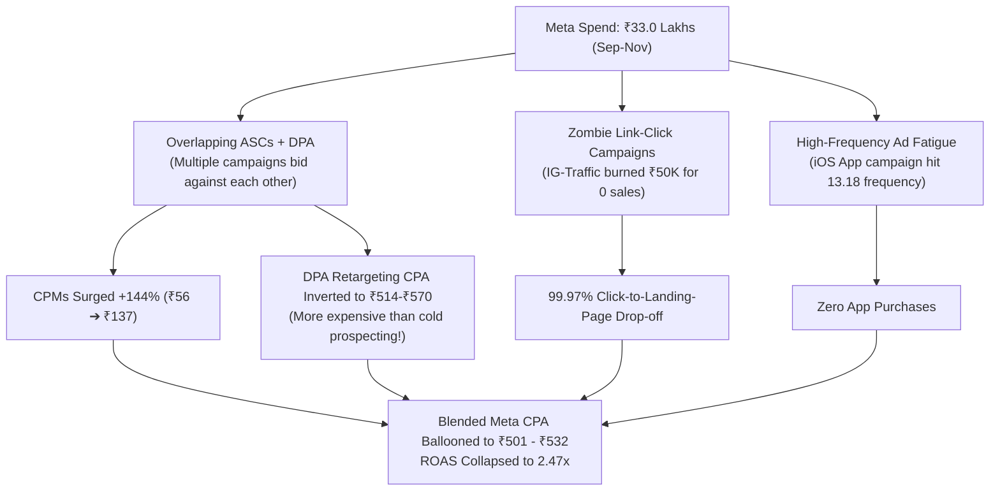
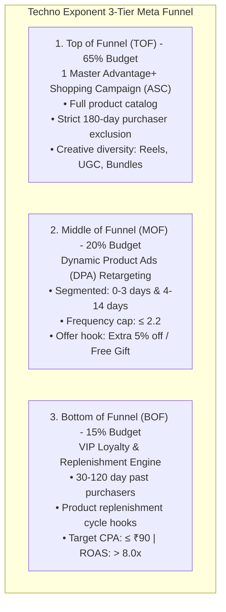

# FABB6 — Meta Ads Performance Forensic Deep Dive & Key Insights

**Client:** FABB6 (Glanzzkart Private Limited)  
**Analyzed Period:** 1st August 2026 – 18th November 2026 (Historical Baseline vs. Competitor Agency Run)  
**Data Sources:** `FABB6-Campaigns-1-Aug-2026-18-Nov-2026.csv`, `Fabb6-Jan-1-2026-to-Nov-17-2026.xlsx`, `Historic Data and Forecast - 18 Nov 2026.xlsx`  
**Prepared by:** Techno Exponent (Growth Architecture & Paid Media Practice)  

---

## Executive Overview: The Meta Ads Collapse

During the competitor agency’s tenure (1st September to 18th November 2026), FABB6 invested **₹32,98,795.65 (~₹33.0 Lakhs)** on Meta Ads. Instead of driving profitable growth, the account suffered an acute efficiency breakdown:

- **Blended Meta CPA:** Surged from **₹276.86 – ₹368.65** (Historical baseline) to an average of **₹500.65**, peaking at **₹532.42** in October.
- **Blended Meta ROAS:** Tanked from **3.12x – 3.52x** down to **2.47x – 2.62x**.
- **CPM Inflation:** Soared from **₹56.15 in August** to **₹104.17 in October (+85%)** and **₹137.03 in November (+144%)**.
- **Avoidable Media Waste:** Over **₹2.08 Lakhs** was burned directly on zero-conversion link clicks and extreme-frequency app ads.

---

## 1. Master Metric Evolution: Pre-Competitor vs. Competitor Run

| Metric | August 2026 (Baseline) | September 2026 (Slashed Run) | October 2026 (Festive Diwali) | November 2026 (Till 18th) | Competitor Total / Avg |
| :--- | :---: | :---: | :---: | :---: | :---: |
| **Meta Ad Spend** | ₹15,68,590.30 | ₹3,09,157.87 | ₹20,44,473.72 | ₹9,45,164.06 | **₹32,98,795.65** |
| **Meta Purchases** | 4,255 | 759 | 3,840 | 1,990 | **6,589** |
| **Cost Per Purchase (CPA)** | **₹368.65** | **₹407.32** | **₹532.42** | **₹474.96** | **₹500.65** |
| **Meta ROAS** | 2.75x | 3.31x | **2.47x** | 2.62x | **2.59x** |
| **Average CPM** | **₹56.15** | ₹28.49 | **₹104.17** | **₹137.03** | **₹102.83** |
| **Average CTR (Link)** | 1.49% | 1.90% | 2.04% | 1.86% | **1.96%** |
| **Average CPC (Link)** | ₹3.76 | ₹1.50 | ₹5.12 | ₹7.37 | **₹5.24** |
| **Click-to-LPV Drop-off** | 55.0% | **88.2%** | **52.4%** | **31.8%** | **56.5%** |

---

## 2. Granular Campaign Breakdown (Sep 1 – Nov 18, 2026)

| Campaign Name | Spend (INR) | Share (%) | Purchases | CPA (INR) | CPM (INR) | Frequency | CPC (INR) | Link Clicks | LPV Drop-off | Primary Verdict |
| :--- | :---: | :---: | :---: | :---: | :---: | :---: | :---: | :---: | :---: | :--- |
| **Advantage+ Sales — Fabb6** | ₹11,38,878 | 34.5% | 2,375 | ₹479.53 | ₹146.71 | 3.14 | ₹6.68 | 1,70,401 | 28.9% | Cold ASC lacking creative hooks; CPA inflated |
| **Retargeting — DPA - Fabb6** | ₹9,50,354 | 28.8% | 1,850 | **₹513.70** | ₹155.47 | 3.21 | ₹6.69 | 1,42,051 | 34.1% | **Cost Inversion:** Retargeting CPA > Prospecting! |
| **Advantage+ Sales — Best Seller** | ₹5,68,931 | 17.3% | 1,361 | ₹418.02 | ₹135.12 | 3.60 | ₹8.10 | 70,269 | 27.8% | Overlapping with main ASC; frequency burned |
| **Lookalike Audience Campaign** | ₹3,88,279 | 11.8% | 735 | **₹528.27** | **₹205.07** | 2.57 | ₹7.90 | 49,142 | 33.0% | Obsolete targeting; highest CPM in account |
| **App-BTG-03072026** | ₹1,38,513 | 4.2% | 128 | **₹1,082.14** | ₹18.07 | 2.90 | ₹0.73 | 1,89,958 | **99.8%** | Ghost clicks: 1.9L clicks, only 372 reached site |
| **IG-Traffic** | ₹50,214 | 1.5% | **0** | **₹0 (0 Sales)** | ₹6.04 | 1.58 | ₹0.49 | 1,02,322 | **99.97%** | **100% Waste:** 1.02L link clicks, only 28 reached site |
| **Advantage+ Sales Combo Products** | ₹25,906 | 0.8% | 44 | ₹588.77 | ₹178.04 | 1.95 | ₹9.87 | 2,626 | 37.9% | Inefficient small-budget fragmentation |
| **New App promo Campaign iOS** | ₹19,161 | 0.6% | **0** | **₹0 (0 Sales)** | ₹59.52 | **13.18** | ₹30.86 | 621 | **100.0%** | **Ad Fatigue Disaster:** Users hit 13.2 times |
| **ALYV Catalog Sales** | ₹13,203 | 0.4% | 36 | ₹366.75 | ₹14.57 | 1.48 | ₹2.23 | 5,924 | 83.5% | Massager / non-beauty catalog drift |
| **Advantage+ Sales — B2B** | ₹2,946 | 0.1% | 8 | ₹368.19 | ₹130.51 | 1.43 | ₹10.63 | 277 | 34.3% | Negligible scale |
| **Other Legacy Ad Sets** | ₹1,411 | 0.0% | 52 | ₹27.13 | — | — | — | — | — | Paused |
| **Total Competitor Run** | **₹32,98,796** | **100.0%** | **6,589** | **₹500.65** | **₹102.83** | **2.76** | **₹5.24** | **7,34,064** | **56.5%** | **Severe Structural Failure** |

---

## 3. The 7 Critical Meta Ads Insights & Technical Failures

### 1. The Retargeting Cost Inversion (DPA Blunder)
- **The Finding:** `Retargeting — DPA - Fabb6` spent **₹9,50,354.11** for 1,850 purchases at an average CPA of **₹513.70** (peaking at **₹570.31** in October).
- **The Inversion:** In healthy performance marketing, retargeting warm audiences (viewed content, added to cart) should have a CPA **40%–60% lower than cold prospecting** (benchmark: ₹160–₹220). Here, DPA retargeting was **MORE EXPENSIVE than cold Advantage+ prospecting (₹479.53)**!
- **Why It Happened:**
  1. The Advantage+ Shopping Campaigns were already harvesting warm audiences because the competitor set **0% existing customer cap** and no exclusion lists.
  2. The DPA campaign lacked recency segmentation (e.g. 0-3 days vs 4-14 days). It repeatedly showed dynamic carousels to cold or exhausted leads.
  3. Frequency climbed to **3.21**, causing ad fatigue and negative feedback.

### 2. Internal Advantage+ Auction Self-Cannibalization
- **The Finding:** The competitor ran **three separate Advantage+ Shopping Campaigns simultaneously**:
  * `Advantage+ Sales Campaign - Fabb6` (₹11.39L spend)
  * `Advantage+ Sales – Best Seller - Fabb6` (₹5.69L spend)
  * `Advantage+ Sales Combo Products` (₹25.9K spend)
- **The Flaw:** Meta’s Advantage+ Shopping algorithm is designed to optimize across the entire product catalog for an account. When multiple ASCs run in the same country targeting the same demographic without audience exclusion rules, **they enter Meta's auction against each other**.
- **The Impact:** Meta bid against itself, driving account CPM from **₹56.15 in August to ₹146–₹178 in October/November**, penalizing FABB6 with higher acquisition costs.

### 3. The ₹50,000 Link-Click Black Hole (`IG-Traffic`)
- **The Finding:** `IG-Traffic` burned **₹50,214.27** across 8.32 million impressions and generated **1,02,322 link clicks**, but delivered **ZERO PURCHASES**.
- **The Drop-Off:** Out of 102,322 link clicks, **only 28 users actually landed on the website** (a **99.97% drop-off**!).
- **Why It Happened:** In DTC performance marketing, optimizing for "Link Clicks" is a known fatal mistake. Meta’s delivery algorithm finds click-happy bots, spam users, and accidental swipers who bounce before DNS resolution. It was 100% budget incineration.

### 4. Severe Ad Fatigue & Frequency Abuse on App Campaigns
- **The Finding:** `New App promotion Campaign iOS` burned ₹19,161 on 24,422 users at an absurd frequency of **13.18**!
- **The Impact:** Every single prospective iOS user was blasted with the same ad **13 times in a single month**, resulting in zero purchases, extreme brand annoyance, and a CPC of ₹30.86.
- Similarly, `App-BTG-03072026` spent ₹1.38 Lakhs generating 1.9 lakh clicks, but **only 372 users reached the landing page (99.8% loss)**, driving purchase CPA to an unsustainable **₹1,082.14** (ROAS 1.22x).

### 5. Obsolete Lookalike Audience Bleed (₹205 CPM)
- **The Finding:** `Lookalike Audience Campaign - Fabb6` spent **₹3,88,278.88** for 735 purchases at a CPA of **₹528.27**.
- **The Flaw:** The CPM on this campaign was **₹205.07**—the highest in the account. Running broad manual lookalikes without offer-level creative hooks in 2026 is an outdated tactic that gets out-competed by Meta’s AI broad delivery.

### 6. The Click-to-Landing-Page Drop-Off Crisis (56.5% Loss)
- Across the competitor's run, Meta reported **7,34,064 link clicks**, but only **3,01,798 Landing Page Views** materialized on the store.
- Over **4,32,000 paid clicks (56.5%) were lost in transit** due to slow mobile loading, unoptimized Shopify redirect scripts, and missing Meta CAPI server-side event tracking.

### 7. Total Absence of a Retention / Re-Order Engine
- While FABB6 has an outstanding **36.7% organic repeat-customer rate**, the competitor spent ₹33 Lakhs treating every purchase as a cold acquisition.
- There was **zero segmented retention advertising** on Meta (e.g. 30-day hair mask replenishment, 60-day shampoo re-orders, VIP customer loyalty perks), leaving high-margin repeat revenue completely unharvested.

---

## 4. How Techno Exponent Fixes Meta Ads (Immediate 14-Day Overhaul)

To reverse the ₹500+ CPA and restore Meta ROAS to **> 4.0x**, Techno Exponent will implement a clean, consolidated **3-Tier Funnel Architecture**:

### Action Items for Week 1–2:
1. **Kill the Bleeders:** Immediately pause `IG-Traffic`, `New App promotion Campaign iOS`, and unsegmented lookalikes (saving ~₹2.1 Lakhs/month in waste).
2. **Consolidate ASCs:** Merge the 3 fragmented Advantage+ campaigns into **1 Master Top-of-Funnel ASC** with strict 180-day purchaser exclusions. This eliminates internal auction bidding and drives CPMs back down from ₹146 to under ₹90.
3. **Fix Retargeting DPA:** Rebuild DPA with tight recency windows (3-day cart abandoners) and frequency capped at ≤ 2.2, driving retargeting CPA down from ₹514 to **under ₹200**.
4. **Deploy CAPI Hardening:** Re-verify Meta Conversions API through the native Shopify gateway to eliminate the 56.5% click-to-landing-page drop-off and ensure 100% deduplicated purchase tracking.
5. **Launch Creative Testing Engine:** Deploy 12–15 fresh vertical 9:16 Reels and UGC video assets focusing on salon-grade hair transformations, before/after color results, and anti-hair-fall routines.
