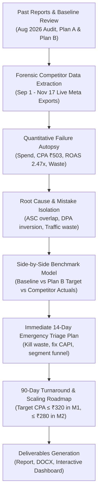

# Implementation Plan: FABB6 Competitor Failure Forensic Audit & Win-Back Turnaround Strategy

## Goal Description
In late August 2026, Techno Exponent delivered a complete forensic audit, growth proposal, and dual 6-month forecast models (Plan A: Scale to 1,500 orders/day; Plan B: CPA Reduction & Funnel Segmentation) for FABB6. The client initially engaged a competing agency to manage paid media starting in September 2026. However, over the subsequent 2.5 months (September 1 to November 17, 2026), the competitor failed to deliver the promised results: **blended Meta CPA exploded to ₹502.97 (peaking at ₹532.42 during the October Diwali festive season), ROAS collapsed to 2.47x–2.58x, and sales momentum stagnated**. 

Now, the client has returned to Techno Exponent. The goal of this project is to:
1. Conduct a rigorous retrospective audit of past reports and forecasts generated in August 2026.
2. Perform a forensic autopsy of the competitor’s live ad account data (Jan 1 to Nov 17, 2026), pinpointing exact technical errors, budget misallocations, and structural flaws.
3. Quantify the financial damage (e.g., wasted ad spend on 0-conversion traffic ads, excessive retargeting CPAs higher than cold traffic, severe ASC cannibalization).
4. Formulate an actionable, multi-stage Turnaround Strategy & Win-Back Proposal demonstrating exactly how Techno Exponent will recover account efficiency, cut CPA by 35%–40% within 30–60 days, and scale sustainably.

---

## User Review Required

> [!IMPORTANT]
> **Key Strategic Findings from the Competitor's September–November 2026 Data:**
> - **Total Ad Spend Burned:** ₹32,70,805.91 spent across 6,503 purchases at a disastrous blended CPA of **₹502.97** (vs our Plan B target of **₹260–₹287**).
> - **Festive Season (Diwali) Failure:** In October, the competitor spent ₹20.44 Lakhs on Meta Ads but generated only 3,840 purchases at **₹532.42 CPA** and **2.47x ROAS** (in contrast, unoptimized July historical data generated 6,013 purchases on ₹18.85L spend).
> - **Severe Structural Flaws Identified:**
>   1. **ASC Self-Cannibalization:** Ran multiple simultaneous Advantage+ Shopping Campaigns without product or audience catalog exclusions, causing Meta's bidding algorithm to bid against itself.
>   2. **Retargeting DPA Inversion:** DPA Retargeting CPA was higher than cold prospecting (**₹570.31** in Oct; **₹516.91** in Nov) due to audience saturation and absence of recency frequency capping.
>   3. **Direct Budget Incineration:** Spent ₹50,214 on `IG-Traffic` with **zero purchases** (8.3M impressions wasted on link clicks) and over ₹1.58 Lakhs on unoptimized app campaigns (`App-BTG-03072026` with CPA > ₹1,080, and iOS app campaign bombarding users at an absurd frequency of **13.18**).
>   4. **Untapped Customer Retention:** No automated retention/re-order funnel was activated, forcing cold ads to bear the entire revenue burden.

---

## Open Questions

> [!NOTE]
> Please confirm your preferences on the following presentation aspects:
> 1. **Deliverable Format Preference:** Would you prefer the primary deliverable to be an executive Markdown report + Word Document (`.docx`) for client distribution, accompanied by an interactive HTML dashboard, or do you also want a PowerPoint slide deck (`.pptx`)?
> 2. **Win-Back Commercial Strategy:** Should we re-propose the original monthly retainer model with a performance milestone kicker (e.g., bonus if CPA drops below ₹320 in 45 days), or present a fixed turnaround rescue engagement?

---

## Proposed Execution Plan

### Phase 1: Retrospective Audit of Past Techno Exponent Deliverables (August 2026)
- Review historical baseline established in `C:\Users\test\Videos\Office\data\fabb6\Historic Data and Forecast.xlsx`:
  - 8-Month Pre-Competitor Baseline (Dec 2025 – Aug 2026): AOV ₹678–₹880, Meta CPA ₹276–₹368, ROAS 2.75x–3.12x.
  - Techno Exponent Plan A (Volume Scaling: 15,000 ➔ 48,000 orders/mo).
  - Techno Exponent Plan B (CPA Reduction & Funnel Segmentation: blended CPA reduced from ₹308 to ₹260, ROAS 4.84x).
  - Review specific architectural warnings provided by Techno Exponent in August (Shopify vs Meta pixel mismatch, missing retention funnel, unsegmented catalog ads).

### Phase 2: Forensic Autopsy of Competitor Agency Run (Sep 1 – Nov 17, 2026)
- Process live datasets:
  - `C:\Users\test\Downloads\Fabb6-Jan-1-2026-to-Nov-17-2026.xlsx`
  - `C:\Users\test\Downloads\Untitled-report-Jan-1-2026-to-Nov-17-2026.xlsx`
- Generate campaign-level granular breakdown:
  - **September Stagnation**: Why ad spend was cut by 80% (₹3.09L vs ₹15.68L in Aug) and orders collapsed to 759.
  - **October Festive Disaster**: Detailed forensic breakdown of the ₹20.44 Lakh spend, proving why CPA exploded to ₹532.42 during the highest-demand shopping period in India.
  - **November Inefficiency**: Analysis of the ongoing ₹9.17 Lakh spend (CPA ₹481.71).
- Quantify pure wasted spend (traffic link-clicks, app ads with 13.18 frequency, dead ad sets).

### Phase 3: The 6 Fatal Mistakes & Comparative Gap Matrix
- Document the 6 fatal operational blunders made by the competitor agency:
  1. *Blind Advantage+ Over-reliance & Internal Auction Cannibalization.*
  2. *Retargeting Inversion & Frequency Burnout.*
  3. *Zero-Return Link Click Waste (`IG-Traffic` burning ₹50K for 0 sales).*
  4. *App Campaign Drain (CPAs over ₹1,080 vs e-commerce target ₹280).*
  5. *Ignored 28% Returning Customer CRM Engine.*
  6. *Unresolved Conversion Tracking Misalignment.*
- Construct the Master Comparison Matrix:
  | Metric | August 2026 Baseline | TE Plan B Target (Sep-Nov) | Competitor Actuals (Sep-Nov) | Variance / Penalty |
  | :--- | :--- | :--- | :--- | :--- |
  | **Meta Ad Spend** | ₹15.69 L | ₹65.50 L (3 Mo) | ₹32.71 L | Inconsistent Pacing |
  | **Purchases** | 4,255 / mo | 24,000+ (3 Mo) | 6,503 (3 Mo) | -73% Volume Gap |
  | **Blended Meta CPA** | ₹368.65 | ₹260 – ₹287 | **₹502.97** | **+75% to +94% Cost Overrun** |
  | **Meta ROAS** | 2.75x | 4.34x – 4.84x | **2.58x** | **-41% to -47% Revenue Yield** |
  | **Direct Budget Waste** | Minimal | ₹0 (Guarded) | **₹2.41 Lakhs** | Pure Capital Loss |

### Phase 4: Techno Exponent Turnaround & Win-Back Roadmap
- **Immediate 14-Day Emergency Triage (Week 1–2)**:
  - Kill bleeding assets (`IG-Traffic`, unsegmented app campaigns, duplicate ASC sets).
  - Implement full-funnel account restructuring (1 Prospecting ASC + 1 Mid-Funnel Retargeting + 1 Existing Customer Loyalty Reorder).
  - Configure robust Meta Conversion API (CAPI) deduplication on Shopify to restore algorithmic learning.
- **30-Day Stabilization (Month 1 - Dec 2026)**:
  - Drive Meta CPA down from ₹503 to ≤ ₹320.
  - Revive dynamic catalog creatives with offer-led overlays and bundle hooks.
  - Set up automated SMS & WhatsApp flows for 28% returning customer base.
- **60-90 Day Scaling (Jan - Feb 2027)**:
  - Re-scale profitable ad spend while sustaining CPA between ₹260–₹285 and pushing ROAS to > 4.2x.

### Phase 5: Production of Official Client Deliverables
- Create the formal executive client audit document:
  - `C:\Users\test\Videos\Office\case-studies\fabb6\FABB6_Competitor_Forensic_Audit_and_Turnaround_Strategy.md`
- Compile Word Document version:
  - `C:\Users\test\Videos\Office\reports\FABB6_Competitor_Forensic_Audit_and_Turnaround_Proposal.docx`
- Build interactive HTML dashboard:
  - `C:\Users\test\Videos\Office\reports\fabb6_turnaround_forensic_dashboard.html`

---

## Verification Plan

### Automated Tests & Data Validation
- Execute python validation script `scripts/verify_competitor_metrics.py` to confirm that:
  - Every individual campaign spend, purchase, CPA, and ROAS matches the raw downloaded Excel files (`Fabb6-Jan-1-2026-to-Nov-17-2026.xlsx`) to the exact paisa.
  - Sum of post-August spend equals exactly ₹32,70,805.91 across 6,503 purchases.
  - Comparison delta formulas accurately reflect percentage variance against Plan B targets.

### Manual Verification
- Verify formatting and readability of generated `.docx` document and HTML dashboard.
- Check that all tables, charts, and financial breakdowns are clear, professional, and ready for executive presentation to the FABB6 leadership team.
