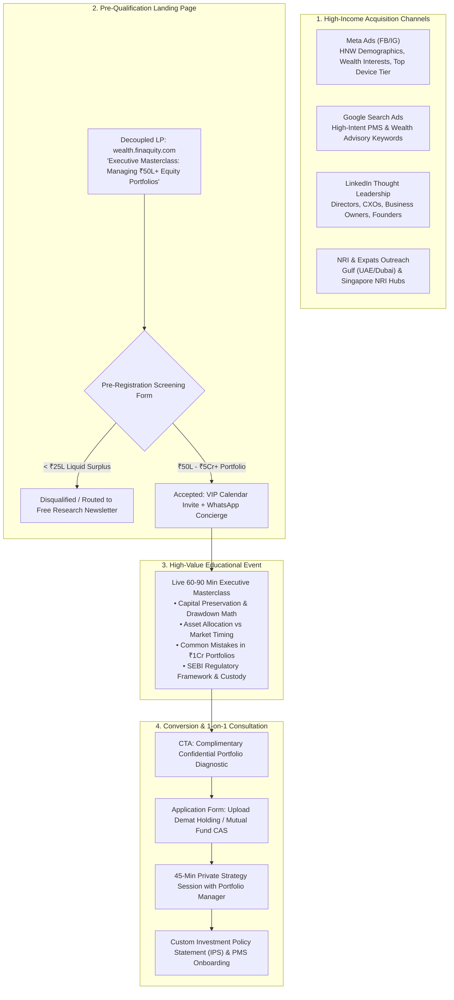
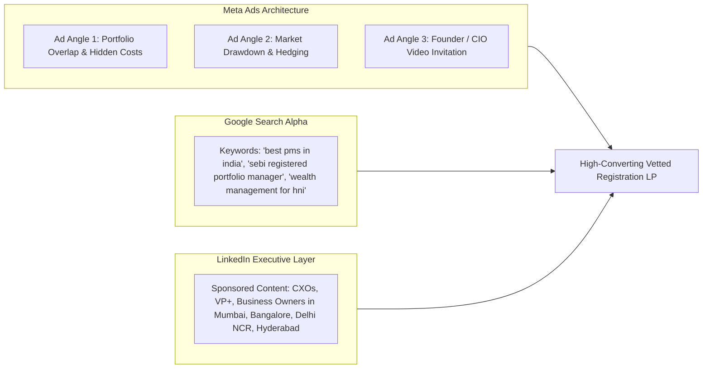
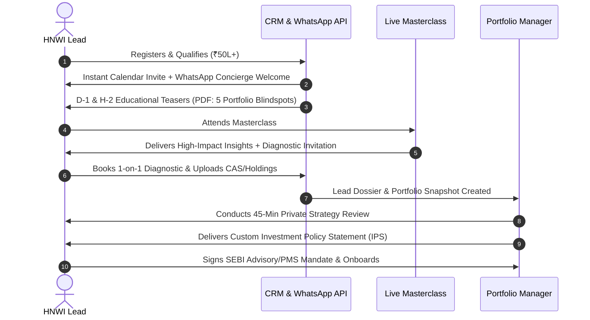

# Implementation Plan: Finaquity HNWI Wealth Management Acquisition Funnel

## Goal Description
Finaquity aims to acquire High-Net-Worth Individuals (HNWIs) and Ultra-HNWIs (₹50 Lakh to ₹5 Crore+ investable surplus) for its SEBI-registered stock market portfolio management / wealth management services. 

Directly selling discretionary/advisory money management to HNWIs via cold ads typically yields near-zero conversion due to trust deficits and high risk sensitivity. To overcome this barrier, this strategy deploys an **Institutional Education & Portfolio Diagnostic Funnel**:
1. **Pre-qualifying Top-of-Funnel Traffic** via high-trust, elite positioning.
2. **Delivering High-Value Executive Masterclasses / Closed-Door Webinars** addressing capital preservation, drawdown management, factor investing, and portfolio risk.
3. **Converting High-Intent Attendees into 1-on-1 Private Portfolio Risk Diagnostics / Teardown Sessions** with the SEBI-registered portfolio manager.
4. **Transitioning Qualified Prospects into Active Managed Investors**.

---

## User Review Required

> [!IMPORTANT]
> **1. SEBI Regulatory Entity Classification & Advertising Code Compliance**
> SEBI's Advertising Code (effective May 2023 for RIAs/RAs and PMS regulations) prohibits:
> - Promising guaranteed, fixed, or indicative returns.
> - Displaying unverified or non-standard performance metrics without statutory benchmarks (BSE 500 / Nifty 50 TRI).
> - Referencing past performance without standard risk disclosures and audited APMI compliance.
> - Using words like "risk-free", "market-beating guarantee", or "top wealth manager in India".
> *We must confirm which specific SEBI license Finaquity holds directly (e.g., PMS license `INP...`, RIA license `INA...`, RA license `INH...`, or an authorized partner arrangement).*

> [!WARNING]
> **2. Brand Decoupling (Critical Brand Safety Action)**
> Finaquity's current homepage promotes ₹499/month active F&O trade ideas, crypto, intraday alerts, and low-ticket subscriptions. An HNWI with ₹50L+ liquid capital will immediately bounce if landed on a page emphasizing day trading and speculative tips.
> *We strongly recommend creating a distinct, institutional-grade sub-domain or dedicated landing experience (e.g., `wealth.finaquity.com` or `pms.finaquity.com`) that strictly communicates capital preservation, disciplined asset allocation, and institutional portfolio management.*

---

## Open Questions

1. **Specific SEBI License:** Is Finaquity operating under its own direct SEBI Portfolio Manager (PMS) license (minimum statutory ₹50L ticket size), an RIA license (fee-only investment advisory), an RA license (model portfolios), or partner PMS tie-ups?
2. **Minimum Ticket Size:** Is the entry threshold strictly set to SEBI's PMS statutory mandate of **₹50 Lakhs**, or is there also an advisory/model portfolio tier starting at ₹20L–₹25L?
3. **Custody & Demat Structure:** Does the client retain their securities in their own Demat account via a Power of Attorney (PoA) / 3-in-1 institutional custodian account (e.g., ICICI, Kotak, HDFC, Zerodha), or is it a pooled PMS custodial setup?
4. **Masterclass Presenter:** Will the founder (Tanmay Singh Rajput) or the Chief Investment Officer / SEBI-registered Portfolio Manager personally deliver the live sessions?
5. **Initial Monthly Ad Budget:** What is the anticipated monthly paid media test budget for lead acquisition (e.g., ₹1.5 Lakhs – ₹3.5 Lakhs/month)?

---

## Proposed Strategic Framework & Execution Plan

### Architecture Overview

---

### Component 1: Brand & Funnel Decoupling (`wealth.finaquity.com`)

#### [NEW] `Office/reports/finaquity_brand_decoupling_spec.md`
- **Objective:** Separate the retail trading hub from the high-ticket wealth management brand.
- **Visual Direction:** Minimalist, institutional, deep slate/navy palette, editorial typography, zero mention of F&O intraday or tips.
- **Key Elements:**
  - SEBI Registration Certificate details prominently displayed in the header and footer.
  - Transparent investment philosophy: Quantitative factor models, fundamental bottom-up research, risk budgeting.
  - Clear statement of investor account custody: Client funds remain in their own individual Demat/bank account.

---

### Component 2: High-Net-Worth Masterclass Curriculum & Positioning

#### Masterclass Concept & Theme
- **Title:** *"The Wealth Preservation Playbook: How to Construct, Protect, and Compound ₹50L+ Equity Portfolios in Uncertain Markets"*
- **Format:** 75-minute live interactive masterclass (hosted on Zoom Webinar or Demio) on Thursday evenings (7:30 PM IST) or Saturday mornings (11:00 AM IST).
- **Core Curriculum Breakdown:**
  1. **The ₹50L+ Dilemma (First 15 mins):** Why mutual fund overlap and unmanaged direct stock picking silently erode 3–5% of annualized compounding.
  2. **Drawdown Mathematics (15 mins):** How a 40% loss requires a 66% gain just to break even, and how institutional hedging/risk controls protect wealth.
  3. **The Multi-Factor Framework (20 mins):** Momentum, Quality, and Low Volatility—how institutions build portfolios that outlast market cycles.
  4. **The Custody & Governance Advantage (10 mins):** Explaining SEBI compliance, direct demat ownership, zero hidden fees, and transparent reporting.
  5. **Q&A & Transition to Action (15 mins):** The "Portfolio Diagnostic" offer.

---

### Component 3: Multi-Tiered Paid Media Acquisition

#### 1. Meta Ads (Facebook & Instagram)
- **Audience Targeting:**
  - Demographics: Age 34–62, Metros (Mumbai, Delhi NCR, Bengaluru, Hyderabad, Pune, Chennai, Kolkata).
  - Devices: Top 5% devices (iPhone 14/15/16 Pro Max, iPad Pro, Mac users).
  - Interests & Behaviors: High-value goods purchasers, Frequent international travelers, Angel investing, Luxury real estate, Golf, Executive education.
  - Exclusions: Job seekers, students, past 30-day registrants.
- **Creatives:** High-end static cards, carousel diagrams explaining portfolio overlap, and direct-to-camera videos by the Founder/Fund Manager.

#### 2. Google Search (High-Intent Alpha/Beta)
- Exact/Phrase match keywords:
  - `[sebi registered portfolio manager]`
  - `[pms investment minimum ticket]`
  - `[equity portfolio management services india]`
  - `[portfolio advisory services sebi]`
  - `"best pms for hni in india"`

#### 3. LinkedIn ABM & Thought Leadership
- Targeted campaigns to CXOs, Managing Directors, Doctors, Family Office principals, and Senior Tech Leaders (ESOP holders) in top Indian tech hubs.

---

### Component 4: Pre-Qualification & Application Filtering Engine

To ensure the portfolio manager only spends time on genuine HNWIs, the registration flow features progressive qualification:

| Step | Form Fields | Qualification Gate |
| :--- | :--- | :--- |
| **Step 1 (Basic)** | Full Name, Corporate Email, Mobile Number, City | SMS / WhatsApp OTP verification |
| **Step 2 (Screening)** | Current Equity Portfolio Value:  • Under ₹25 Lakhs • ₹25L to ₹50 Lakhs • ₹50L to ₹1.5 Crore • Above ₹1.5 Crore | Auto-segments leads. Those < ₹25L receive automated webinar replay access only; ₹50L+ get assigned a dedicated relationship manager. |
| **Step 3 (Investor Goal)** | Primary goal: Wealth Preservation, Alpha Generation, or Risk Diversification | Prepares context for the 1-on-1 diagnostic call |

---

### Component 5: The Conversion Engine — "1-on-1 Portfolio Diagnostic"

- **The Hook:** *"Complimentary 45-Minute Portfolio Stress Test & Risk Audit"*
- **What the Prospect Gets:**
  1. **Overlap Analysis:** Detection of common holdings across their mutual funds and direct equities.
  2. **Drawdown Risk Score:** How their portfolio would have performed during COVID-19 (March 2020) or 2008 crashes.
  3. **Fee & Expense Leakage Audit:** Calculating hidden expense ratios, turnover costs, and cash drag.
  4. **Custom Asset Allocation Map:** Actionable recommendations aligned with SEBI risk profiles.
- **The Close:** Presenting Finaquity's managed strategy as the logical, turnkey solution for managing their portfolio with ongoing risk governance.

---

### Component 6: Automated Nurture & Retention Playbook

---

## Verification Plan

### Milestone 1: Strategic Deliverables Verification
1. Verify comprehensive marketing strategy proposal and funnel blueprint saved to `C:\Users\test\Videos\Office\reports\finaquity_hnwi_marketing_strategy.md`.
2. Verify masterclass presentation slide deck outline and landing page copy written in the Office reports directory.
3. Validate audience targeting templates for Meta Ads, Google Ads, and LinkedIn.

### Milestone 2: Compliance & Guardrail Auditing
1. Audit all ad copy, webinar titles, and landing page claims against SEBI's 2023 Advertising Code (no performance guarantees, statutory risk disclaimers included).
2. Confirm separation of retail trading materials from HNWI wealth management communications.

### Milestone 3: Funnel Unit Economics & Benchmark Alignment
- Benchmark validation against standard HNWI wealth management metrics:
  - Target Cost Per Webinar Registration (CPL): ₹450 – ₹950
  - Target Webinar Attendance Rate: 35% – 50%
  - Target Webinar-to-Diagnostic Booking Rate: 12% – 20%
  - Target Diagnostic-to-Investor Conversion Rate: 15% – 25%
  - Estimated Blended Customer Acquisition Cost (CAC) per ₹50L+ Investor: ₹18,000 – ₹38,000
  - First-Year Revenue per ₹50L Investor (at 1.5%–2.0% AUM fee): ₹75,000 – ₹1,00,000 (LTV/CAC > 3.5x).

---

## Deliverables Generated Upon Approval
1. **Master Strategy Report:** Full 12-part marketing strategy document formatted for presentation to the Finaquity leadership team.
2. **Landing Page Wireframe & Copy:** High-converting registration page structure for the HNW Masterclass.
3. **Webinar Presentation Outline (Deck Structure):** Slide-by-slide narrative engineered to build trust and drive diagnostic bookings.
4. **Targeting & Ad Copy Suite:** Ready-to-deploy ad copies and audience specifications for Meta, Google Search, and LinkedIn.
5. **Follow-Up Nurture Sequence:** WhatsApp and email copy templates for pre-event attendance and post-event booking.
