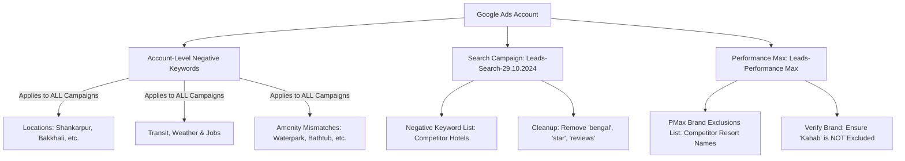

# Google Ads Search Terms & Negative Keywords Optimization Report
**Business**: Kahab Beach Resort (KBR)  
**Website**: [kahabbeachresort.com](https://kahabbeachresort.com/)  
**Location**: Mandarmani, Purba Medinipur, West Bengal  
**Deliverable Files**:
- Master Multi-Tab Spreadsheet: [KBR_Negative_Keywords_Master_Action_Plan.xlsx](file:///c:/Users/test/Videos/TE-AI%20Agent/data/KBR/KBR_Negative_Keywords_Master_Action_Plan.xlsx)
- Ready-to-Upload CSV: [Recommended_Negative_Keywords_KBR.csv](file:///c:/Users/test/Videos/TE-AI%20Agent/data/KBR/Recommended_Negative_Keywords_KBR.csv)

---

## Executive Summary & Performance Audit

A comprehensive analysis of all **9,844 search terms** from the Google Ads account across both the **Search Campaign** (`Leads-Search-29.10.2024`) and **Performance Max Campaign** (`Leads-Performance Max`) was conducted.

```
Total Ad Spend Analyzed:       ₹1,46,113.87
Total Conversions Recorded:    1,090.63
Overall Account CPA:           ₹133.97

Zero-Conversion Search Terms:  1,563 terms (Spend > ₹0, Conv = 0)
Wasted Ad Spend:               ₹40,496.13  (27.71% of total budget!)
Competitor Search Terms Spend: ₹5,820.20   (CPA: ₹342.77 — 2.5x higher than account average)
```

### Campaign Breakdown

| Campaign | Type | Search Terms | Spend (INR) | Conversions | CPA (INR) | 0-Conv Spend | Wasted % |
| :--- | :--- | :---: | :---: | :---: | :---: | :---: | :---: |
| **Leads-Search-29.10.2024** | Search | 4,163 | ₹1,21,992.63 | 828.15 | ₹147.31 | ₹32,898.74 | 26.97% |
| **Leads-Performance Max** | PMax | 5,681 | ₹24,121.24 | 262.48 | ₹91.90 | ₹7,597.39 | 31.49% |
| **Total** | **All** | **9,844** | **₹1,46,113.87** | **1,090.63** | **₹133.97** | **₹40,496.13** | **27.71%** |

---

## 3 Critical Red Flags Requiring Immediate Action

> [!CAUTION]
> ### 1. Self-Brand Cannibalization / "Excluded" Brand Traffic
> In the Search Terms report, the exact term **`kahab beach resort`** is marked as **`Excluded`** in 4 separate rows (including the primary PMax conversion driver with 129.33 conversions).  
> **Immediate Check Required**: Ensure that your brand name (`kahab`, `kahab beach resort`, `kbr`) was **NOT** accidentally placed into an account-level negative keyword list, campaign negative list, or ad-group exclusion. Choking brand terms suppresses your highest-ROI traffic (which converts at ₹67 CPA).

> [!WARNING]
> ### 2. Existing Negative Keywords Are Choking Valid Traffic & Brand Searches
> Several words in your current 171 negative keywords list are single, overly broad words that block high-value searchers:
> - **`bengal`**: Mandarmani is located in **West Bengal**. Having `bengal` as a phrase negative matched 356 search terms and **blocked 7 of your own brand queries** (e.g., *“kahab beach resort mandarmani silampur west bengal”*). It also blocks generic searches like *“beach resort in west bengal”*. **Action**: Replace `bengal` with specific competitors like `sher e bengal` and `bengal beach resort`.
> - **`star`**: Negating `star` blocks *“3 star hotels in mandarmani”*, *“4 star resort in mandarmani”*, and *“5 star resort in mandarmani”*. These are high-intent luxury seekers looking for upscale accommodations that match Kahab Beach Resort.
> - **`reviews`, `photos`, `location`**: Negating these blocked high-intent brand searchers (*“kahab beach resort reviews”*, *“kahab beach resort photos”*). Travelers search for photos and reviews immediately prior to booking.
> - **`unique`, `grand`, `queen`**: Negating single common adjectives blocks descriptive queries. Replace with exact competitor names: `unique beach resort`, `grand beach resort`, `sea queen`.
> - **`cost`**: Negating `cost` blocks commercial searchers (*“mandarmani hotel cost”*).

> [!IMPORTANT]
> ### 3. Performance Max Negative Leakage
> Over **5,681 search terms** ran through Performance Max, racking up ₹7,597 in wasted spend on competitors and irrelevant locations. **Campaign-level negative keywords in Search DO NOT apply to Performance Max!**  
> To protect PMax, you must:
> 1. Add these negative keywords at the **Account Level** (`Admin / Settings > Account settings > Negative keywords`).
> 2. Create a **Brand Exclusion List** in Performance Max campaign settings to exclude competitor hotel brands.

---

## Existing Negative Keywords: Cleanup & Removal Recommendations

Review of the existing 171 negative keywords list identifies the following keywords that must be removed, modified, or replaced:

| Existing Negative | Match Type | Recommended Action | Critical Reason / Risk |
| :--- | :--- | :--- | :--- |
| **`bengal`** | PHRASE | **REMOVE & REPLACE** | Blocks *“west bengal”* searches and blocked 7 Kahab brand searches. Replace with `sher e bengal` and `bengal beach resort`. |
| **`star`** | PHRASE | **REMOVE** | Blocks *“3 star”*, *“4 star”*, and *“5 star”* luxury resort searches matching KBR’s upscale positioning. |
| **`reviews`** | PHRASE | **REMOVE** | Blocked *“kahab beach resort mandarmani reviews”*. High purchase intent. |
| **`photos`** | PHRASE | **REMOVE** | Blocked *“kahab beach resort photos”*. Travelers view gallery before booking. |
| **`location`** | PHRASE | **REMOVE** | Blocked *“kahab beach resort location”*. Guests confirming travel route. |
| **`cost`** | PHRASE | **REMOVE** | Blocks *“hotel cost in mandarmani”* (price comparison intent). |
| **`unique`** | PHRASE | **REPLACE** | Replace with competitor name: **`unique beach resort`**. |
| **`queen`** | PHRASE | **REPLACE** | Replace with competitor name: **`sea queen`** / **`sea queen beach resort`**. |
| **`grand`** | PHRASE | **REPLACE** | Replace with competitor name: **`grand beach resort`**. |
| **`cottage`** | PHRASE | **REMOVE / MONITOR** | Blocked 6 brand searches (*“the kahab cottage prices”*). Beach resort guests use *cottage* synonymously with beach rooms. |
| **`villa`** | PHRASE | **REMOVE / MONITOR** | High-budget villa searchers can convert into KBR’s Super Deluxe rooms. |
| **`do`, `can`, `how`, `what`** | PHRASE | **REMOVE** | 2-to-3 letter common words that risk breaking long-tail queries. Replace with phrases like `how to reach`. |
| **`india`, `land`** | PHRASE | **REMOVE** | Overly broad single words that add no targeting protection. |
| **`amaya`** | PHRASE | **DEDUPLICATE** | Appears twice in current list. |

---

## 141 New Recommended Negative Keywords (Categorized)

The full list of 141 categorized negative keywords has been compiled into the master action plan file:
[KBR_Negative_Keywords_Master_Action_Plan.xlsx](file:///c:/Users/test/Videos/TE-AI%20Agent/data/KBR/KBR_Negative_Keywords_Master_Action_Plan.xlsx) and [Recommended_Negative_Keywords_KBR.csv](file:///c:/Users/test/Videos/TE-AI%20Agent/data/KBR/Recommended_Negative_Keywords_KBR.csv).

Below is the structured breakdown by category:

### 1. Competitor Resorts & Hotels in Mandarmani / Bengal (47 Keywords)
*Direct brand searches for other properties that have 0 conversion intent for KBR:*

| Keyword | Match Type | Wasted Spend / Performance Context |
| :--- | :---: | :--- |
| `"classic beach resort"` | Phrase | Mandarmani competitor (₹301+ spend, 1,119 impressions) |
| `"classic resort"` | Phrase | Competitor variant |
| `"red crab"` | Phrase | Red Crab Beach Resort (₹297+ spend; existing only had Bengali *“lal kakra”*) |
| `"red crab beach resort"` | Phrase | Competitor variant |
| `"jairam"` | Phrase | Jairam Beach Resort / Hi Tide (₹121.94 spend, 0 conversions) |
| `"sea queen"` | Phrase | Sea Queen Beach Resort (₹141.74 spend, 0 conversions) |
| `"sea smile"` | Phrase | Sea Smile Inn (₹88.14 spend, 0 conversions) |
| `"silver sand"` | Phrase | Silver Sand Eco Resort (₹86.90 spend, 0 conversions) |
| `"emerald bay"` | Phrase | Hotel Emerald Bay Inn (₹76.83 spend, 0 conversions) |
| `"monsoon resort"` | Phrase | Monsoon Resort Mandarmani (₹47.09 spend, 0 conversions) |
| `"kamala homestay"` | Phrase | Kamala Homestay Mandarmani (₹65.61 spend, 0 conversions) |
| `"saykat saranya"` | Phrase | S S Resort Saykat Saranya (₹42.08 spend, 0 conversions) |
| `"s s resort"` | Phrase | Competitor variant |
| `"k sea view"` | Phrase | Resort K Sea View (₹743.77 spend, high CPA of ₹185) |
| `"rath inn"` | Phrase | Rath Inn Resort (₹130.87 spend, 0 conversions) |
| `"sankha bela"` | Phrase | Hotel Sankha Bela (₹94.51 spend, 0 conversions) |
| `"aditya beach resort"` | Phrase | Aditya Beach Resort (₹77.67 spend, 0 conversions) |
| `"google beach resort"` | Phrase | Google Beach Resort (₹72.60 spend, 0 conversions) |
| `"bengal beach resort"` | Phrase | Bengal Beach Resort (₹216.62 spend; safe replacement for `bengal`) |
| `"kings crown"` | Phrase | Kings Crown Resort (₹51.52 spend, 0 conversions) |
| `"sunview resort"` | Phrase | Sunview Resort Mandarmani (₹20.79 spend, 0 conversions) |
| `"garden retreat"` | Phrase | Competitor property |
| `"sea horse"` | Phrase | Sea Horse Resort (₹184.92 spend) |
| `"ocean retreat"` | Phrase | Competitor property |
| `"sand city"` | Phrase | Resort Sand City |
| `"mandarmani dream"` | Phrase | Competitor property |
| `"samudra prem"` | Phrase | Competitor property |
| `"belovely"` | Phrase | Hotel Belovely Mandarmani |
| `"beach valley"` | Phrase | Beach Valley Resort |
| `"hotel holiday"` | Phrase | Competitor property |
| `"holiday beach resort"` | Phrase | Holiday Beach Resort Mandarmani (₹84.36 spend, 0 conversions) |
| `"hotel krishna"` | Phrase | Competitor hotel |
| `"hotel parasol"` | Phrase | Competitor hotel |
| `"hotel ashoka"` | Phrase | Competitor hotel |
| `"hotel surya"` | Phrase | Competitor hotel |
| `"sagar katha"` | Phrase | Competitor property |
| `"resort tarangamala"` | Phrase | Tarangamala Resort |
| `"hotel nilkantha"` | Phrase | Competitor property (replaces broad `nilkantha`) |
| `"swarnamoyee"` | Phrase | Swarnamoyee Beach Resort |
| `"quest inn"` | Phrase | Quest Inn Mandarmani (₹44.44 spend, 0 conversions) |
| `"hotel diamond"` | Phrase | Hotel Diamond Glory |
| `"green resort"` | Phrase | Green Resort Mandarmani (₹98.12 spend) |
| `"sagar kuthi"` | Phrase | Sagar Kuthi Resort (₹42.97 spend, 0 conversions) |
| `"hotel prime"` | Phrase | Prime Beach Resort |
| `"prime beach resort"` | Phrase | Prime Beach Resort Mandarmani (₹75.70 spend) |
| `"grand beach resort"` | Phrase | Safe replacement for single word `grand` |
| `"unique beach resort"` | Phrase | Safe replacement for single word `unique` |

---

### 2. Geographical Negative Keywords — Other Destinations & Towns (30 Keywords)
*Over 920 searches were triggered for locations 15 to 1,500 km away from Mandarmani:*

| Keyword | Match Type | Reason & Location |
| :--- | :---: | :--- |
| `"shankarpur"` | Phrase | Adjacent beach 15 km away (₹624.89 spend across 69 queries!) |
| `"bakkhali"` | Phrase | Beach destination in South 24 Parganas (74 queries) |
| `"henry island"` | Phrase | Island off Bakkhali |
| `"mousuni"` | Phrase | Mousuni Island tent camping (60 queries) |
| `"mousuni island"` | Phrase | Mousuni Island variant |
| `"dublagadi"` | Phrase | Odisha beach destination (50 queries) |
| `"gopalpur"` | Phrase | Odisha beach destination (41 queries) |
| `"chandipur"` | Phrase | Odisha beach destination |
| `"kovalam"` | Phrase | Kerala beach destination (30 queries) |
| `"varkala"` | Phrase | Kerala cliff beach (25 queries) |
| `"havelock"` | Phrase | Andaman Islands (63 queries) |
| `"neil island"` | Phrase | Andaman Islands (22 queries) |
| `"andaman"` | Phrase | Andaman Union Territory |
| `"darjeeling"` | Phrase | North Bengal hill station |
| `"lataguri"` | Phrase | Dooars forest destination (33 queries) |
| `"diamond harbour"` | Phrase | South 24 Parganas riverside (35 queries) |
| `"kolaghat"` | Phrase | Highway town, not a beach |
| `"raichak"` | Phrase | Ganga riverside resort |
| `"haldia"` | Phrase | Port city |
| `"mayapur"` | Phrase | Pilgrimage site |
| `"tarapith"` | Phrase | Pilgrimage temple |
| `"vizag"` | Phrase | Andhra Pradesh city |
| `"visakhapatnam"` | Phrase | Andhra Pradesh city |
| `"bagda beach"` | Phrase | Odisha beach (31 queries) |
| `"cox's bazar"` | Phrase | Bangladesh beach |
| `"kurseong"` | Phrase | Hill station |
| `"kalimpong"` | Phrase | Hill station |
| `"dooars"` | Phrase | Forest wildlife destination |
| `"new digha"` | Phrase | Digha sub-market hotel searches |
| `"old digha"` | Phrase | Digha sub-market hotel searches |

---

### 3. Non-Booking Intent — Competitor Phone Numbers & Contacts (7 Keywords)
*Users actively searching for a competitor's phone number or a telephone directory have zero intention of booking another resort:*

| Keyword | Match Type | Wasted Spend / Impact |
| :--- | :---: | :--- |
| `"phone number"` | Phrase | ₹559.69 spend on direct competitor phone queries (Grand, Sea Queen, Sana, etc.) |
| `"contact number"` | Phrase | Competitor contact searches |
| `"mobile number"` | Phrase | Direct competitor mobile inquiries |
| `"reception number"` | Phrase | Competitor reception desk lookups |
| `"whatsapp number"` | Phrase | WhatsApp contact lookups |
| `"customer care"` | Phrase | Portal/support complaints |
| `"helpline"` | Phrase | General inquiries |

---

### 4. Amenity & Accommodation Format Mismatch (21 Keywords)
*Kahab Beach Resort features luxurious sea-facing rooms, suites, and an outdoor swimming pool/infinity pool. It does NOT offer water parks, bathtubs, private plunge pools in rooms, or camping:*

| Keyword | Match Type | Why Negate |
| :--- | :---: | :--- |
| `"water park"` | Phrase | KBR has an infinity pool, not a water park (₹726.61 spend wasted!) |
| `"waterpark"` | Phrase | Spelling variant |
| `"water sports"` | Phrase | Jet-ski / speed-boat vendor inquiries |
| `"bathtub"` | Phrase | KBR rooms do not have bathtubs (₹210.00 spend wasted) |
| `"bath tub"` | Phrase | Spelling variant |
| `"jacuzzi"` | Phrase | KBR has no jacuzzi facilities |
| `"plunge pool"` | Phrase | In-room private plunge pool search |
| `"in room pool"` | Phrase | In-room private pool search |
| `"dormitory"` | Phrase | Backpacker shared hostel beds |
| `"ashram"` | Phrase | Religious ashram accommodations |
| `"dharamshala"` | Phrase | Free/low-cost charitable pilgrim stay |
| `"youth hostel"` | Phrase | Backpacker youth hostel |
| `"tent stay"` | Phrase | Beach camping tent setup |
| `"tent booking"` | Phrase | Camping tent booking |
| `"beach camping"` | Phrase | Beach camping setup |
| `"dome stay"` | Phrase | Geodesic dome glamping |
| `"beach shack"` | Phrase | Temporary beach wooden shack |
| `"hourly"` | Phrase | Short-stay hourly room seekers |
| `"rooms for 2 hours"` | Phrase | Day-use / hourly searches |
| `"wbtfdc"` | Phrase | WB State Fisheries tourist lodge |
| `"tourist lodge"` | Phrase | Government-operated lodge query |

---

### 5. Travel Logistics & Non-Commercial Information (19 Keywords)
*Travelers searching for distance calculations, train tables, and highway conditions are in an early research or transit stage:*

| Keyword | Match Type | Category |
| :--- | :---: | :--- |
| `"distance from kolkata"` | Phrase | Distance / Route |
| `"route map"` | Phrase | Navigation |
| `"train timetable"` | Phrase | Transit |
| `"train time"` | Phrase | Transit |
| `"bus timetable"` | Phrase | Transit |
| `"bus time"` | Phrase | Transit |
| `"bus fare"` | Phrase | Transit |
| `"how to reach"` | Phrase | Transit (safe replacement for single word `how`) |
| `"how to go"` | Phrase | Transit |
| `"road condition"` | Phrase | Highway driving inquiry |
| `"toll plaza"` | Phrase | Highway toll |
| `"toll tax"` | Phrase | Highway toll |
| `"railway station"` | Phrase | Station inquiry |
| `"tide time"` | Phrase | Ocean tides timing |
| `"tide table"` | Phrase | High/low tide schedule |
| `"tsunami"` | Phrase | Natural disaster / emergency |
| `"cyclone"` | Phrase | Weather emergency |
| `"police station"` | Phrase | Civic emergency |
| `"hospital near"` | Phrase | Medical emergency |
| `"history of mandarmani"` | Phrase | Educational / General |
| `"wikipedia"` | Phrase | Informational research |

---

### 6. Job Seekers, Employment & Commercial Retail (15 Keywords)
*Queries from candidates looking for hospitality jobs or travelers seeking wholesale markets:*

| Keyword | Match Type | Category |
| :--- | :---: | :--- |
| `"job"` | Phrase | Employment |
| `"jobs"` | Phrase | Employment |
| `"vacancy"` | Phrase | Employment |
| `"vacancies"` | Phrase | Employment |
| `"career"` | Phrase | Employment |
| `"recruitment"` | Phrase | Employment |
| `"salary"` | Phrase | Employment |
| `"chef job"` | Phrase | Employment |
| `"waiter job"` | Phrase | Employment |
| `"receptionist job"` | Phrase | Employment |
| `"wine shop"` | Phrase | Off-shop liquor search |
| `"liquor shop"` | Phrase | Off-shop liquor search |
| `"beer price"` | Phrase | Alcohol pricing |
| `"fish market"` | Phrase | Wholesale seafood bazaar |
| `"crab price"` | Phrase | Seafood market pricing |

---

## Google Ads Implementation Blueprint



### Step-by-Step Implementation Guide:

1. **Fix Brand Exclusion Alert Immediately**:
   - Navigate to `Campaigns > Leads-Search-29.10.2024 > Negative Keywords` and `Leads-Performance Max > Settings > Brand Exclusions`.
   - Ensure that `kahab`, `kahab beach resort`, and `kbr` are **NOT** excluded.
2. **Apply Account-Level Negative Keywords**:
   - In Google Ads, click **Admin** (or Tools & Settings) > **Account settings** > **Negative keywords**.
   - Paste the general categories: Other Locations (Shankarpur, Bakkhali, etc.), Transit & Logistics, Weather & Civic, Jobs & Careers, and Amenity Mismatches.
   - *This automatically protects both Search and Performance Max!*
3. **Clean Up Existing Negative Keywords**:
   - In your Search campaign negative list, **delete** `bengal`, `star`, `reviews`, `photos`, `location`, and `cost`.
   - **Replace** single words `queen` with `"sea queen"`, `unique` with `"unique beach resort"`, and `grand` with `"grand beach resort"`.
4. **Upload the Curated Negative List**:
   - Go to **Tools and Settings > Shared Library > Negative keyword lists**.
   - Create or update the list **"KBR - Master Negative List"** using the provided file: [Recommended_Negative_Keywords_KBR.csv](file:///c:/Users/test/Videos/TE-AI%20Agent/data/KBR/Recommended_Negative_Keywords_KBR.csv).
   - Apply the list to `Leads-Search-29.10.2024`.
5. **Configure PMax Brand Exclusions**:
   - Go to `Leads-Performance Max > Settings > Additional settings > Brand exclusions`.
   - Create a brand list titled **"Competitor Resorts - Bengal"** and include the top competitor brands (`Sun City`, `Bombay Beach Resort`, `Dolphin`, `Viceroy`, `Classic Beach Resort`, `Sana Beach`, etc.).
