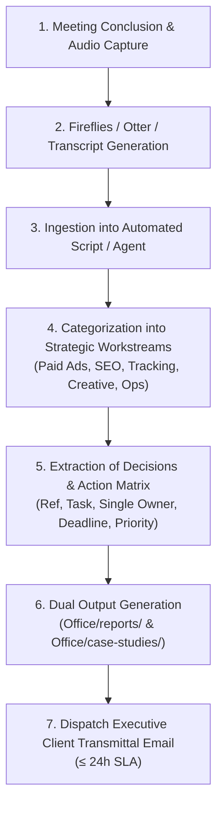

# Client Minutes of Meeting (MOM) & Reusable Agency Workflow

**Meeting Title:** Weekly Meeting - Label IT Solutions & TE  
**Client:** Label IT Solutions ([labelitsolutions.co.uk](https://labelitsolutions.co.uk))  
**Agency Partner:** TechnoExponent (TE)  
**Date:** Wednesday, November 18, 2026  
**Recording & Transcript Source:** [Fireflies.ai Record](https://app.fireflies.ai/view/Weekly-Meeting-Label-It-Solutions-TE::01M75NJ80T3EJZFDHGCXV0Q39D)  

---

## Part 1: Minutes of Meeting (MOM) — Label IT Solutions

### 1. Meeting Attendance & Key Roles

| Attendee | Organization | Role / Function | Contact Channel |
| :--- | :--- | :--- | :--- |
| **A Allana** | Label IT Solutions | Client Principal & Director | Email / WhatsApp |
| **Sarnendu Patra** | TechnoExponent | Head of Marketing / Account Lead | sarnendu@technoexponent.com |
| **Subhraanil Naskar** | TechnoExponent | Performance Marketing & PPC Lead | subhraanil@technoexponent.com |
| **Arpita Shaw** | TechnoExponent | SEO & Content Marketing Specialist | arpita@technoexponent.com |

---

### 2. Executive Summary

The primary objective of this weekly sync was to review the final deliverables of the **Setup & Planning Phase** and formally transition the account into the **Live Execution Phase**. 

Key milestones achieved:
1. **Full Tracking & Measurement Foundation Verified:** Google Analytics 4 (GA4), Google Tag Manager (GTM), Google Search Console (GSC), and Google Ads conversion actions (`Purchase`, `Add to Cart`) are verified and active.
2. **E-Commerce Catalogue Approved:** Google Merchant Center (GMC) setup is complete with products approved, categorized, and synced to Google Ads.
3. **Google Ads Ready for Same-Day Launch:** Google's card verification deposit (£0.10) was confirmed live during the meeting. The daily budget was calibrated from Google’s automated recommendation (£21/day) down to **£5.00/day** (~£150/month) for an initial 14–20 day learning sprint to protect spend while discovering conversion behavior.
4. **On-Page & Technical SEO Foundation Deployed:**
   - **Yoast SEO Plugin:** Successfully connected to the WooCommerce CMS to support on-page SEO optimisation and metadata management.
   - **Technical SEO:** Ongoing improvements to website health, with identified issues and action items tracked in a shared sheet.
5. **Content & Metadata Ready for Staging:** Complete keyword research, metadata sets, blog content, and weekly KPI sheets are prepared. Staging will commence upon receipt of final product imagery and contact details.

---

### 3. Detailed Workstream Discussions & Status

#### Workstream A: Search Engine Optimization (SEO) & Content
* **Yoast SEO Plugin Connected:**
  * Successfully connected and configured Yoast SEO on the WooCommerce CMS to streamline on-page SEO optimization, social OpenGraph tags, indexation rules, and meta descriptions.
* **Technical SEO Audit & Tracking Sheet:**
  * Ongoing improvements to website health are actively underway, addressing canonical issues, mobile render times, and structured data gaps.
  * A master Technical SEO Activity Sheet has been established to track all identified issues, remediation statuses, and pending action items in real time.
* **Keyword Strategy & Intent Mapping (05:10):**
  * Keyword search volume, intent categorization, and baseline ranking benchmarks completed.
  * Target keywords prioritize high-commercial-intent terms around direct thermal labels, shipping labels, and barcode consumables in the UK market.
* **On-Page Metadata Preparation (05:40):**
  * Optimized Meta Titles and Descriptions written for core categories and product groups, validated for upload to the WooCommerce CMS via Yoast SEO.
* **Content Engine & Editorial Assets (06:27, 08:55):**
  * First website blog article completed. Accompanying branded blog banner is currently in design production. Both will be shared with A Allana for review.
* **KPI Monitoring Architecture (08:09):**
  * Dedicated Weekly KPI Performance Sheet established with a distinct keyword ranking tab to monitor weekly rank shifts post-metadata upload.

#### Workstream B: Platform Setup, Google Merchant Center & Tracking
* **Google Business Profile (GBP) (09:07):** Listing created and submitted for verification; currently under standard Google review (visibility expected within 5 business days post-approval).
* **Google Merchant Center (GMC) Product Sync (09:07):** Products uploaded, categorized, grouped, and approved. Merchant Center product imagery is dynamically linked to Google Ads Shopping inventory.
* **Conversion Tracking Infrastructure (09:07):** Event tracking deployed via GTM and GA4. Conversion actions configured in Google Ads for `Purchase` (with dynamic transaction value) and `AddToCart`.
* **Multi-Format Campaign Previews (11:13):** Suite prepared across Standard Shopping, Search (Alpha/Intent), and Display remarketing. Copy, headlines, and sitelinks reviewed live on mobile preview during call.

#### Workstream C: Media Spend, Budget Calibration & Campaign Launch
* **Daily Budget Recalibration (09:53, 10:12):**
  * Google’s automated recommendation suggested **£21.00/day** (~£650.00/month).
  * In response to client spend prudence, the team mutually agreed to scale down the entry budget to **£5.00/day** (~£150.00/month).
  * *Strategic Rationale:* Minimize risk, gather initial search term and conversion flow data, and scale upwards based strictly on empirical CPA and ROAS.
* **Payment Card Verification Cleared (12:18):**
  * Temporary 10 pence (£0.10) verification charge from Google was confirmed live during the call by A Allana.
* **Same-Day Launch & 14–20 Day Learning Phase (15:14, 15:33, 17:24):**
  * Subhraanil Naskar to apply the £5/day budget cap and activate campaigns on Nov 18, 2026.
  * Initial 14–20 days will serve as an exploratory learning period to identify broken user flows and conversion friction.

#### Workstream D: Operational Communications & Creative Dependencies
* **Customer-Facing Phone Number Separation (07:38, 16:07, 17:04):**
  * Current number belongs to a director handling corporate/administrative matters.
  * Label IT Solutions will provide a dedicated product sales and support number via WhatsApp.
  * Director's number remains for Google verification/account administration; new customer-facing number will be added to the website, GBP, and Google Ads call assets.
* **High-Quality Product Photography & Previews (06:40, 18:32, 19:04):**
  * A Allana compiling priority SKU photos and visual display previews showing how products should appear.
  * Agency design team will utilize these references to align graphics and ad visual collaterals. Target: End of current week.

---

### 4. Key Decisions Agreed (Binding)

> [!IMPORTANT]
> 1. **Google Ads Spend Cap:** Begin campaign at **£5.00/day**; scaling capped until 14–20 day baseline conversion metrics demonstrate positive CPA/ROAS efficiency.
> 2. **Same-Day Go-Live:** Campaigns activated on Wednesday, Nov 18, 2026.
> 3. **Phone Number Governance:** Retain director's line for Google verification; route inbound client/shopper inquiries to the dedicated new product number.
> 4. **Weekly Cadence:** Maintain weekly performance syncs with interim updates via the shared KPI dashboard.

---

### 5. Consolidated Action Item Matrix

| Ref # | Task Description | Owner | Priority | Target Due Date | Status / Notes |
| :---: | :--- | :--- | :---: | :---: | :--- |
| **ACT-01** | Reduce Google Ads daily budget to ~£5.00/day and activate campaigns | **Subhraanil Naskar** | 🔴 Urgent | Nov 18, 2026 | Completed |
| **ACT-02** | Send dedicated customer-facing phone number via WhatsApp | **A Allana** | 🔴 Urgent | Nov 19, 2026 | In progress |
| **ACT-03** | Update website and Google Ads call extensions with new phone number | **Subhraanil Naskar** | 🟡 High | Within 24h of receiving # | Pending ACT-02 |
| **ACT-04** | Update Google Business Profile contact number once approved | **Subhraanil Naskar** | 🟡 High | Post-GBP Approval | In queue |
| **ACT-05** | Upload prepared SEO meta titles & meta descriptions to website via Yoast | **Arpita Shaw** | 🟡 High | Nov 20, 2026 | Ready for deployment |
| **ACT-06** | Track technical SEO improvements and fixes in shared sheet | **Arpita Shaw** | 🟡 High | Ongoing | Sheet created & shared |
| **ACT-07** | Share completed blog article and visual banner for client review | **Arpita Shaw** | 🟢 Medium | Nov 21, 2026 | Article written, banner in design |
| **ACT-08** | Send priority product photographs and presentation preview references | **A Allana** | 🟡 High | Nov 22, 2026 (End of Week) | Client compiling |
| **ACT-09** | Deliver formal Minutes of Meeting (MOM) via email | **Sarnendu Patra** | 🟡 High | Nov 19, 2026 (Within 24h) | Completed |
| **ACT-10** | Daily monitoring of initial search queries, clicks, spend, and negative keywords | **Subhraanil Naskar** | 🟡 High | Ongoing (Nov 19–Dec 8) | Active 14-20 day sprint |
| **ACT-11** | Weekly KPI tracking sheet updates (Rankings, Impressions, Clicks, Spend) | **Arpita Shaw** | 🟢 Medium | Weekly (Every Monday) | System established |

---

### 6. Client Email Transmittal (Standalone — No Attachment Required)

```text
Subject: Minutes of Meeting (MOM): Weekly Review & Campaign Launch - Label IT Solutions & TechnoExponent

Dear Asif,

Thank you for your valuable time during our weekly review meeting yesterday.

As discussed, we have officially concluded the planning phase and transitioned your account into the live execution phase. Below is the complete record of the key progress updates, decisions made, and immediate action items:

==================================================
EXECUTIVE SUMMARY & KEY UPDATES
==================================================
1. Google Ads Activation:
   • Payment card verification was successfully confirmed live during the meeting (10p deposit).
   • To ensure prudent spend and collect initial baseline conversion data, we reduced Google's suggested daily budget (£21/day) down to £5.00/day (~£150/month) for an initial 14–20 day learning sprint.
   • Subhraanil is activating the campaign today across Shopping, Search, and Display.

2. Tracking & E-Commerce Infrastructure:
   • Google Analytics 4 (GA4), Tag Manager (GTM), and Google Search Console (GSC) are fully deployed.
   • Google Merchant Center (GMC) products are approved, categorized, and synced to Google Ads.
   • Custom conversion actions for "Purchase" and "Add to Cart" are tested and verified.

3. Search Engine Optimization (SEO) & Content:
   • Yoast SEO Plugin: Successfully connected to support on-page SEO optimisation and metadata management.
   • Technical SEO: Ongoing improvements to website health, with identified issues and action items tracked in a shared sheet.
   • Keyword Research & Metadata: High-intent UK keyword research completed; metadata sets prepared for upload.
   • Content Engine: Our first commercial blog article is written and will be shared with you alongside the custom banner for review.
   • KPI Sheet: Weekly KPI sheet and keyword ranking tab established for weekly performance tracking.

4. Public Contact Routing:
   • Agreed to separate the corporate director phone number (retained for Google admin/account verification) from customer sales enquiries.
   • Dedicated new customer-facing phone number to be added across website headers, Google Business Profile, and Google Ads call extensions.

==================================================
ACTION ITEM MATRIX
==================================================
• Subhraanil Naskar (TechnoExponent):
  - Reduce Google Ads daily budget to £5.00/day and activate campaign (Nov 18, 2026 - Done)
  - Daily monitoring of search term queries, clicks, spend, and negative keywords (Ongoing)
  - Update website and Google Ads call extensions once new phone number is received

• Arpita Shaw (TechnoExponent):
  - Upload prepared meta titles and descriptions via Yoast SEO (Nov 20, 2026)
  - Share completed blog article and banner materials for review (Nov 21, 2026)
  - Track technical SEO improvements in shared sheet and maintain weekly KPI reporting

• A Allana (Label IT Solutions):
  - Send dedicated customer-facing phone number through WhatsApp (Nov 19, 2026)
  - Send priority product photographs and presentation previews (By end of this week, Nov 22, 2026)

==================================================
NEXT STEPS & SCHEDULE
==================================================
• 14–20 Day Learning Phase: We are closely monitoring real search queries and user behavior to identify friction points and optimize conversion rates.
• Next Weekly Review: Wednesday, Nov 25, 2026 (or ongoing updates via our shared tracking sheet).

If you have any questions or feedback on any of the points above, please let us know.

Warm regards,

Sarnendu Patra
Head of Marketing | TechnoExponent
sarnendu@technoexponent.com | www.technoexponent.com
```

---

## Part 2: The Reusable Client MOM Workflow & SOP

To ensure every client meeting follows this enterprise standard, the following assets and automation tools have been integrated into the workspace:

### 1. Workflow Architecture & Lifecycle



### 2. Workspace Assets Deployed

1. **Agent Skill SOP**: [SKILL.md](file:///c:/Users/test/Videos/Office/.agents/skills/meeting-mom-generator/SKILL.md)
   - Defines ingestion standards, quality guardrails, and data synthesis rules.
2. **Master Markdown Template**: [client_meeting_mom_template.md](file:///c:/Users/test/Videos/Office/templates/client_meeting_mom_template.md)
   - Reusable template with standard placeholders and action item table schemas.
3. **Automated Generator Script**: [generate_meeting_mom.py](file:///c:/Users/test/Videos/Office/scripts/generate_meeting_mom.py)
   - CLI tool that parses raw notes/transcripts, generates Markdown and standalone branded HTML reports, and automatically handles dual-routing to `reports/` and `case-studies/{client}/`.
4. **Brand Profile Card**: [label-it-solutions.json](file:///c:/Users/test/Videos/Office/brands/label-it-solutions.json)
   - Full brand profile card added to the workspace's master brand directory.
5. **Standalone HTML Report**: [Label_IT_Solutions_MOM_Nov18_2026.html](file:///c:/Users/test/Videos/Office/reports/Label_IT_Solutions_MOM_Nov18_2026.html)
   - Executive-styled, print-ready HTML deliverable.

### 3. Quick Run Command for Future Meetings

```powershell
python scripts/generate_meeting_mom.py \
  --client "<Client Name>" \
  --domain "<domain.com>" \
  --date "<Meeting Date>" \
  --fireflies-url "<Transcript URL>" \
  --notes-file "data/meeting_notes.txt" \
  --generate-html
```
