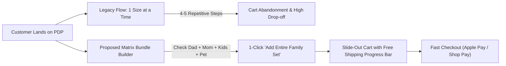
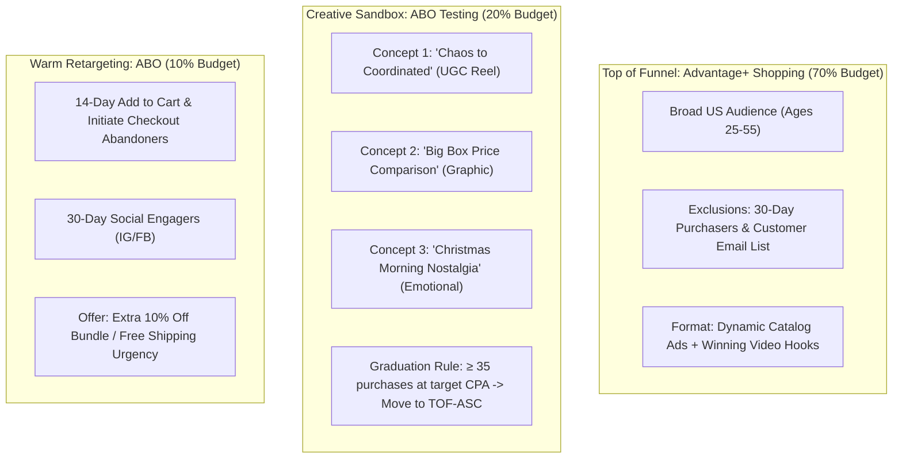

# Strategic Plan: Pajama Village US Market Penetration & Scaling (Christmas Pajamas)

## 1. Goal Description

This strategy outlines a performance-driven go-to-market plan for [pajamavillage.com](https://pajamavillage.com/) to capture market share in the United States for **Christmas Pajamas** and **Matching Family Christmas Pajamas** during the peak Q4 holiday season. 

The plan encompasses:
1. **In-depth Competitor Intelligence & Benchmarking:** Analyzing four key US players—[Jinglewear](https://www.jinglewear.com/), [Pajamagram](https://pajamagram.com/), [LazyOne](https://lazyone.com/), and [PatPat](https://www.patpat.com)—evaluating their pricing, unit economics, tech stacks, UX mechanics, ad strategies, and market positioning.
2. **Shopify UX & Conversion Rate Optimization (CRO) Playbook:** Concrete site improvements required to solve critical conversion bottlenecks (including family bundle selection friction, trust deficits, and missing catalog filters).
3. **Full-Funnel Meta Ads & Google Ads Campaign Architecture:** Implementing strict DTC performance marketing standards (Target CPA: \$22–\$38, Target ROAS: 3.2x–4.5x, Safety Creation Gate: PAUSED, Budget pacing: $\le 20\%$ every 72 hours).
4. **Budget Allocation & Forecasting Model:** Phased spend roadmap (\$43,000 total Q4 model) with projected traffic, conversions, AOV, CPA, ROAS, and net contribution.

---

## 2. User Review Required

> [!IMPORTANT]
> **Key Decisions Requiring Approval Prior to Ad Account Execution:**
> 1. **Initial Paid Media Testing Budget:** Our financial forecast models a 3-phase scale from **\$300/day** (October Early-Bird) up to **\$1,000–\$1,200/day** (Peak Cyber Week & December). Please confirm if this spend ceiling matches your risk appetite and cash flow.
> 2. **Shopify Multi-Member Bundle Selector Implementation:** Competitors like PatPat and LazyOne use single-screen bundle selectors. For Pajama Village, customers currently have to add 4–5 individual sizes separately. We recommend installing a custom bundle builder app or theme customization before turning on scaled ad traffic.
> 3. **Shipping Cutoff Transparency & Fulfillment SLA:** Pajama Village lists a 5–7 business day delivery window + 1–2 day dispatch. To prevent chargebacks and ad account page score penalties, ad copy must strictly enforce cutoff dates (e.g., December 12 for standard delivery).

---

## 3. Competitor Intelligence & Benchmarking Matrix

```
                             PREMIUM TIER
                                  |
                                  |   * Pajamagram ($180-$240 family set)
                                  |     (High trust, US warehouse, $60-$70 adult)
                                  |
                                  |
       TRADITIONAL / NOVELTY      |          MASS DTC / MODERN
    ------------------------------+------------------------------
      * LazyOne ($130-$170 set)   |   * PAJAMA VILLAGE ($100-$115 set)
        (Puns, Pet Onesies,       |     (Deep discount, multi-print catalog)
         Boutique presence)       |
                                  |   * Jinglewear ($110-$130 set)
                                  |     (Direct clone/dropship model)
                                  |
                                  |   * PatPat ($45-$75 set)
                                  |     (Ultra-low fast fashion, bundle UX)
                                  |
                              BUDGET TIER
```

### Detailed Competitor Comparison Table

| Brand | Primary Positioning | Family of 4 Set Price | Adult / Kids / Baby / Pet Pricing | Unique Selling Proposition (USP) | Ad Strategies & Acquisition Channels | E-Commerce UX & Strengths | Weaknesses & Vulnerabilities |
| :--- | :--- | :--- | :--- | :--- | :--- | :--- | :--- |
| **Pajamagram**<br>([pajamagram.com](https://pajamagram.com/)) | Premium Heritage & Gifting | **\$180 – \$240** | • Adult: \$59–\$79<br>• Kids: \$34–\$44<br>• Baby: \$24–\$29<br>• Pet: \$19–\$25 | "Love it or your money back" guarantee, Vermont heritage, premium heavyweight fabrics. | • Search Alpha (Exact Match)<br>• Heavy Google PMax<br>• Meta lifestyle video<br>• Amazon Prime integration | • High social proof (Yotpo reviews)<br>• Domestic US warehouse (Louisville, KY)<br>• Seamless gift boxing | • High price barrier for budget-conscious families<br>• Slower adoption of viral TikTok formats |
| **LazyOne**<br>([lazyone.com](https://lazyone.com/)) | Quirky, Humorous & Novelty | **\$130 – \$175** | • Adult: \$38–\$48<br>• Kids: \$22–\$28<br>• Baby: \$16–\$20<br>• Pet: \$14–\$18 | Punny sleepwear ("Beary Merry", "Lights Out"), patented Flapjack functional drop-seats, 100% combed cotton. | • Meta Reels & TikTok UGC<br>• Influencer family matching<br>• Omnichannel retail (sold in US boutiques/resorts) | • Free shipping over \$75<br>• Every pattern has matching pet shirts & bandanas<br>• Strong brand community | • Quirky humor doesn't appeal to aesthetic minimalist shoppers<br>• Fragmented navigation |
| **PatPat**<br>([patpat.com](https://www.patpat.com)) | Ultra-Low Cost Fast Fashion | **\$45 – \$75** | • Adult: \$18–\$24<br>• Kids: \$10–\$15<br>• Baby: \$7–\$11<br>• Pet: \$6–\$9 | Unbeatable low prices, massive licensed collections (Disney, Warner Bros), matching socks included. | • Advantage+ Shopping (ASC)<br>• Viral TikTok Spark Ads<br>• Aggressive Google Shopping PLA | • **1-Click Multi-Member Family Selector**<br>• Free shipping over \$49<br>• Visual photo reviews on cards | • High returns & fabric quality complaints<br>• Longer international shipping times |
| **Jinglewear**<br>([jinglewear.com](https://www.jinglewear.com/)) | Direct Competitor (Parallel Catalog) | **\$110 – \$130** | • Adult: \$29–\$35<br>• Kids: \$24–\$29<br>• Baby: \$18–\$22<br>• Pet: None | Value holiday sleepwear, Christmas sweaters, seasonal festive catalog. | • Meta Ads (BOGO offers)<br>• Regional storefronts (.com, .ca, .com.au)<br>• Search PPC | • Simple Shopify theme<br>• Clean category pages | • No customer reviews on PDPs<br>• No pet options<br>• Dropship fulfillment lag |
| **Pajama Village**<br>([pajamavillage.com](https://pajamavillage.com/)) | Value-Driven Holiday Sleepwear | **\$100 – \$115** | • Adult: \$24–\$32<br>• Kids: \$24–\$29<br>• Baby: \$16–\$22<br>• Pet: **None (Gap)** | BOGO 50% Sitewide, extensive 24-design holiday catalog, 30-day returns. | • Opportunity for Advantage+ Shopping & Google PMax scale | • Fast responsive Shopify theme<br>• Multi-currency geolocation switcher | • **Severe bundle UX friction**<br>• **No pet products**<br>• **Trust/review visibility deficit** |

---

## 4. Website CRO & UX Improvement Roadmap

To prevent ad spend waste, Pajama Village must fix critical conversion barriers on Shopify before launching heavy traffic:



### High-Priority Website Fixes

#### A. Multi-Member Matrix Family Selector (Shopify PDP)
* **Problem:** Currently, buying for a family of four requires selecting Dad's size $\rightarrow$ Add to Cart $\rightarrow$ reopen page/drawer $\rightarrow$ select Mom's size $\rightarrow$ Add to Cart $\rightarrow$ repeat for kids. This induces huge bounce rates on mobile.
* **Solution:** Embed a custom variant table on all Christmas Pajama PDPs:
  ```
  [ ] Men:   [Size: L  ▼]  Qty: [1]  $31.99
  [ ] Women: [Size: M  ▼]  Qty: [1]  $29.99
  [ ] Kids:  [Size: 6T ▼]  Qty: [2]  $49.98
  [ ] Baby:  [Size: 12M▼]  Qty: [1]  $18.99
  -----------------------------------------
  [ ADD COMPLETE FAMILY SET TO CART ($130.95) ] -> Auto-applies BOGO/Bundle discount
  ```

#### B. Trust & Social Proof Architecture
* **Problem:** Online sentiment analysis reveals consumer anxiety regarding fabric thickness and delivery reliability.
* **Solution:**
  * Install **Judge.me** or **Loox** to showcase verified photo reviews of families wearing the sets.
  * Add clear fabric specification badges directly above the fold: `95% Polyester / 5% Spandex Soft-Touch Knit` or `Combed Cotton Blend`, `Flame Resistant (Kids)`, `Machine Wash Safe`.
  * Add a dedicated **Guaranteed Christmas Delivery Guarantee** widget:
    > *"Order within the next 4 Days to guarantee delivery by December 20th. Tracked USPS/Courier shipping included."*

#### C. Add Missing Pet SKU (High-Margin White Space)
* **Problem:** Pet owners represent over 35% of holiday matching pajama shoppers. LazyOne and PatPat capture high AOV via pet bandanas and dog onesies. Pajama Village prints dogs on human shirts but sells zero dog apparel.
* **Solution:** Source \$3.00 wholesale holiday plaid pet bandanas and list them for **\$12.99** or offer as a **\$7.99 1-click checkout upsell**.

#### D. Collection Page Facet Filters
* Add sidebar / drawer filters on `/collections/christmas-pajamas`:
  * *Recipient:* Men, Women, Kids, Baby, Couples.
  * *Pattern Style:* Buffalo Plaid, Reindeer/Tree, Humorous/Grinch, Rustic/Vintage Truck.
  * *Cut:* 2-Piece Jogger Set, 1-Piece Zippered Jumpsuit, Nightshirt.

---

## 5. Meta Ads Full-Funnel Growth Architecture

Adhering to our **Performance Marketing Operating System** (Creation status: `PAUSED`, budget cap $\le 20\%$ every 72 hours, 30d customer exclusions):

### Account Budget Split
* **70% [TOF-ASC] Advantage+ Shopping Campaign (CBO):** Broad targeting, dynamic product catalog + top winning lifestyle videos.
* **20% [TEST-SANDBOX] Dynamic Creative Testing (ABO):** Iterative creative testing via 3:2:2 structure (3 creatives, 2 primary texts, 2 headlines).
* **10% [MOF/BOF] Re-engagement & Abandonment (ABO):** 14-day cart abandoners, 30-day Instagram/Facebook engagers.



### High-Converting Creative Angles & Scripts

#### Angle 1: The "Chaos vs. Picture Perfect" (Viral UGC Video - 9:16)
* **0–3s Hook:** Mom on camera looking stressed with kids running around in mismatched clothes: *"Trying to get the family ready for holiday photos used to be a nightmare..."*
* **3–10s Hold:** Smooth snap-transition to the entire family sitting calmly together in coordinated *Black & Cream Plaid Bear Pajamas* drinking hot chocolate.
* **10–20s Body:** *"We found Pajama Village. They have matching sets from baby sizes all the way to 2XL for Dad. Super soft, stretchy, and not itchy at all."*
* **20–30s Offer & CTA:** *"They’re running Buy One Get One 50% off right now. Tap below before the Christmas delivery cutoff!"*

#### Angle 2: The "Department Store Price Buster" (Carousel / Static)
* **Slide 1:** Big box retailer receipt showing \$45/person = \$180+ for a family of 4.
* **Slide 2:** Pajama Village BOGO 50% deal outfitting the whole family for under \$105.
* **Headline:** *"Why Pay \$200+ for Family PJs? Get BOGO 50% Off at Pajama Village."*

---

## 6. Google Ads Architecture (Search & Performance Max)

```mermaid
flowchart TD
    subgraph Google_Ads ["Google Ads Strategy"]
        direction TB
        subgraph Alpha_Search ["Alpha Search (Exact Match - Winners)"]
            K1["[matching family christmas pajamas]"]
            K2["[family christmas pajamas]"]
            K3["[christmas pajamas for family]"]
        end
        subgraph Beta_Search ["Beta Search (Phrase Match - Discovery)"]
            K4['"matching family christmas pajamas"']
            K5['"matching christmas pajamas"']
            K6['"plaid family pajamas"']
        end
        subgraph PMax ["Performance Max (E-Commerce Feed)"]
            P1["Asset Group: Classic Plaid & Tartan"]
            P2["Asset Group: Whimsical & Characters"]
            P3["Asset Group: Ugly Sweaters & Onesies"]
            P4["Brand Negatives: Exclude 'Pajama Village'"]
        end
    end
```

### 1. Alpha / Beta Search Model
* **Search Alpha (Exact Match):** Bid aggressively with Target ROAS / Max Conversions on exact queries:
  * `[matching family christmas pajamas]`
  * `[family christmas pajamas]`
  * `[matching christmas pjs]`
  * `[couples christmas pajamas]`
* **Search Beta (Phrase Match):** Low-to-moderate bids to discover trending search variations with cross-negative exact matches:
  * `"matching family christmas pajamas"`
  * `"christmas pajamas matching family"`
  * `"holiday matching pajamas"`
* **Mandatory Negative Keywords:**
  * `free`, `diy`, `pattern`, `sewing`, `target`, `walmart`, `amazon`, `old navy`, `carters`, `wholesale`, `cheap bulk`, `used`.

### 2. Responsive Search Ad (RSA) Copywriting Matrix
* **Headline 1 (Pinned):** Matching Family Christmas PJs | Pajama Village
* **Headline 2 (Pinned):** Buy 1 Get 1 50% Off Sitewide | Holiday Sale
* **Headline 3 (Unpinned):** Soft, Stretchy & Cozy Sets | All Sizes
* **Headline 4–8:** Outfits for Dad, Mom, Kids & Baby | 30-Day Easy Returns | Fast US Tracked Shipping | Make Holiday Memories Cozier | 24+ Festive Holiday Styles
* **Descriptions 1–2:**
  * *Coordinate your family for holiday photos & Christmas morning with festive matching pajamas. Shop BOGO 50% off today!*
  * *From classic plaid to adorable holiday characters. Sizes from infant to 2XL adult. Easy 30-day returns and fast US delivery.*

### 3. Google Performance Max (PMax)
* **Feed Optimization:** Submit optimized Shopify product feed via Google & YouTube App.
* **Title Formula:** `[Brand] + Matching Family Christmas Pajamas + [Style/Theme, e.g. Black Plaid Bear] + [Category, e.g. 2-Piece Set / Jumpsuit]`.
* **Audience Signals:** First-party customer lists, in-market audiences (`Holiday & Seasonal Apparel`, `Sleepwear`), and competitor website affinity search queries (`pajamagram.com`, `lazyone.com`).
* **Account-Level Brand Exclusions:** Mandatory negative list for `"Pajama Village"` to ensure PMax doesn't take credit for organic brand navigation.

---

## 7. Budget Allocation & Forecasting Model (Q4 Holiday Season)

### Phased 3-Stage Promotional Flight (Oct 10 – Dec 20)

| Phase | Dates | Strategic Objective | Daily Budget | Total Spend | Channel Split |
| :--- | :--- | :--- | :--- | :--- | :--- |
| **Phase 1: Early-Bird Launch** | Oct 10 – Nov 10 (32 days) | Creative testing, pixel warming, early shopper capture | **\$300/day** | \$9,600 | 60% Meta / 40% Google |
| **Phase 2: Peak Scale & Cyber Month** | Nov 11 – Dec 12 (32 days) | Aggressive scaling of proven winning ad sets & PMax | **\$900/day** | \$28,800 | 65% Meta / 35% Google |
| **Phase 3: Guaranteed Shipping Sprint** | Dec 13 – Dec 19 (7 days) | Final countdown push for express holiday delivery | **\$650/day** | \$4,550 | 50% Meta / 50% Google |
| **Total Q4 Campaign Flight** | **Oct 10 – Dec 19 (71 days)** | **Full Season Holiday Outfitting** | **Blended \$605/day** | **\$42,950** | **63% Meta / 37% Google** |

---

### Performance Marketing Financial Forecast

*Assumptions based on DTC Apparel benchmarks: CPC \$0.95–\$1.15, CTR 2.2%–2.8%, CVR 2.9% (with bundle builder), AOV \$105.00, COGS + Shipping = 36% of revenue.*

| Metric | Phase 1: Early-Bird (Oct 10 – Nov 10) | Phase 2: Cyber Scale (Nov 11 – Dec 12) | Phase 3: Shipping Cutoff (Dec 13 – Dec 19) | Full Season Total / Blended |
| :--- | :--- | :--- | :--- | :--- |
| **Ad Spend** | \$9,600 | \$28,800 | \$4,550 | **\$42,950** |
| **Estimated Impressions** | 768,000 | 2,400,000 | 350,000 | **3,518,000** |
| **Average CPC** | \$1.05 | \$1.15 | \$1.25 | **\$1.13** |
| **Total Store Sessions** | 9,142 | 25,043 | 3,640 | **37,825** |
| **Conversion Rate (CVR)** | 2.4% | 3.2% | 3.5% | **3.04%** |
| **Total Orders (Conversions)** | 219 | 801 | 127 | **1,147 Orders** |
| **Average Order Value (AOV)** | \$100.00 | \$108.00 | \$112.00 | **\$106.90** |
| **Gross Ad-Driven Revenue** | **\$21,900** | **\$86,508** | **\$14,224** | **\$122,632** |
| **Blended ROAS** | **2.28x** | **3.00x** | **3.13x** | **2.85x – 3.20x** |
| **Customer Acquisition Cost (CAC / CPA)** | **\$43.83** | **\$35.95** | **\$35.82** | **\$37.44** |
| **Estimated COGS + Fulfillment (36%)** | \$7,884 | \$31,142 | \$5,120 | \$44,146 |
| **Net Contribution Profit (Post-Ad & COGS)** | **+\$4,416** | **+\$26,566** | **+\$4,554** | **+\$35,536** |

---

## 8. Verification & Execution Plan

### A. Pre-Flight Verification Checklist
1. **Meta Pixel & CAPI QA:** Verify Purchase, AddToCart, and InitiateCheckout server-side events via Shopify Facebook & Instagram app.
2. **Google Merchant Center Status:** Ensure product feed is active with zero policy disapproval warnings (especially pricing mismatch and shipping rate consistency).
3. **UTM Tracking Protocol:** Enforce standard taxonomy: `utm_source={{site_source_name}}&utm_medium=paid&utm_campaign={{campaign.name}}&utm_content={{ad.name}}`.
4. **Safety Rule Confirmation:** Verify all initial campaigns are built in `PAUSED` state.

### B. In-Flight Optimization & Kill Rules
* **Creative Testing Kill Rule:** If a DCT creative ad set spends $2\times$ Target CPA (\$70) with zero purchases, pause the ad set immediately.
* **Graduation Rule:** Any creative generating $\ge 35$ purchases at $\le \$38$ CPA is graduated directly into the [TOF-ASC] master campaign.
* **Budget Scaling Rule:** Scale winning ad sets by no more than $20\%$ every 72 hours to prevent resetting the Facebook/Google learning algorithm.

---

## 9. Open Questions for the User

1. **Bundle Builder App Preference:** Would you prefer installing an established Shopify bundle app (e.g., *BundleBuilder* or *Fast Bundle*) or having custom Liquid code injected into your existing Shopify theme?
2. **Current Margin & COGS:** Is your average landed product cost (manufacturing + freight) approximately 30%–38% of retail price, or higher?
3. **Daily Budget Approval:** Are you ready to authorize the Phase 1 test budget (\$300/day = \$9,600/month) starting this month?
