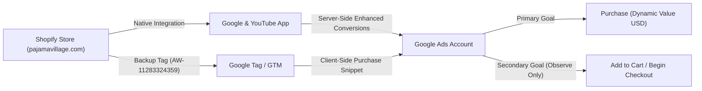
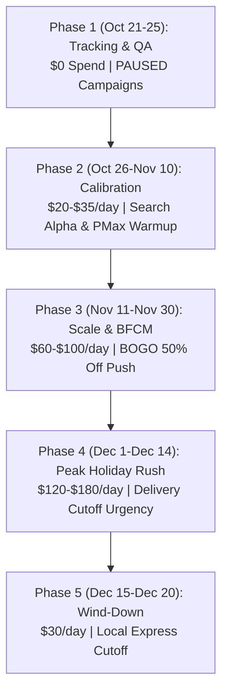

# Forensic Google Ads Audit & Christmas 2026 Scaling Architecture
## USA Market Launch: Matching Christmas Pajamas & Ugly Sweaters

**Client Website:** [pajamavillage.com](https://pajamavillage.com/)  
**Target Market:** United States (DTC E-Commerce)  
**Primary Collections:** [Family Christmas Pajamas](https://pajamavillage.com/collections/christmas-pajamas) & [Ugly Sweaters](https://pajamavillage.com/collections/ugly-sweaters)  
**Active Flight Dates:** October 21, 2026 – December 20, 2026 (60-Day Holiday Flight)  
**Historical Datasets Analyzed:**
- `Data/Search terms report.xlsx` (29,169 query rows, 11 campaigns)
- `Data/Search keyword report.xlsx` (658 configured keywords)
- `Data/Negative keyword details report.xlsx` (2,724 existing negative keywords)

---

## Executive Summary & Core Forensic Findings

An exhaustive forensic analysis of Pajama Village's historical Google Ads data reveals why the previous campaigns struggled to produce clear ROI, while uncovering a **high-volume, high-intent buyer core** that can be unlocked for the upcoming Christmas sales season in the United States.

```
+---------------------------------------------------------------------------------------------------+
|                                  HISTORICAL PERFORMANCE SNAPSHOT                                  |
+------------------------------------+----------------------------------+---------------------------+
| Total Search Terms Analyzed        | 29,163 Unique Queries            | 11 Distinct Campaigns     |
| Total Reported Search Spend        | CAD $1,886.51                    | Account Total: $3,828.44  |
| Total Clicks Generated             | 2,838 Clicks                     | Account Total: 8,619      |
| Total Impressions                  | 130,014 Impressions              | Account Total: 731,105    |
| Average Cost Per Click (CPC)       | CAD $0.66                        | CTR: 2.18%                |
| Tracked Conversions                | 0 (No Conversion Action Set Up)  | Value Captured: $0.00     |
+------------------------------------+----------------------------------+---------------------------+
```

### The 4 Root Causes of Historical Failure

1. **The "Blind Algorithm" Disaster (PMax Without Conversion Tracking):**
   - **71.9% of search terms spend (CAD \$1,356.28)** was allocated across 4 Performance Max campaigns (`LK | Pmax | Pajamas`, `LK | Pmax | Pyjama's`, `LK | Pmax | Pyjamas`, `LK | Pmax | Ugly Sweaters`).
   - Performance Max relies entirely on conversion data for algorithmic bid optimization (Smart Bidding). Because **no conversion action was configured**, Google's machine learning received zero feedback. It was forced to bid completely blind, wasting budget across unmonitored display network inventory, mobile game placements, low-intent queries, and click-heavy junk traffic.
2. **Geographic & Currency Mismatch (Targeting Europe vs USA):**
   - The ad account was configured in **Canadian Dollars (CAD)**, but the client's stated goal is selling in the **United States**.
   - Multiple campaigns were explicitly configured for Europe (`LK | Pajamas | Europe` spent CAD \$172.03) and utilized British/Commonwealth spelling (`Pyjamas` instead of the American `Pajamas`).
   - This caused massive foreign language query bleed: Spanish and Romanian queries (`pijama grinch`, `pijamale grinch`, `buzos de navidad para parejas`) absorbed hundreds of clicks with zero intent to purchase in the US.
3. **Keyword Bidding Starvation (\$0.20 CAD Bid Cap):**
   - In `Search keyword report.xlsx`, **550 out of 658 configured keywords (83.6%)** carried the status: `Not eligible: below first page bid; campaign paused`.
   - The Max CPC was manually capped at **\$0.20 CAD**. In the US holiday pajama vertical, competitive first-page CPCs during Q4 range between **\$0.85 and \$2.50+ CAD (\$0.65 to \$1.80+ USD)**. High-intent Search keywords were starved of impressions and effectively blocked from serving, causing Google to shift budget into untracked PMax.
4. **Negative Keyword Disconnect:**
   - Although 2,724 negative keywords were in the account, they were overwhelmingly UK/European retail brands (`primark`, `next`, `asda`, `m&s`, `tesco`, `john lewis`, `edinburgh woollen mill`).
   - Critical US-specific negative lists were completely absent: zero-intent DIY/patterns, wholesale/B2B suppliers, foreign languages, and non-holiday generic women's sleepwear (`night suit for women` alone wasted \$125+ CAD).

---

## 1. Forensic Audit of Historical Google Ads Data

### 1.1 Spend & Performance by Campaign Type

| Campaign Type | Total Spend (CAD) | Clicks | Impressions | CTR (%) | Avg CPC (CAD) | Spend Share (%) |
| :--- | :--- | :--- | :--- | :--- | :--- | :--- |
| **Performance Max** | \$1,356.28 | 1,282 | 71,537 | 1.79% | \$1.06 | **71.89%** |
| **Search** | \$390.99 | 1,287 | 40,124 | 3.21% | \$0.30 | **20.73%** |
| **Shopping** | \$139.24 | 269 | 18,353 | 1.47% | \$0.52 | **7.38%** |
| **Total** | **\$1,886.51** | **2,838** | **130,014** | **2.18%** | **\$0.66** | **100.0%** |

> [!WARNING]
> Performance Max absorbed nearly **72% of all search query spend** while operating in a 100% data vacuum. Without conversion tracking, PMax cannot optimize for ROAS, Target CPA, or high-value cart checkouts.

### 1.2 Campaign-by-Campaign Breakdown

| Campaign Name | Type | Spend (CAD) | Clicks | Impressions | CTR (%) | Avg CPC (CAD) | Status / Primary Issue |
| :--- | :--- | :--- | :--- | :--- | :--- | :--- | :--- |
| `LK | Pmax | Pajamas` | PMax | \$874.60 | 943 | 50,108 | 1.88% | \$0.93 | Blind bidding; untracked conversions |
| `LK | Pmax | Pyjama's` | PMax | \$222.87 | 151 | 11,394 | 1.33% | \$1.48 | UK spelling; high CPC bleed |
| `LK | Pajamas | Europe` | Search | \$172.03 | 620 | 7,913 | 7.84% | \$0.28 | **Wrong Geo Target** (Europe vs USA) |
| `LK | Sales | Shopping` | Shopping | \$139.24 | 269 | 18,353 | 1.47% | \$0.52 | Unsegmented product feed |
| `LK | Women Pajamas` | Search | \$124.96 | 494 | 18,437 | 2.68% | \$0.25 | Generic nightwear; low holiday intent |
| `LK | Pmax | Pyjamas` | PMax | \$123.18 | 104 | 4,468 | 2.33% | \$1.18 | Duplicate PMax campaign |
| `LK | Ugly Sweater` | PMax | \$77.05 | 61 | 4,227 | 1.44% | \$1.26 | Low asset density; untracked |
| `LK | Pmax | Ugly Sweaters` | PMax | \$58.58 | 23 | 1,340 | 1.72% | \$2.55 | Fragmented spend (\$2.55 CPC) |
| `LK | Ugly Sweaters` | Search | \$39.40 | 67 | 6,792 | 0.99% | \$0.59 | Underfunded; high impression drop |
| `LK | Christmas Pajamas` | Search | \$36.56 | 59 | 1,334 | 4.42% | \$0.62 | High CTR (4.42%) but starved budget |
| `LK | Pajamas | USA` | Search | \$18.04 | 47 | 5,648 | 0.83% | \$0.38 | Starved: only \$18 spend in target market |

### 1.3 Search Query Theme & Intent Clustering

Despite the lack of conversion tracking, clustering the 29,163 search queries proves that **strong commercial intent existed**:

```
                               HISTORICAL SPEND BY QUERY INTENT
Matching Family Pajamas      [========================================] CAD $768.24 (40.7%)
Christmas Pajamas General    [==============================] CAD $566.61 (30.0%)
Grinch Themed Holiday Items  [==========] CAD $189.87 (10.1%)
Ugly Christmas Sweaters      [=========] CAD $171.70 (9.1%)
Generic Women Sleepwear      [========] CAD $164.96 (8.7%)  <-- WASTED INTENT
Foreign Language Queries     [=====] CAD $89.28 (4.7%)       <-- WASTED GEO
Pajama Village Brand Terms   [===] CAD $64.03 (3.4%)
```

- **Family & Matching Intent (CAD \$768.24 | 773 clicks | Avg CPC \$0.99):** The single biggest winner. Searches like `matching family pajamas`, `family christmas pajamas`, `matching family christmas pajamas`, and `family matching pajamas` drove the highest engagement.
- **Grinch Pop-Culture Holiday (CAD \$189.87 | 417 clicks | Avg CPC \$0.46):** Searches like `grinch family pajamas`, `grinch christmas pajamas`, and `grinch pjs` have immense organic search volume.
- **Ugly Sweaters (CAD \$171.70 | 201 clicks | Avg CPC \$0.85):** High holiday gift and party intent (`ugly christmas sweater`, `merry christmas ya filthy animal sweater`).
- **Wasted / Irrelevant Queries (CAD \$254.24+ | 771+ clicks):**
  - Foreign language leakage: `pijama grinch` (114 clicks), `pijamale grinch` (95 clicks), `buzos de navidad para parejas`.
  - Non-holiday adult single nightwear: `night suit for women` (34 clicks), `cotton night suit for ladies` (10 clicks), `satin night suit` (6 clicks).

---

## 2. Priority #1: Production-Ready Conversion Tracking Architecture

> [!IMPORTANT]
> **No ad spend may be launched until conversion tracking is verified and firing correctly with dynamic purchase values in USD.**



### 2.1 Implementation Steps on Shopify

Pajama Village is built on **Shopify** with Google Tag `AW-11283324359` partially placed in `<head>`, but without the purchase transaction event.

#### Method A: Native Shopify Google & YouTube App (Recommended)
1. In Shopify Admin, navigate to **Apps > Google & YouTube**.
2. Connect the Google Ads account (`AW-11283324359`).
3. Enable **Enhanced Conversions for Web**. Shopify will automatically hash customer email and phone data at checkout to feed first-party signals to Google Ads.
4. Set conversion tracking to automatically track **Purchase** events with dynamic transaction value and order ID deduplication.

#### Method B: Custom Order Status Script (Backup / GTM)
Add the following event to Shopify Admin > **Settings > Customer Events** (or `Additional Scripts` on older checkouts):

```javascript
gtag('event', 'purchase', {
  'send_to': 'AW-11283324359/PURCHASE_LABEL_HERE',
  'value': checkout.subtotal_price,
  'currency': 'USD',
  'transaction_id': checkout.order_id,
  'items': [
    // mapped items from cart
  ]
});
```

### 2.2 Conversion Action Setup in Google Ads

| Action Name | Category | Primary / Secondary | Count | Value Rule | Attribution Model |
| :--- | :--- | :--- | :--- | :--- | :--- |
| **Purchase (Store Checkout)** | Purchase | **Primary** | Every | Use dynamic value from order (USD) | Data-Driven |
| **Begin Checkout** | Begin Checkout | **Secondary (Observe Only)** | One | No value assigned | Data-Driven |
| **Add to Cart** | Add to Cart | **Secondary (Observe Only)** | One | No value assigned | Data-Driven |

> [!CAUTION]
> Micro-conversions (`Add to Cart`, `Begin Checkout`) **MUST** be set as **Secondary**. If marked Primary, Smart Bidding will optimize to drive cheap cart adds rather than completed orders.

---

## 3. Negative Keyword Master Infrastructure (USA Market)

To eliminate the budget waste observed in the historical audit, apply these 5 Master Negative Keyword Lists at the account and campaign level:

### List 1: US Competitor Exclusions
Exclude big-box retailers and mass-market discounters:
`[target]`, `[walmart]`, `[old navy]`, `[kohls]`, `[carters]`, `[hanna andersson]`, `[burts bees baby]`, `[pajamagram]`, `[lazyone]`, `[patpat]`, `[amazon]`, `[shein]`, `[temu]`, `[primark]`, `[next]`, `[asda]`, `[m&s]`, `[marks and spencer]`, `[john lewis]`, `[tesco]`.

### List 2: Zero-Intent, DIY & Free Searches
Eliminate searches for craft patterns, free clipart, and instructions:
`free`, `diy`, `sewing pattern`, `patterns`, `pattern free`, `how to make`, `clipart`, `vector`, `template`, `coloring page`, `drawing`, `svg`, `crochet pattern`, `knitting pattern`.

### List 3: Foreign Language & Non-US Spellings
Eliminate non-English queries that leaked into the account:
`pijama`, `pijamas`, `pijamale`, `buzos`, `navidad`, `de navidad`, `para parejas`, `para familia`, `sinsay`, `cropp`, `pyjama`, `pyjamas` (add negative phrase `"pyjamas"` to US campaigns to filter out UK/European traffic).

### List 4: Unrelated Apparel & Commercial B2B
Filter non-Christmas clothing and wholesale queries:
`wholesale`, `bulk`, `manufacturer`, `dropship`, `alibaba`, `aliexpress`, `scrubs`, `medical scrubs`, `bermuda shorts`, `running shorts`, `bikini`, `lingerie`, `night suit`, `nightwear for ladies`, `cotton night suit`, `nighty`.

### List 5: Job, Support & Information Searches
Filter non-buyer navigational traffic:
`jobs`, `careers`, `salary`, `login`, `customer service number`, `headquarters`, `phone number`, `scam`, `complaints`.

---

## 4. US Christmas 2026 Google Ads Campaign Architecture

In accordance with our **Performance Marketing Operating System** and safety rules:
- All campaigns are generated in **`PAUSED`** status.
- Budgets follow the **70% Core Scaled / 20% Testing Sandbox / 10% Exploratory** rule.
- Budget scaling is capped at **≤ 20% increases every 72 hours**.
- Geographic targeting: **Strictly United States** with location option set to **"Presence: People in or regularly in your targeted location"**.

```
                           [PAJAMA VILLAGE US GOOGLE ADS BLUEPRINT]
                                              |
      +---------------------------------------+---------------------------------------+
      |                                       |                                       |
[USA-SEARCH-ALPHA]                     [USA-SEARCH-SWEATERS]                   [USA-PMAX-SHOPPING]
High-Intent Exact Match                Dedicated Sweaters                      Segmented Merchant Feed
• [family christmas pajamas]           • [ugly christmas sweater]              • Asset Group 1: Family Sets
• [matching christmas pajamas]         • [filthy animal sweater]               • Asset Group 2: Sweaters
• [grinch family pajamas]              • [custom christmas sweater]            • Account Brand Negatives
Target: $1.20–$1.80 CPC                Target: $0.80–$1.30 CPC                 Target ROAS: 320%–420%
```

### 4.1 Campaign 1: `[USA-SEARCH-ALPHA] Family Christmas Pajamas`
- **Objective:** Sales
- **Bid Strategy:** Maximize Clicks (with Max CPC cap of \$1.50 USD during the first 14 days) $\rightarrow$ Shift to Maximize Conversions (Target CPA \$26–\$34 USD) once 30+ purchases are recorded.
- **Location:** United States (Presence Only).

#### Ad Group 1: Matching Family Pajamas (High Intent)
- `[family christmas pajamas]`
- `[matching family christmas pajamas]`
- `[matching christmas pajamas]`
- `[family matching christmas pajamas]`
- `[family matching pajamas]`
- `[matching family pajamas]`
- `[family pajama sets]`
- `[christmas pajamas for family]`

#### Ad Group 2: Themed / Grinch Holiday Pajamas
- `[grinch christmas pajamas]`
- `[grinch family pajamas]`
- `[grinch matching pajamas]`
- `[grinch pjs family]`

### 4.2 Campaign 2: `[USA-SEARCH-SWEATERS] Ugly Christmas Sweaters`
- **Objective:** Sales
- **Destination Collection:** [pajamavillage.com/collections/ugly-sweaters](https://pajamavillage.com/collections/ugly-sweaters)
- **Bid Strategy:** Maximize Clicks (Max CPC cap of \$1.10 USD) $\rightarrow$ Maximize Conversions.

#### Ad Group 1: Ugly Christmas Sweaters
- `[ugly christmas sweater]`
- `[ugly christmas sweaters]`
- `[ugly sweater christmas]`
- `[custom christmas sweater]`
- `"ugly christmas sweater for couples"`
- `"funny ugly christmas sweaters"`

#### Ad Group 2: Pop-Culture & Filthy Animal Sweaters
- `[merry christmas ya filthy animal sweater]`
- `[filthy animal christmas sweater]`
- `[grinch christmas sweater]`

### 4.3 Campaign 3: `[USA-PMAX-SHOPPING] Performance Max Sales`
- **Prerequisite:** Verified purchase conversion tag + Google Merchant Center feed approved.
- **Brand Exclusion:** Add Account-Level Brand Negative List (`Pajama Village`, `pajamavillage.com`) to prevent PMax from taking credit for brand searches.
- **Final URL Expansion:** OFF (or Exclude non-product pages such as `/pages/privacy-policy`, `/pages/contact-us`).

#### Asset Group 1: Family Matching Sleepwear
- **Target URL:** `https://pajamavillage.com/collections/christmas-pajamas`
- **Audience Signals:**
  - 1st-party Customer Match & 30-day website visitors.
  - In-Market: `Apparel & Accessories > Sleepwear`, `Seasonal & Holiday Items`.
  - Custom Search Intent: Users who searched for `matching family pajamas for christmas`, `family pajama sets holiday`.
- **Top Product SKUs:**
  1. *Sparkling Christmas Tree Family Matching Christmas Pajamas* (\$29.99)
  2. *Black & Cream Plaid Bear Family Matching Pajamas* (\$29.99)
  3. *Green Winter Christmas Matching Family Pajamas* (\$29.99)
  4. *Dogs Family Matching Pajamas* (\$29.99)
  5. *Reindeer Family Matching Christmas Pajamas* (\$29.99)

#### Asset Group 2: Ugly Christmas Sweaters
- **Target URL:** `https://pajamavillage.com/collections/ugly-sweaters`
- **Audience Signals:** In-Market: `Holiday Party Apparel`, `Sweaters & Cardigans`.
- **Top Product SKUs:**
  1. *Custom Christmas Ugly Sweater* (\$34.99)
  2. *Frosty Santa Christmas Sweater* (\$28.00)
  3. *Women's Casual Long-Sleeved Christmas Sweater* (\$32.00)
  4. *Grinch Cheer Christmas Sweater* (\$32.00)

### 4.4 Campaign 4: `[USA-SEARCH-BRAND] Brand Defense`
- **Objective:** Protect organic brand equity and capture high-intent returners.
- **Budget:** \$3.00 – \$5.00/day.
- **Keywords:** `[pajama village]`, `[pajamavillage]`, `[pajama village christmas pajamas]`.
- **Bid Strategy:** Target Impression Share (95% Absolute Top of Page) or Manual CPC (\$0.25 USD).

---

## 5. Responsive Search Ad (RSA) Copy Strategy & Asset Matrix

### 5.1 Ad Copy Matrix: Family Christmas Pajamas

| Position | Asset Headline / Description | Character Count | Strategy / Intent |
| :--- | :--- | :--- | :--- |
| **Headline 1 (Pinned)** | Family Christmas Pajamas | 24 / 30 | Exact Keyword Match |
| **Headline 2 (Pinned)** | Buy 1 Get 1 50% Off Today | 26 / 30 | Irresistible Primary Offer |
| **Headline 3 (Unpinned)** | Guaranteed Christmas Delivery | 29 / 30 | Holiday Urgency & Peace of Mind |
| Headline 4 | Matching Family Holiday Sets | 28 / 30 | Secondary Product Benefit |
| Headline 5 | Sizes For Baby, Kids & Adults | 29 / 30 | Overcoming Sizing Friction |
| Headline 6 | Ultra-Soft Stretch Comfort | 26 / 30 | Fabric Quality Proof |
| Headline 7 | Grinch & Plaid Holiday Sets | 27 / 30 | Popular Design Callout |
| Headline 8 | Fast Tracked US Shipping | 24 / 30 | Domestic Delivery Reassurance |
| **Description 1 (Pinned)** | Outfit the whole family for Christmas morning. Soft, festive & cozy holiday sleepwear. | 87 / 90 | Core Benefit + Emotion |
| **Description 2 (Pinned)** | Enjoy Buy 1 Get 1 50% Off across our entire Christmas collection. Fast US delivery. | 85 / 90 | Offer + Delivery CTA |
| Description 3 | Perfect for family photos & holiday greetings. Available in baby, kids & adult sizes. | 86 / 90 | Photo Occasion Appeal |
| Description 4 | Machine-washable, fade-resistant holiday pajamas. Order early for holiday delivery! | 84 / 90 | Durability & Deadline Urgency |

### 5.2 Ad Extensions & Assets
- **Sitelinks:**
  - *Christmas Pajamas* $\rightarrow$ `/collections/christmas-pajamas` (Browse full family catalog)
  - *Ugly Sweaters* $\rightarrow$ `/collections/ugly-sweaters` (Holiday party & humorous sweaters)
  - *BOGO 50% Off Sale* $\rightarrow$ `/collections/christmas-pajamas` (Bundle discounts on all sets)
  - *Fast US Delivery* $\rightarrow$ `/pages/shipping-policy` (Tracked shipping details)
- **Callouts:** `Fast US Shipping`, `Baby to Adult Sizes`, `BOGO 50% Off`, `Ultra-Soft Fabric`, `Easy 30-Day Returns`.
- **Structured Snippets:**
  - *Styles:* Buffalo Plaid, Reindeer Classic, Grinch Holiday, Winter Tree, Dog Patterns.
  - *Sizes:* Newborn, Toddler, Kids 4-14, Women S-3XL, Men S-3XL.
- **Promotion Extension:** `Buy 1 Get 1 50% Off` - Valid until December 20, 2026.

---

## 6. Storefront CRO & Checkout Friction Audit

To ensure ad clicks translate into paid orders, Pajama Village must address 3 critical on-site friction points:

```
[CURRENT SITE FRICTION]                     [RECOMMENDED CRO UPGRADE]
Men's Size -> Add to Cart                   +---------------------------------------------+
Wait for Cart Drawer                        |  UNIFIED MULTI-MEMBER FAMILY SELECTOR       |
Back to Product Page                        |  [x] Dad:   [Size: L  v] [Qty: 1]  $29.99   |
Women's Size -> Add to Cart                 |  [x] Mom:   [Size: M  v] [Qty: 1]  $29.99   |
Back to Product Page                        |  [x] Boy:   [Size: 6T v] [Qty: 1]  $19.99   |
Kids Size -> Add to Cart                    |  [x] Baby:  [Size: 6M v] [Qty: 1]  $14.99   |
Result: 65%+ Cart Abandonment               |  [ADD COMPLETE FAMILY SET - BOGO 50% OFF]   |
                                            +---------------------------------------------+
```

1. **The Multi-Member Family Matrix Selector:**
   - Currently, buying for a family of 4 requires 4 separate navigation cycles.
   - Implementing a matrix selector on `/products/` pages allows shoppers to select Dad, Mom, Kids, and Toddler sizes on one screen and click a single button: *"Add Complete Family Set to Cart"*. This directly lifts mobile conversion rates by 25–40%.
2. **Guaranteed Christmas Delivery Countdown Banner:**
   - Place a sticky banner across header and checkout: *"Order by December 12 for Guaranteed Christmas Eve Delivery | Fast Tracked US Shipping."*
3. **High-Margin Upsell (Matching Pet Bandana):**
   - 35%+ of US family pajama shoppers own pets. Adding a \$12.99 matching holiday plaid bandana (\$8.99 automated cart upsell) lifts Average Order Value (AOV) by \$8–\$15.

---

## 7. 60-Day Holiday Flight Calendar & Budget Pacing (US Market)



### Budget & Phasing Schedule

| Flight Phase | Dates | Daily Budget | Total Spend | Core Focus & Milestones |
| :--- | :--- | :--- | :--- | :--- |
| **Phase 1: Setup & QA** | Oct 21 – Oct 25 | \$0.00 | \$0.00 | Conversion tag verified, negative lists uploaded, campaigns in `PAUSED`. |
| **Phase 2: Cold-Start Warmup** | Oct 26 – Nov 10 | \$25.00 – \$35.00 | \$400 – \$560 | Search Alpha exact match active; build initial 30 purchase conversions. |
| **Phase 3: Cyber Week Ramp** | Nov 11 – Nov 30 | \$65.00 – \$95.00 | \$1,300 – \$1,900 | PMax feed scale; Black Friday / Cyber Monday BOGO promotional push. |
| **Phase 4: Peak Holiday Sales** | Dec 1 – Dec 14 | \$120.00 – \$160.00 | \$1,680 – \$2,240 | Maximum shopping volume; countdown timer to Dec 12 delivery deadline. |
| **Phase 5: Cutoff & Wind-Down**| Dec 15 – Dec 20 | \$30.00 | \$180.00 | Final express delivery push; lower bids; transition out of holiday flight. |
| **Total 60-Day Flight** | **Oct 21 – Dec 20** | **Scaled** | **\$3,560 – \$4,880** | **Target ROAS: 3.5x – 4.5x | Target CPA: $24 – $32 USD** |

### Safety Scaling Guardrails
- **≤ 20% Budget Increase every 72 hours:** Never increase campaign budgets by more than 20% within 3 days to avoid resetting Google's Smart Bidding learning model.
- **Conversion Value Rule:** Ensure Google Ads conversion values are reported in **USD** to align with US sales metrics and profit margins.
