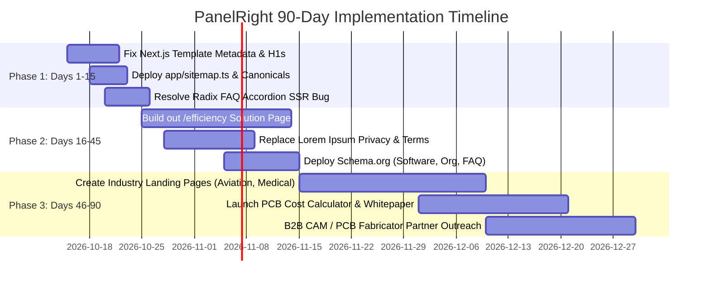

# 30-60-90 Day SEO & Growth Roadmap: PanelRight
**Domain:** https://www.panelright.com/  
**Technology:** Next.js (App Router) on Vercel  
**Audit Date:** October 14, 2026  
**Focus:** Technical Remediation, Next.js Metadata Optimization & B2B Organic Lead Generation  

---

## Executive Implementation Strategy
PanelRight operates in a highly specialized, high-margin B2B engineering space (**PCB Panel Optimization & CAM Software**). The website currently suffers from **zero organic search visibility** because critical developer boilerplate (Next.js 13 template descriptions, unmounted FAQ accordions, missing canonicals, and missing sitemaps) was left active in production.

This roadmap resolves technical blockers in Week 1–2, builds out core solution content in Month 2, and scales organic authority in Month 3.

---

## Phase 1: Days 1–15 (Emergency Technical Cleanup)

### Immediate Priority Actions
1. **Remove Next.js 13 Template Boilerplate:**
   - Replace `"An open source application built using the new router..."` in `app/layout.tsx` with optimized PCB panelization copy.
   - Replace Vercel preview OpenGraph image with official branded asset (`https://www.panelright.com/opengraph-image.png`).
2. **Correct Homepage Heading Structure (Fix 7 H1s):**
   - Retain a single primary `<h1>PCB Panel Optimization & Automated Panelization Software</h1>`.
   - Demote industry tabs (Aviation, Marine, Medical Device, Automotive, etc.) from `<h1>` to `<h3>` or `
`.
3. **Deploy Dynamic XML Sitemap in Next.js:**
   - Create `app/sitemap.ts` exporting all canonical routes (`/`, `/faq`, `/efficiency`, `/privacy`, `/terms`).
   - Add `Sitemap: https://www.panelright.com/sitemap.xml` to `public/robots.txt`.
4. **Deploy Self-Referencing Canonical Tags:**
   - Add `metadataBase: new URL('https://www.panelright.com')` and `alternates: { canonical: './' }` in `app/layout.tsx`.
5. **Fix FAQ Server-Side Rendering (SSR) Bug:**
   - Ensure Radix UI / Shadcn Accordion renders answer text into the HTML payload so search engines can read all 14 Q&A pairs.

---

## Phase 2: Days 16–45 (Solution Depth & Trust Foundation)

1. **Transform `/efficiency` from Placeholder into Conversion Asset:**
   - Replace the 25-word "Under Construction" notice with a 1,000+ word technical breakdown explaining how PanelRight's mathematical nesting algorithms maximize panel utilization and reduce per-board costs.
   - Include comparison diagrams and laminate savings tables.
2. **Replace Latin Lorem Ipsum on Legal Pages:**
   - Publish legitimate B2B Privacy Policy and Terms of Service covering CAD file confidentiality, non-disclosure (NDA), and data security.
   - Add links to `/privacy` and `/terms` in the global footer.
3. **Inject JSON-LD Structured Data:**
   - Deploy `Organization`, `SoftwareApplication`, and `FAQPage` schemas from `09_schema_drafts.json`.
4. **Fix Subdomain Navigation & Contact Loop:**
   - Update the "Return" button on `solutions.panelright.com/contact` to link directly back to `https://www.panelright.com/`.

---

## Phase 3: Days 46–90 (Authority Scaling & Lead Generation)

1. **Launch Dedicated Industry Landing Pages:**
   - Create focused solution sub-pages:
     - `/industries/aviation-defense-pcb`
     - `/industries/medical-device-pcb`
     - `/industries/automotive-pcb`
2. **Lead Generation Asset (PCB Laminate Savings Calculator):**
   - Build a lightweight interactive panel utilization calculator where engineers input board dimensions (X, Y) and receive estimated material savings.
3. **B2B Backlink & Industry Visibility:**
   - Target authoritative electronics manufacturing publications (*I-Connect007*, *Printed Circuit Design & Fab*, *EE Times*).
   - Establish corporate LinkedIn presence to elevate Brand Authority from its current score of 1.
