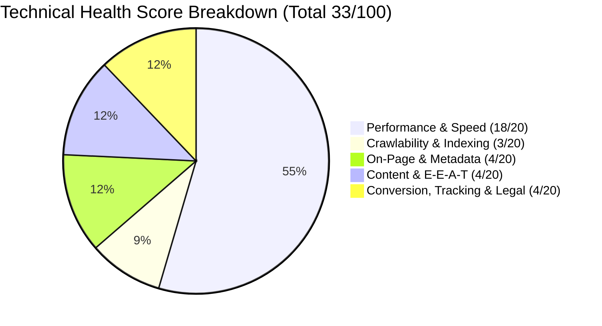
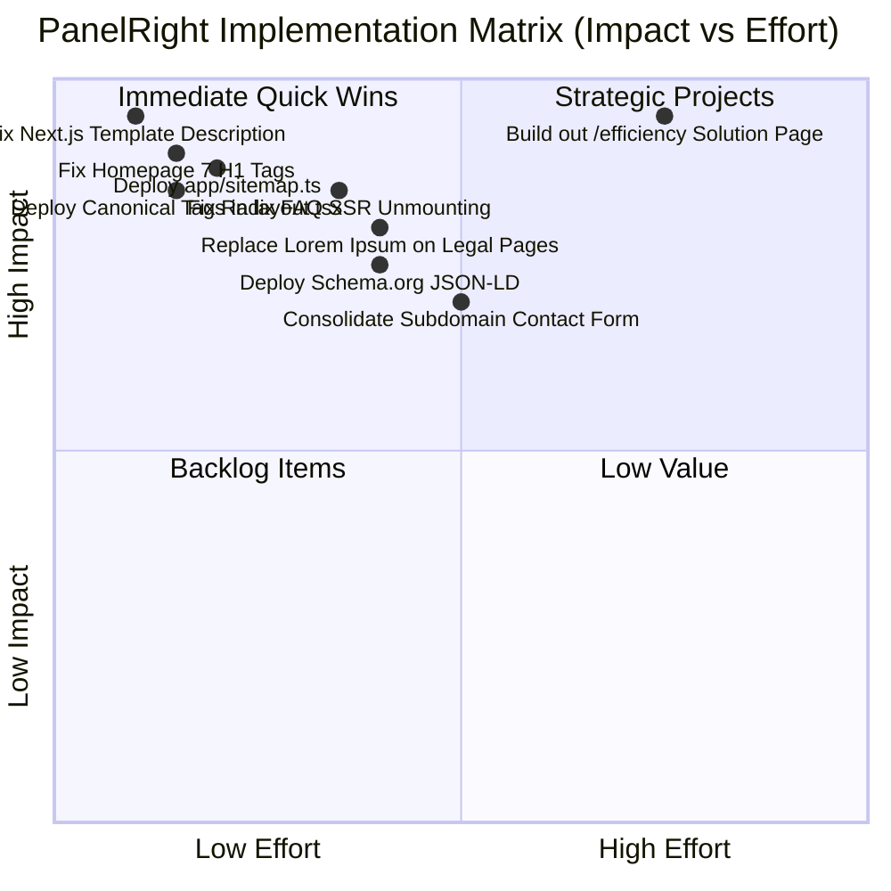

# Technical SEO & On-Page Website Audit Report
**Client Website:** https://www.panelright.com/  
**Application Portal / Contact:** https://solutions.panelright.com/contact  
**Core Offering:** PCB (Printed Circuit Board) Panel Optimization & Automated Panelization Software  
**Target Market:** Global B2B (Electronics OEMs, PCB Fabricators, Contract Manufacturers)  
**Technology Stack:** Next.js 13+ (App Router), React, Tailwind CSS, Radix UI on Vercel / AWS  
**Audit Date:** October 14, 2026  
**Overall Website Health Score:** **33 / 100 (Critical Remediation Required)**  

---

## 1. Executive Summary

### 1.1 Overview & Core Business Context
PanelRight (`www.panelright.com`) provides a high-value, specialized B2B algorithmic software solution designed to solve one of the most expensive bottlenecks in electronics manufacturing: **Printed Circuit Board (PCB) panelization and array optimization**. By mathematically optimizing the nesting, orientation, and spacing of circuit boards on master fabrication panels, PanelRight enables manufacturers to **minimize expensive FR-4 / laminate eWaste and cut per-board fabrication costs**.

Despite operating in a highly lucrative B2B niche with strong technical hosting fundamentals (**Next.js on Vercel delivering an ultra-fast TTFB of 68 ms**), the website currently suffers from **zero organic search visibility** (Semrush Organic Traffic: **0**, AI Search Visibility: **0**, Moz Brand Authority: **1**).

This organic invisibility is directly driven by **critical developer boilerplate and unfinished assets left active in production**:

### 1.2 Baseline Search & Domain Authority Metrics (Verified Tools)
- **Semrush (Oct 13, 2026):**
  - **Authority Score:** 2 / 100 ("Lacks organic traffic")
  - **Organic Search Traffic:** 0 visits / month
  - **Paid Search Traffic:** 0
  - **Referring Domains:** 1.2K | **Backlinks:** 1.3K
  - **AI Search Visibility:** 0 across ChatGPT, Google AI Overviews, Google AI Mode, and Gemini (0 mentions, 0 cited pages)
- **Moz Domain Overview (Oct 2026):**
  - **Domain Search Theme:** Industrial Panel Systems
  - **Domain Authority (DA):** 6 / 100
  - **Brand Authority:** 1 / 100
  - **Page Authority (PA):** 22 / 100
- **Hosting Infrastructure & Geolocation:**
  - **IP Address:** `64.29.17.65` (Vercel, Inc / Amazon.com, Inc.)
  - **Server Location:** Walnut, California, United States

### 1.3 Overall Health Score Breakdown

| Audit Category | Max Weight | Score | Status | Primary Observed Defect |
|---|---|---|---|---|
| **Crawlability & Sitemaps** | 10 | **2 / 10** | **Fail** | `sitemap.xml` is 404; no sitemap pointer in `robots.txt` |
| **Indexability & Canonicalisation** | 10 | **2 / 10** | **Fail** | Missing `<link rel="canonical">` across 100% of pages |
| **On-Page Metadata** | 10 | **2 / 10** | **Critical** | Default Next.js 13 starter boilerplate meta descriptions in production |
| **Heading Structure (H1/H2)** | 10 | **2 / 10** | **Critical** | 7 separate H1 tags on homepage; 0 H1 tags on `/efficiency` |
| **Content Depth & Indexability** | 10 | **2 / 10** | **Critical** | Primary CTA links to 25-word "Under Construction" page; FAQ answers unmounted |
| **Performance & Core Web Vitals** | 10 | **10 / 10** | **Pass** | Exceptional static speed via Vercel Edge (TTFB 68ms, FCP 500ms) |
| **Mobile & Rendering Parity** | 10 | **8 / 10** | **Pass** | Clean responsive layout; but Radix accordion unmounts answers from server DOM |
| **Structured Data (Schema.org)** | 10 | **0 / 10** | **Fail** | Zero Schema.org JSON-LD blocks across the entire domain |
| **E-E-A-T & Trust Signals** | 10 | **2 / 10** | **Critical** | Zero team/founder info; unlinked `/privacy` & `/terms` contain Latin Lorem Ipsum |
| **Security & Architecture** | 10 | **3 / 10** | **Warning** | Missing X-Frame-Options/CSP on root; fragmented subdomain contact flow |
| **TOTAL WEIGHTED SCORE** | **100** | **33 / 100** | **Critical** | **Immediate Next.js Production Cleanup Required** |

---

## 2. Top Critical Findings (The "Smoking Guns")

### Finding 1: Default Next.js 13 Template Description Active in Production
- **Observed:** On the homepage (`/`) and the efficiency page (`/efficiency`), the HTML meta description reads:
  > *"An open source application built using the new router, server components and everything new in Next.js 13."*
- **Evidence:** This exact string is the default boilerplate description from the open-source `shadcn/taxonomy` Next.js 13 template repository.
- **Impact:** Search engine snippets in Google and social shares on LinkedIn/Slack display developer starter text instead of PanelRight's PCB optimization value proposition.

### Finding 2: Primary Homepage CTA Links to a 25-Word "Under Construction" Page
- **Observed:** On the homepage, the prominent link *"How We Find Efficient Solutions"* leads to `https://www.panelright.com/efficiency`.
- **Evidence:** The page contains only 25 total words:
  > *"Under Construction. This page is currently being built. Please check back soon."*
- **Impact:** The page has **0 H1 tags**, offers zero value to prospective customers, returns HTTP 200 without a `noindex` tag, and causes visitors to immediately bounce.

### Finding 3: Severe Heading Dilution (7 H1 Tags on Homepage)
- **Observed:** The homepage contains **7 separate `<h1>` tags**:
  1. `<h1>Minimize eWaste. Reduce Cost.</h1>`
  2. `<h1>Aviation & Defense</h1>`
  3. `<h1>Marine</h1>`
  4. `<h1>Medical Device</h1>`
  5. `<h1>Automotive</h1>`
  6. `<h1>Industrial & Energy</h1>`
  7. `<h1>Consumer & Appliance</h1>`
- **Impact:** In HTML5 semantics and SEO, having 7 H1s on a single 341-word page confuses search engine topic modeling by treating each industry tab as the primary page title.

### Finding 4: FAQ Answers Unmounted in Server HTML (Invisible to Googlebot)
- **Observed:** On `https://www.panelright.com/faq`, 14 high-value questions are displayed.
- **Evidence:** In server-rendered HTML, the Radix UI accordion renders closed items with `

` containing zero text. Crawlers see only 130 words of question headings and **zero answer text**.
- **Impact:** Googlebot cannot index the answers, cannot award FAQ Rich Snippets, and flags the page as thin content.

### Finding 5: Live Production Legal Pages Contain Latin Lorem Ipsum
- **Observed:** The URLs `https://www.panelright.com/privacy` and `https://www.panelright.com/terms` are live on production and return HTTP 200.
- **Evidence:**
  - `/privacy` begins: *"The Privacy Policy for Taxonomy App. Blandit libero volutpat sed cras ornare arcu..."*
  - `/terms` begins: *"Read our terms and conditions. Lorem ipsumMagna fermentum iaculis..."*
  - Neither page is linked in the footer.
- **Impact:** Demonstrates unfinished development to enterprise B2B prospects and severely undermines Google E-E-A-T.

### Finding 6: Total Absence of XML Sitemap & Canonical Tags
- **Observed:** `https://www.panelright.com/sitemap.xml` returns **HTTP 404 Not Found**.
- **Observed:** 100% of pages lack `<link rel="canonical">` tags.

---

## 3. Comprehensive Technical Audit by Module

### 3.1 Crawlability & Indexability
- **Robots.txt:** Serves HTTP 200, allowing all user-agents, but fails to include a `Sitemap:` pointer.
- **Sitemap Hygiene:** Completely absent (404). In Next.js App Router, this is resolved by creating `app/sitemap.ts`.
- **Redirect Chains:** `http://panelright.com/` requires 2 hops (308 -> 308) to reach `https://www.panelright.com/`.

### 3.2 On-Page SEO & Metadata Optimization
- **Title Tags:** Currently 10–23 characters long (`PanelRight`, `FAQ | PanelRight`, `Efficiency | PanelRight`). They miss all primary search volume for *"PCB Panel Optimization"*, *"PCB Panelization Software"*, and *"PCB Array Nesting"*.
- **Meta Descriptions:** 2 pages share identical Next.js 13 template descriptions.
- **Heading Order:** The homepage jumps from H1 to H2 with 7 duplicate H1 tags; `/efficiency` has an H2 without any H1.

### 3.3 Content & Information Architecture
- The entire public marketing footprint consists of fewer than 530 total words.
- To rank for high-intent B2B electronics manufacturing queries, PanelRight must establish topical authority by building out dedicated industry pages and publishing technical guides on PCB panel utilization formulas.

### 3.4 Security & Server Configuration
- **Server:** Hosted on Vercel / AWS.
- **SSL/TLS:** TLS 1.3 active with valid certificates.
- **Security Headers:** Missing `X-Frame-Options`, `X-Content-Type-Options`, and `Content-Security-Policy` on the main domain. These should be defined in `next.config.js`.

---

## 4. Prioritised Action Items & 30-Day Quick Wins

### Top 10 Quick Wins (Deploy Within 7 Days)
1. **Replace Default Next.js 13 Description:** Update `app/layout.tsx` metadata with optimized PCB optimization copy (15 mins).
2. **Correct Homepage H1s:** Demote 6 industry H1s to `<h3>` or `
`, keeping only the primary title as `<h1>` (20 mins).
3. **Deploy `app/sitemap.ts`:** Automatically generate a valid XML sitemap containing all routes (30 mins).
4. **Deploy Canonical Tags in `app/layout.tsx`:** Add `metadataBase` and `alternates` configuration (15 mins).
5. **Fix Radix UI FAQ Accordion:** Ensure FAQ answers are rendered into the server HTML payload (45 mins).
6. **Apply Temporary Fix to `/efficiency`:** If the content is not ready, add a `noindex` tag or redirect to `/#workSection` (15 mins).
7. **Replace Latin Lorem Ipsum on `/privacy` and `/terms`:** Draft clean, legitimate commercial B2B policies (1 hour).
8. **Add Footer Links:** Link Privacy Policy, Terms, and Contact Us in the global website footer (20 mins).
9. **Update OpenGraph Image:** Replace the temporary Vercel preview URL with a permanent branded graphic (20 mins).
10. **Add Security Headers in `next.config.js`:** Add `X-Frame-Options` and `X-Content-Type-Options` (30 mins).
