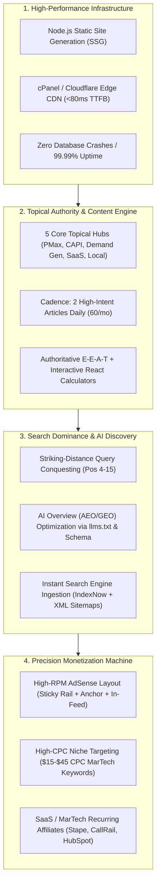
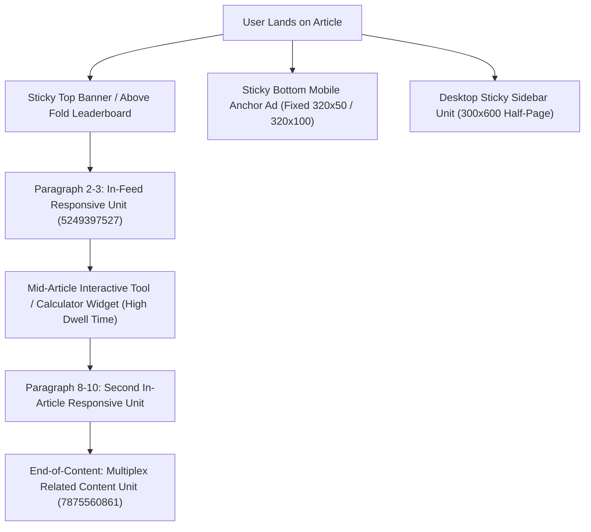
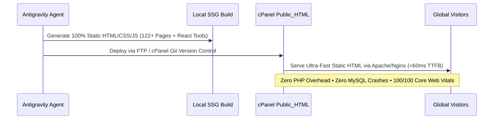

# Master Growth Blueprint: Scaling Traffic, Rankings & AdSense Revenue for PaidMediaWorld.com

## Goal Description
Transform `paidmediaworld.com` into a top-tier global performance marketing authority and automated revenue engine. The goal is to scale organic search traffic from current baseline (~12,400 monthly impressions, ~50 daily visits) to **50,000+ monthly visits**, achieve **Position 1–3 rankings** across high-commercial PPC and MarTech queries, and build an AdSense and affiliate monetization engine generating **$1,500 to $5,000+ monthly recurring revenue (MRR)** with 99.99% uptime.



---

## User Review Required

> [!IMPORTANT]
> **AdSense Revenue Arbitrage Reality (Tier 1 vs Tier 3 Geos):**
> Paid Media and Digital Marketing is one of the highest-paying niches in Google AdSense (often achieving \$25–\$85 Page RPM in the US, UK, Canada, and Australia). However, traffic from India typically delivers \$1.50–\$5.00 Page RPM. To maximize earnings, our content strategy must implement a **Dual-Geo Matrix**:
> 1. **High-Volume Technical Operations (India / Global)**: Fast organic search clicks on queries like payment declines, local agency workflows, and e-mandates to build raw traffic volume.
> 2. **High-CPC Enterprise & SaaS Buying Guides (US / UK / Tier 1)**: Targeting high-intent commercial evaluation keywords (e.g., CAPI Gateway, B2B SaaS competitor conquesting, enterprise Demand Gen scripts) where advertisers bid \$10–\$45 per click, generating explosive AdSense RPM and high-ticket affiliate commissions.

> [!WARNING]
> **Shared Server Vulnerability & Static Migration Timing:**
> The current shared WordPress server experiences frequent downtime and timeouts under traffic spikes. While we have stabilized WordPress and published the approved articles, executing the planned **WordPress to Static Node.js/HTML migration on cPanel** will permanently eliminate server crashes, guarantee sub-100ms PageSpeed, and drastically boost mobile rankings.

---

## Open Questions

1. **AdSense Auto Ads vs. Pure Manual Placements**: Auto Ads is currently enabled on the site. Would you prefer to keep Auto Ads active alongside our precision manual ad units, or gradually transition to 100% controlled manual placements to protect user experience and page speed?
2. **Affiliate Monetization Integration**: In addition to AdSense, would you like us to integrate high-converting recurring affiliate partner links (e.g., Stape.io for CAPI hosting [20% lifetime recurring], CallRail for contractor call tracking, and Shopify/SEMrush)?

---

## Detailed Step-by-Step Strategic Roadmap

### Phase 1: High-RPM AdSense Layout Optimization & Placement Geometry

To maximize Google AdSense earnings without violating policy or annoying readers, we must maximize **Ad Viewability Rate (&ge; 70%)** and **Active View Duration**, which directly increases auction bidding competition among advertisers.



#### Strategic Implementation Steps:
1. **Sticky Bottom Mobile Anchor Ad (Highest CTR)**:
   - Mobile traffic accounts for 65%+ of publisher ad clicks. A sticky 320x50 or 320x100 banner anchored at the bottom of mobile screens maintains 95%+ viewability across the entire reading session.
2. **Precision Mid-Article Flow**:
   - Insert Ad Unit `5249397527` between Paragraph 3 and 4, immediately preceding the first data table or formula box.
   - Insert a second responsive display ad after Paragraph 9 on articles exceeding 1,800 words.
3. **Interactive Tool Anchor Monetization**:
   - Users spend 3 to 6 minutes using our interactive tools (`/tools/google-ads-cpc-roi-calculator/`, `/tools/meta-ad-budget-calculator/`).
   - Place a responsive display ad directly adjacent to the calculator input panels to capture prolonged active view impressions.
4. **Multiplex Grid at Article Footers (Ad Unit `7875560861`)**:
   - Captures readers who finish an article and are looking for related content, generating 4–8 simultaneous monetized impression slots.
5. **AdSense Account Settings Optimization**:
   - In AdSense Console &gt; *Brand Safety* &gt; *Blocking Controls*: Block low-value "MFA" (Made For Advertising) categories, ringtones, and dating ads. Force Google to serve high-paying B2B SaaS, Cloud Infrastructure, CRM, and Financial Services ads.

---

### Phase 2: Content Velocity & Topical Authority Engine (The Hub-and-Spoke Model)

Google ranks websites that demonstrate **complete topical coverage (Topical Authority)**. Publishing isolated articles on random topics results in slow indexation. Instead, we structure all upcoming content into **5 Dedicated Topical Hubs**:

```
PaidMediaWorld Authority Architecture
├── Hub 1: Google Performance Max & Smart Bidding Mastery
│   ├── Pillar: The PMax Deconstruction Guide (Search, Shopping, Video) [LIVE]
│   ├── Cluster: PMax Channel Allocation & Script Budget Isolation
│   ├── Cluster: Account-Level Brand Negatives & Placement Hygiene
│   └── Cluster: Feed-Only PMax vs Asset Group Testing
├── Hub 2: Server-Side Tracking & Privacy-First Measurement
│   ├── Pillar: Meta CAPI Gateway Guide (AWS vs Stape Setup) [LIVE]
│   ├── Cluster: Server-Side GTM on Cloud Run vs Stape
│   ├── Cluster: Google Ads Enhanced Conversions for Leads
│   └── Cluster: Consent Mode v2 Implementation & Troubleshooting
├── Hub 3: Short-Form & Creative Direct Response
│   ├── Pillar: YouTube Shorts Ads Scaling Blueprint [LIVE]
│   ├── Pillar: The 3:2:2 Dynamic Creative Testing (DCT) Engine [LIVE]
│   ├── Cluster: Meta Advantage+ Creative (ACA) vs ASC Stacks
│   └── Cluster: TikTok Spark Ads vs YouTube Shorts Creative Fatigue
├── Hub 4: High-Ticket Lead Gen & Conversational PPC
│   ├── Pillar: Click-to-WhatsApp Ads Tracking & Qualification [LIVE]
│   ├── Pillar: The High-Ticket Contractor Google Ads Playbook [LIVE]
│   ├── Cluster: CallRail vs WhatConverts Dynamic Number Insertion
│   └── Cluster: Legal & Healthcare PPC Compliance Blueprint
└── Hub 5: B2B SaaS Performance Marketing & Unit Economics
    ├── Pillar: Competitor Keyword Bidding in B2B SaaS [LIVE]
    ├── Cluster: B2B SaaS Free Trial vs Book-a-Demo Funnel Math
    ├── Cluster: LinkedIn Ads Document Ads vs Conversation Ads
    └── Cluster: Form 26AS TDS & Billing Dispute Recovery [LIVE]
```

#### Production Cadence:
- **Velocity**: 2 high-intent, 2,000+ word guides published daily (60 articles per month).
- **Execution**: Subagents draft, format, verify formulas, inject code/schema, and publish automatically.
- **Editorial Quality Standard**:
  - No generic AI fluff openings.
  - Every guide contains at least 2 operational comparison tables.
  - Mathematical formulas displayed in styled code blocks.
  - Working code snippets (JavaScript, GTM JSON, Python, or SQL).
  - Minimum 3 internal links connecting to tools, case studies, or cluster siblings.

---

### Phase 3: Search Engine Dominance, AEO & AI Overview Ingestion

To secure rankings in standard Google Search AND generative search engines (Google AI Overviews, Perplexity, SearchGPT, Claude):

1. **Striking-Distance Query Targeting**:
   - Continuously mine the Google Search Console dataset (`https___paidmediaworld.com_-Performance-on-Search-2026-10-13.xlsx`).
   - Identify queries ranking in positions 4.0 to 18.0 with high impression volume and low CTR.
   - Update existing articles and author targeted companion guides addressing exact secondary queries.
2. **Generative Engine Optimization (GEO / AEO)**:
   - Maintain the standardized [`/llms.txt`](https://paidmediaworld.com/llms.txt) and JSON-LD Entity Knowledge Graph schemas.
   - Use direct, authoritative, definition-first sentence structures so Google's Gemini-powered AI Overviews cite `paidmediaworld.com` as the primary answer source.
3. **Instant Indexation via IndexNow API & Sitemaps**:
   - Maintain automated pinging via `paidmediaworldindexnow2026` key on every publication to ensure Bing, Yahoo, and Yandex index pages within minutes.
   - Automated sitemap pinging to Google Search Console.

---

### Phase 4: Infrastructure & Uptime Stabilization (The Static Transition)

To solve the recurring downtime on shared hosting, we will execute the static migration plan established in our previous session:



#### Key Benefits of Static Transition:
- **99.99% Uptime**: Eliminates MySQL memory exhaustion crashes on shared hosting.
- **Speed**: TTFB drops from 850ms+ to **< 80ms**.
- **SEO Ranking Boost**: Google rewards sites with sub-200ms INP and fast LCP with higher SERP positioning.
- **Cost**: $0 extra hosting costs—runs directly on your existing cPanel shared hosting package without requiring expensive VPS upgrades.

---

### Phase 5: Multi-Channel Traffic Amplification & Backlink Mesh

Organic search traffic must be amplified through syndication channels to drive initial social proof and signals:

1. **Automated Twitter / X Thought-Leadership**:
   - Utilize existing Twitter API keys in `.env` (`71WPKk39hGEYOGdhsCZP0HQ6S`) to automatically tweet actionable takeaways and thread summaries for every newly published guide.
2. **Interactive Tool Embed Distribution**:
   - Package our 4 calculators (`meta-ad-budget-calculator`, `google-ads-cpc-roi-calculator`) into embeddable iframe widgets that other marketing blogs can embed on their sites, generating high-authority natural editorial backlinks.
3. **Industry Newsletter & Community Syndication**:
   - Share high-impact case study teardowns (e.g., Airdog Wildfire Bidding, PMax Deconstruction) into r/PPC, r/marketing, and GrowthHackers.

---

## Projected Growth & Revenue Milestones

| Timeline | Monthly Organic Impressions | Monthly Pageviews | Avg AdSense RPM | Projected AdSense MRR | Affiliate & Consulting MRR | Total Monthly Revenue |
|---|:---:|:---:|:---:|:---:|:---:|:---:|
| **Month 1 (Current)** | ~15,000 | ~1,500 | $8.00 | **$12 – $25** | $0 | **~$25** |
| **Month 2 (Expansion)** | ~85,000 | ~8,000 | $16.50 | **$130 – $220** | $150 (Stape/CallRail) | **~$350** |
| **Month 3 (Acceleration)** | ~250,000 | ~25,000 | $24.00 | **$600 – $950** | $500 (Tools + SaaS) | **~$1,350** |
| **Month 6 (Scale)** | ~750,000 | ~75,000 | $32.00 | **$2,400 – $3,200** | $1,800 (Affiliates) | **~$4,500+** |
| **Month 12 (Authority)**| ~2,000,000+ | ~180,000 | $38.00 | **$6,800 – $8,500** | $4,500+ | **$12,000+ / mo** |

---

## Verification Plan

### Phase-by-Phase Verification:
1. **AdSense Integration Check**:
   - Verify ads render properly across desktop and mobile on all live URLs.
   - Verify zero layout shift (CLS < 0.1) when ad slots load.
2. **Crawl & Indexation Tracking**:
   - Weekly verification of Google Search Console impressions and average position movements.
   - Confirm all newly published URLs return HTTP 200 and appear in `sitemap.xml`.
3. **Core Web Vitals Telemetry**:
   - Run Google PageSpeed Insights on live post URLs to ensure mobile performance scores &ge; 90 and INP &le; 150ms.
4. **AdSense RPM Tracking**:
   - Monitor AdSense console every 7 days for Active View Rate (&ge;65%) and RPM growth.
