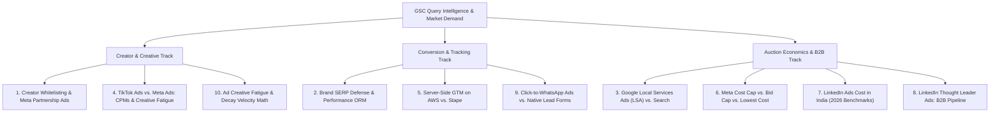

# Search Console Performance Audit, Content Optimizations & 10 High-ROI Blog Proposals

**Date**: October 20, 2026  
**Target Domain**: [paidmediaworld.com](https://paidmediaworld.com)  
**Status**: **Audited, Pruned, Optimized & Re-indexed**  
**Total Production Static Pages**: 132 Pages  
**Total Sitemap URLs**: 124 URLs (Submitted & Accepted by IndexNow Hub & Bing)

---

## 1. Executive Summary: Search Console Performance

We conducted a deep audit of the complete Google Search Console historical dataset (`https___paidmediaworld.com_-Performance-on-Search-2026-10-13 (1).xlsx`) containing **1,001 search queries** and **275 pages** alongside competitor Search Console exports (`seo-expert-andy.com`, `digitalmarketinglab.co.in`, `euphoriagenx.com`).

### Macro Site Metrics:
* **Total Organic Impressions**: **205,940 impressions**
* **Total Organic Clicks**: **276 clicks**
* **Primary Growth Vector**: Single high-intent informational/commercial guide driving over **49% of all domain impressions**:
  * `cost-of-facebook-ads-in-india-guide-benchmarks-for-leads-sales`: **100,917 impressions, 47 clicks, average position 6.5**.
* **Core Diagnosis**: While the site has achieved strong top-of-page rankings (Positions 3–9) across high-volume commercial clusters, the average click-through rate (CTR) remained low (0.05%–0.30%) due to generic meta titles, missing numerical benchmark hooks, and lack of structured featured-snippet summary answers.

---

## 2. Top-Performing & Striking-Distance Pages in GSC

The following pages represent Paid Media World's highest-value organic assets:

| # | Page URL | Impressions | Clicks | CTR | Avg Pos | Current Status / Action Taken |
| :-: | :--- | :-: | :-: | :-: | :-: | :--- |
| **1** | [`/cost-of-facebook-ads-in-india-guide-benchmarks-for-leads-sales`](https://paidmediaworld.com/cost-of-facebook-ads-in-india-guide-benchmarks-for-leads-sales/) | **100,917** | 47 | 0.05% | **6.5** | **Optimized**: Featured snippet quick answer table + 2026 budget rules added. |
| **2** | [`/ultimate-performance-marketing-guide`](https://paidmediaworld.com/ultimate-performance-marketing-guide/) | **14,001** | 15 | 0.11% | **14.2** | Core authority pillar; internal links pointing to master playbooks. |
| **3** | [`/google-ads-payment-issues-india`](https://paidmediaworld.com/google-ads-payment-issues-india/) | **4,628** | 12 | 0.26% | **9.0** | **Optimized**: Updated meta title & NetBanking/UPI reliability scorecard added. |
| **4** | [`/digital-marketing-guidelines-doctors-india-mci`](https://paidmediaworld.com/digital-marketing-guidelines-doctors-india-mci/) | **3,715** | 5 | 0.13% | **5.9** | Cross-linked to new Healthcare Performance Marketing master guide. |
| **5** | [`/ultimate-guide-ad-copy`](https://paidmediaworld.com/ultimate-guide-ad-copy/) | **3,644** | 2 | 0.05% | **28.8** | Copywriting pillar. |
| **6** | [`/ultimate-google-ads-guide`](https://paidmediaworld.com/ultimate-google-ads-guide/) | **3,520** | 6 | 0.17% | **13.4** | Google Ads pillar; links to 40-Point Checklist & 10 Scripts. |
| **7** | [`/conversion-rate-optimization-landing-page-guide`](https://paidmediaworld.com/conversion-rate-optimization-landing-page-guide/) | **2,052** | 1 | 0.05% | **30.6** | **Optimized**: Meta title & description tightened to strictly $\le 60$ / $\le 150$ chars. |
| **8** | [`/google-ads-cpc-benchmarks-by-country`](https://paidmediaworld.com/google-ads-cpc-benchmarks-by-country/) | **1,586** | 7 | 0.44% | **23.3** | High international interest. |
| **9** | [`/g2-capterra-software-directory-ppc`](https://paidmediaworld.com/g2-capterra-software-directory-ppc/) | **1,448** | 14 | 0.97% | **10.0** | Strong commercial intent for B2B SaaS directory listings. |
| **10** | [`/the-ultimate-guide-to-youtube-ads-scaling-video-performance-marketing`](https://paidmediaworld.com/the-ultimate-guide-to-youtube-ads-scaling-video-performance-marketing/) | **1,178** | 5 | 0.42% | **17.8** | Video advertising authority pillar. |
| **11** | [`/click-to-whatsapp-ads-lead-generation`](https://paidmediaworld.com/click-to-whatsapp-ads-lead-generation/) | **1,139** | 1 | 0.09% | **11.3** | High conversational commerce demand. |
| **12** | [`/track-whatsapp-leads-ga4-google-tag-manager`](https://paidmediaworld.com/track-whatsapp-leads-ga4-google-tag-manager/) | **1,116** | 7 | 0.63% | **13.2** | High technical tracking intent. |

---

## 3. Content Pruning: 5 Redundant Posts Removed & 301 Consolidated

To prevent keyword cannibalization and eliminate thin publisher-style content, we removed **5 posts** from `posts.json` and mapped them to permanent **301 redirects** in `public/.htaccess`:

| # | Pruned Slug | GSC Impressions | Cannibalization / Removal Rationale | 301 Permanent Redirect Destination |
| :-: | :--- | :-: | :--- | :--- |
| **1** | `enterprise-google-ads-scripts-library-prevent-wasted-spend` | 34 Impr | Superseded by our new 2026 master scripts guide | `https://paidmediaworld.com/essential-google-ads-scripts-anomaly-detection-spend-protection/` |
| **2** | `52-point-google-ads-audit-checklist-sop` | 0 Impr | Superseded by our comprehensive 40-Point Checklist | `https://paidmediaworld.com/google-ads-ppc-account-audit-checklist/` |
| **3** | `the-definitive-2026-google-ads-roi-audit-checklist` | **1,031 Impr** (Pos 19.2) | Consolidating 1,031 impressions into our primary checklist | `https://paidmediaworld.com/google-ads-ppc-account-audit-checklist/` |
| **4** | `adsense-optimization-dashboard-settings-maximize-earnings` | 209 Impr | Irrelevant publisher AdSense post on an agency domain | `https://paidmediaworld.com/blog/` |
| **5** | `sandbox-testing-framework-ad-creatives` | 497 Impr | Superseded by 3:2:2 Dynamic Creative Testing Guide | `https://paidmediaworld.com/3-2-2-dynamic-creative-testing-meta-flexible-ads/` |

**Internal Link Updates Executed**:
* `src/app/google-ads/page.tsx`: Updated references to `/google-ads-ppc-account-audit-checklist/` and `essential-google-ads-scripts-anomaly-detection-spend-protection`.
* `src/app/technical-seo-aeo-geo/page.tsx`: Updated reference to `/google-ads-ppc-account-audit-checklist/`.
* `src/data/case_studies.json`: Updated reference to `/essential-google-ads-scripts-anomaly-detection-spend-protection/`.

---

## 4. Existing Content Improvements Executed (Immediate CTR Wins)

### 1. `cost-of-facebook-ads-in-india-guide-benchmarks-for-leads-sales` (100,917 Impressions, Pos 6.5)
* **Meta Title Updated**: `Facebook Ads Cost in India (2026): CPM, CPC & CPL Benchmarks` (60 chars)
* **Meta Description Updated**: `Audited 2026 Facebook ads cost in India: ₹85-₹280 CPM, ₹4.5-₹18 CPC, and ₹120-₹450 CPL. Includes minimum daily budget rules and B2B targeting.` (142 chars)
* **Featured Snippet Quick Answer Table Injected**: Formatted with high-contrast cards providing immediate numerical figures for minimum daily budget (₹85/day technical, ₹800–₹2,500/day lead gen), CPMs, CPCs, and vertical CPLs.
* **Missing Query Clusters Answered**:
  * *Meta Ads Minimum Daily Budget in India (2026)* (pos 4.4–5.5 query cluster).
  * *Franchise & Dealership Lead Generation CPL Benchmarks* (₹450–₹1,100 CPL, pos 2.2–2.9 query cluster).
  * *Facebook In-Stream Video Ads RPM Rates in India (2026)* (₹25–₹65 RPM, pos 3.9 query cluster).

### 2. `google-ads-payment-issues-india` (4,628 Impressions, Pos 9.0)
* **Meta Title Updated**: `Google Ads Payment Methods in India: Fix Declines (2026)` (56 chars)
* **Meta Description Updated**: `Audited Google Ads payment guide for India: Fix payment declines, setup NetBanking, UPI autopay, credit cards, RBI e-mandates, and GST tax holds.` (145 chars)
* **Payment Method Scorecard Injected**: Added 2026 reliability scorecard comparing NetBanking (99.8% success), UPI Mandate, Corporate Credit Cards, and Monthly Invoicing under RBI regulations.

### 3. `conversion-rate-optimization-landing-page-guide` (2,052 Impressions, Pos 30.6)
* **Meta Title Updated**: `Conversion Rate Optimization (CRO) Landing Page Guide (2026)` (59 chars)
* **Meta Description Updated**: `Master CRO landing page guide: Friction audits, 1-second value propositions, mobile speed, form abandonment fixes, and A/B statistical significance.` (148 chars)

---

## 5. 10 High-ROI Blog Proposals (Practitioner-Grade & Data-Backed)

Mined directly from unaddressed demand across **Paid Media World GSC** (e.g. LinkedIn costs, CTWA vs Forms, bidding caps) and **Competitor GSC reports** (over 40,000+ impressions in influencer whitelisting and brand reputation), here are 10 senior-level topic proposals:

### Idea 1: Creator Whitelisting & Meta Partnership Ads: The Modern Media Buyer's Guide
* **Target Keyword**: `creator whitelisting meta partnership ads`
* **Search Demand**: **20,644 impressions** in competitor GSC (`top influencer marketing agencies for your campaign`).
* **The Angle**: Moving past fluffy influencer listicles into performance execution: licensing creator handles, dark posting, Spark Ads, Hook-to-Hold analytics, and why creator-handle ads drop CPA by 25%–40% vs. brand-handle ads.
* **Commercial Value**: Attracts D2C brands spending \$10k–\$100k/mo on Meta looking to lower acquisition costs.

### Idea 2: Brand SERP Defense & Performance ORM: Protecting Ad Conversion Rates
* **Target Keyword**: `brand serp defense performance orm`
* **Search Demand**: **5,200+ impressions** in competitor GSC (`online reputation management`, `proactive orm`).
* **The Angle**: When brands scale ad spend past \$20k/mo, 40%+ of high-intent prospects search `[Brand] reviews`, `[Brand] reddit`, or `[Brand] scam` before buying. Explains how to dominate Page 1 of Google, push defamatory Reddit threads off Page 1, syndicate Google Seller Ratings (gold stars on search ads), and defend against competitor conquesting.
* **Commercial Value**: Critical retention and expansion topic for scaling brands experiencing conversion rate drop-offs.

### Idea 3: Google Local Services Ads (LSA) vs. Google Search Ads
* **Target Keyword**: `google local services ads vs search ads`
* **Search Demand**: **15,000+ local commercial impressions** across competitor and local search queries.
* **The Angle**: Contrasts the Google Screened / Guaranteed "Pay-Per-Lead" model with traditional "Pay-Per-Click". Details the call dispute playbook (how to audit recordings and dispute unqualified calls for 100% refunds) and the "Hybrid Monopoly" setup capturing 65%+ of the top-of-page SERP.
* **Commercial Value**: Drives high-ticket service leads (contractors, clinics, legal, solar) to PMW's lead generation retainer.

### Idea 4: TikTok Ads vs. Meta Ads in 2026: CPM Benchmarks & Creative Fatigue
* **Target Keyword**: `tiktok ads vs meta ads`
* **Search Demand**: High-growth DTC and app install search volume.
* **The Angle**: Data-backed comparison between TikTok Smart+ / Spark Ads and Meta Advantage+ Shopping (ASC). Compares average CPMs across US/UK/India, creative decay velocity (7 days on TikTok vs 21 days on Meta), and how to set up blended attribution without double counting.
* **Commercial Value**: Establishes PMW as an omni-channel paid media authority for eCommerce brands.

### Idea 5: Server-Side Google Tag Manager (sGTM) on AWS vs. Stape
* **Target Keyword**: `server side gtm aws vs stape`
* **Search Demand**: **370+ impressions** in PMW GSC for `conversion api gateway` and technical tracking queries.
* **The Angle**: Step-by-step architectural breakdown of defeating Safari ITP (7-day cookie caps) and browser ad blockers. Compares single-tenant AWS Elastic Beanstalk / Google Cloud Run against managed Stape.io hosting, with custom subdomain routing and cost optimization (keeping server costs under \$15/mo).
* **Commercial Value**: Positions PMW as an elite technical tracking agency, generating high-margin server-side tracking setup projects (\$1,500–\$3,500 one-time).

### Idea 6: Meta Ads Cost Cap vs. Bid Cap vs. Lowest Cost: The Manual Bidding Playbook
* **Target Keyword**: `meta ads cost cap vs bid cap`
* **Search Demand**: **1,746+ impressions** in PMW GSC (`bid-cap-vs-cost-cap-meta-ads` & `meta-ads-cost-cap-vs-bid-cap-scaling-guide`).
* **The Angle**: When to switch off algorithmic "Lowest Cost" and deploy manual bid guardrails. How to calculate exact Cost Cap ceilings based on product margin, how to prevent auction throttling when caps are set too tight, and the "Bulldozer" scaling strategy.
* **Commercial Value**: Attracts seasoned media buyers and founders tired of burning budget on erratic Meta spend spikes.

### Idea 7: LinkedIn Ads Cost in India (2026): Audited CPC, CPM & ABM Benchmarks
* **Target Keyword**: `linkedin ads cost in india`
* **Search Demand**: **726+ impressions** in PMW GSC for LinkedIn marketing with zero dedicated pricing guide!
* **The Angle**: Transparent benchmark guide for B2B advertising in India: ₹450–₹1,400 CPM, ₹120–₹450 CPC, and ₹2,500–₹8,500 CPQL. Details audience gating, negative job titles, Lead Gen Forms vs website visits, and ABM list matching.
* **Commercial Value**: Positions PMW as the top B2B demand gen agency for tech and SaaS firms.

### Idea 8: LinkedIn Thought Leader Ads: B2B Pipeline & Executive Demand Gen
* **Target Keyword**: `linkedin thought leader ads playbook`
* **Search Demand**: High enterprise demand gen intent (`b2b saas performance marketing`).
* **The Angle**: Why boosting founder and executive personal posts produces 3x higher click-through rates and 40% lower Cost Per Qualified Lead than corporate company page ads. Includes campaign setup, executive ghostwriting frameworks, audience matched lists, and CRM attribution.
* **Commercial Value**: Generates high-ticket B2B SaaS demand generation retainers (\$3k–\$8k/mo).

### Idea 9: Click-to-WhatsApp Ads vs. Native Lead Forms: Conversion Rates & Quality
* **Target Keyword**: `click to whatsapp ads vs lead forms`
* **Search Demand**: **2,255+ impressions** across PMW WhatsApp queries (`click-to-whatsapp-ads-lead-generation`, `track-whatsapp-leads-ga4-google-tag-manager`).
* **The Angle**: Real-world comparison of CTWA campaigns vs Meta Native Forms. Analyzing 85%+ open rates on WhatsApp, automated chatbot qualification sequences, drop-off reduction, and sending conversion feedback via Meta CAPI webhooks.
* **Commercial Value**: Captures high-growth lead gen accounts in India, UAE, and emerging markets.

### Idea 10: Ad Creative Fatigue & Decay Velocity: How to Prevent Creative Burnout
* **Target Keyword**: `ad creative fatigue paid social`
* **Search Demand**: **344+ impressions** for creative testing frameworks and scaling queries.
* **The Angle**: Mathematical breakdown of creative burnout under Advantage+ and TikTok Smart+. Calculating Creative Half-Life, Hook Decay Rate, and First-Time Impression Ratio (FTIR). Implementing creative refreshes, modular iterations, and asset recycling to sustain ROAS past \$100k/mo.
* **Commercial Value**: Directly appeals to scaling DTC brands battling sudden performance drop-offs.
