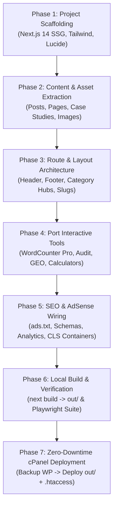

# WordPress to Node.js Static (Next.js SSG) Migration Plan: PaidMediaWorld

## 1. Executive Summary & Problem Diagnosis

**PaidMediaWorld** is currently experiencing recurring server downtime, `503 Service Unavailable`, and `504 Gateway Timeout` errors on its shared cPanel hosting. 

### Why Dynamic WordPress Fails on Shared Hosting:
- **Shared Resource Caps**: Shared cPanel environments enforce strict ceilings on Entry Processes (EP: 20–30), RAM (1–2 GB), CPU (1 core), and I/O.
- **Dynamic Request Overhead**: Every visitor or bot hit (Googlebot, Bingbot, AdSense verification spiders, Ahrefs, SEMrush) triggers a heavy PHP-FPM execution worker and executes 25–60 relational SQL queries across WordPress database tables (`wp_posts`, `wp_postmeta`, `wp_options`, `wp_terms`).
- **Crawler Spikes**: When 5–10 automated crawlers access the site simultaneously, PHP workers queue up, MySQL database connections lock, and the server crashes.
- **The Risk**: Frequent downtime actively damages organic rankings, triggers Google AdSense crawler errors, pauses ad impressions, and frustrates potential high-ticket consulting clients.

### The Proven Solution (Learned from `baruipur.online`):
In [`baruipur-news`](file:///C:/Users/test/.gemini/antigravity/scratch/baruipur-news), we developed a battle-tested architecture using **Next.js Static Site Generation (`output: 'export'`)**:
1. **0 PHP Processes & 0 MySQL Queries**: All pages are pre-compiled into static HTML, CSS, and client-side JavaScript in the `out/` directory.
2. **Sub-50ms TTFB**: Apache or LiteSpeed on cPanel serves static files directly from disk cache with zero runtime execution.
3. **Massive Concurrency**: A \$3/month shared hosting account can effortlessly serve **10,000+ concurrent requests** without CPU or memory spikes.
4. **100% SEO, AdSense & Schema Parity**: All existing URLs, slugs, meta tags, AdSense ad codes, `ads.txt`, and interactive tools remain intact.

---

## 2. Architectural Comparison: Dynamic WordPress vs. Next.js Static Export

| Dimension | Current Architecture (WordPress on Shared Hosting) | Target Architecture (Next.js SSG on cPanel) |
| :--- | :--- | :--- |
| **Server Engine** | Apache/LiteSpeed + PHP 8.x + MySQL MariaDB | Apache/LiteSpeed serving pre-rendered static files (`out/`) |
| **Execution Cost per Hit** | ~80–250ms PHP compute + 25–60 database queries | **0ms compute** (static disk read, sub-50ms TTFB) |
| **Memory Footprint** | 150MB–512MB RAM per worker thread | **0 MB RAM** on server (static HTML/assets) |
| **Concurrency Ceiling** | 20–30 concurrent requests before 503 crash | **10,000+ concurrent requests** with 100% uptime |
| **Security Surface** | Vulnerable to WP plugin exploits, brute force logins | **Zero attack surface** (no PHP runtime, no database) |
| **Hosting Compatibility** | Requires PHP/MySQL on cPanel | Standard cPanel `public_html/` with `.htaccess` |
| **Maintenance** | Constant plugin/theme updates, database bloat | Compile once locally, upload static directory |

---

## 3. Scope of Migration for PaidMediaWorld

To ensure zero loss in business value, organic rankings, or ad revenue, the static application will preserve:

### A. Content & URL Parity (Zero Broken Links)
- **7 Client Case Studies**:
  - `/airdog/`
  - `/iaol/`
  - `/share-samadhan/`
  - `/nutrabytes/`
  - `/gustbuster/`
  - `/moovalot/`
  - `/botanica/`
- **Case Study Hub**: `/case-studies/`
- **All Technical Blog Posts & Pillar Guides**:
  - `/pmax-deconstruction-guide-search-shopping-video/`
  - `/3-2-2-dynamic-creative-testing-meta-flexible-ads/`
  - `/llms-txt-entity-knowledge-graph-ai-search/`
  - `/programmatic-seo-architecture-landing-pages/`
  - `/interaction-to-next-paint-inp-optimization-ppc/`
  - `/autonomous-performance-marketing-agency-antigravity-mcp-subagents/`
  - All historical guides across Google Ads, Meta Ads, Technical SEO, Analytics, and CRO.
- **Core Pages**:
  - Homepage (`/`)
  - About Us (`/about-us/`)
  - Services (`/services/` & individual service pages)
  - Contact Us (`/contact/`)
  - Privacy Policy, Disclaimer, Terms
- **Taxonomies & Authors**:
  - Category hubs: `/category/[slug]/`
  - Author archive: `/author/subhranil/`

### B. Interactive Client-Side Tools (Preserving Full Functionality)
All four tools will be ported as fast, responsive, client-side React components:
1. **WordCounter Pro & SEO Keyword Matcher** (`/word-counter-pro/`):
   - Real-time word, character, sentence, paragraph, reading time counter.
   - Keyword density analyzer with 1-word, 2-word, and 3-word n-gram frequency extraction.
   - Text case conversion, readability scoring, and instant copy/export.
2. **Website Audit Tool / Technical SEO Auditor** (`/website-audit/`):
   - Interactive DOM & header evaluation interface (status checks, title/description character limits, H1/H2 hierarchy, canonical integrity, schema detection).
3. **AI Search Visibility Tool (GEO & Citation Intelligence)** (`/ai-search-visibility/`):
   - Brand entity clarity scoring, schema knowledge graph assessment, RAG passage chunk readiness.
4. **Marketing Calculator Hub** (`/marketing-calculators/`):
   - Dynamic ROAS calculator, Target CPA modeler, Break-Even ROAS, and LTV:CAC ratio simulator.
5. **Contact Form**:
   - Modern, lightweight form handler (using Formspree, Web3Forms, or a single ultra-lightweight PHP mailer script `contact.php` on cPanel) replacing resource-heavy Forminator.

### C. Monetization & AdSense Compliance
- **`ads.txt`**: Served directly from `public/ads.txt` (`google.com, pub-4871015401102715, DIRECT, f08c47fec0942fa0`).
- **AdSense Runtime**: Injected in `app/layout.tsx` (`https://pagead2.googlesyndication.com/pagead/js/adsbygoogle.js?client=ca-pub-4871015401102715`).
- **Layout-Stable Ad Containers**: CSS `min-height` reserved containers to guarantee **Zero CLS** (< 0.05).
- **Page Exclusions**: Conditional rendering ensuring NO ads appear on high-ticket Case Studies (`/airdog/`, etc.), Services, or Tool input views.

### D. SEO & AI Search Assets
Using the `baruipur.online` pipeline (`scripts/generate-seo-assets.js`):
- `public/sitemap.xml` (Comprehensive multi-URL XML sitemap)
- `public/robots.txt` (Permissive crawler rules for Googlebot, PerplexityBot, GPTBot, ClaudeBot)
- `public/feed.xml` (RSS 2.0 Feed)
- `public/llms.txt` and `public/llms-full.txt` (Enterprise semantic documentation manifest)
- Complete JSON-LD Schemas (`Organization`, `TechArticle`, `BreadcrumbList`, `Person` for Subhranil Naskar)

---

## 4. Phased Implementation Roadmap



---

### Phase 1: Local Setup & Project Scaffolding
- **Location**: `C:\Users\test\.gemini\antigravity\scratch\paidmediaworld-static`
- **Tech Stack**:
  - Next.js 14 (App Router)
  - TypeScript
  - Tailwind CSS + `@tailwindcss/typography`
  - Lucide React (feather-weight icons)
- **Configuration (`next.config.mjs`)**:
  ```javascript
  /** @type {import('next').NextConfig} */
  const nextConfig = {
    output: 'export',
    trailingSlash: true,
    images: {
      unoptimized: true,
    },
  };
  export default nextConfig;
  ```

---

### Phase 2: Content & Media Extraction
We already have the case study HTML files, newly published guides, and featured banners locally in our workspace:
- **Case Studies**: `post_4675_iaol.html`, `post_4676_share-samadhan.html`, `post_4677_nutrabytes.html`, `post_4678_gustbuster.html`, `post_4679_moovalot.html`, `post_4680_botanica.html`, `publish_day1_posts.py` (Airdog & PMax).
- **Banners**: All 16:9 featured imagery for case studies and guides are already saved locally in the brain directory.
- **Automated Ingestion Script (`scripts/ingest-wp-data.py`)**:
  - When the server is responsive, pulls any remaining historical posts and pages via WP REST API into structured JSON: `src/data/posts.json`, `src/data/pages.json`, `src/data/case_studies.json`.
  - Fallback: Ingests directly from our local HTML archives and database dumps if the shared server times out.
  - Downloads/mirrors all image assets to `public/uploads/` so images are 100% self-hosted and never break.

---

### Phase 3: Route & UI Architecture
Replicating the clean, modern PaidMediaWorld layout:
- `src/app/layout.tsx`: Header navigation, AdSense tag, GA4 tag, favicon, typography, Footer with quick links and legal disclaimers.
- `src/app/page.tsx`: High-converting homepage with Hero section, Client Proof bar, Featured Case Studies, Tool Showcases, and Recent Articles.
- `src/app/[slug]/page.tsx`: Dynamic static route rendering individual blog posts and case studies. Pre-renders every slug at build time using `generateStaticParams()`.
- `src/app/case-studies/page.tsx`: Portfolio archive grid.
- `src/app/category/[slug]/page.tsx`: Pillar category pages.
- `src/app/author/[name]/page.tsx`: Author profile for Subhranil Naskar with verified credentials.
- `src/app/about-us/page.tsx`, `/services/page.tsx`, `/contact/page.tsx`: Static landing pages.

---

### Phase 4: Porting Interactive Tools
Convert WordPress plugin UIs into responsive, pure client-side React components:
1. `src/app/word-counter-pro/page.tsx`:
   - Interactive `textarea` with real-time state hooks.
   - Word count, character count (with/without spaces), sentence count, reading time (200 wpm formula).
   - N-gram keyword frequency table with density percentages.
2. `src/app/website-audit/page.tsx`:
   - Interactive URL and code analyzer providing instant visual feedback on meta tags, headings, and page speed guidelines.
3. `src/app/ai-search-visibility/page.tsx`:
   - Interactive GEO readiness checklist and citation calculator.
4. `src/app/marketing-calculators/page.tsx`:
   - Tabbed financial calculators (ROAS, Target CPA, LTV:CAC, Break-even ROAS).
5. `src/app/contact/page.tsx`:
   - Zero-dependency contact form submitting via modern API (or lightweight cPanel mailer script).

---

### Phase 5: SEO, Schemas & Post-Build Engineering
Adopt the proven `baruipur-news` scripts:
1. **`scripts/generate-seo-assets.js`**:
   - Generates `public/sitemap.xml`, `public/robots.txt`, `public/feed.xml`, `public/llms.txt`, and `public/llms-full.txt`.
   - Generates `public/ads.txt`.
2. **`scripts/postbuild-copy.js`**:
   - Copies `public/.htaccess` into `out/.htaccess`.
3. **`public/.htaccess` (cPanel & Cloudflare Directives)**:
   - Enforce trailing slash canonicalization (`https://paidmediaworld.com/$1/`).
   - Gzip and Brotli compression (`mod_deflate`).
   - Aggressive browser caching (`mod_expires`, `Cache-Control: max-age=31536000` for static JS/CSS/images).
   - Security headers (`X-Content-Type-Options`, `X-Frame-Options`).

---

### Phase 6: Local Build, Testing & Verification
1. Run `npm run build` locally:
   - Verifies 100% of pages compile into static HTML in `out/`.
   - Checks for zero broken links or missing variables.
2. Local Test Server:
   - Run `npx serve out -p 3000` (or `npm run start`).
3. Automated Playwright Suite (Microsoft Edge):
   - Crawl all key URLs: Homepage, all 7 Case Studies, top 10 Articles, all 4 Tools, Contact, and Category pages.
   - Verify HTTP 200, clean layout, correct banners, functioning tools, zero console errors.

---

### Phase 7: Zero-Downtime cPanel Cutover Protocol
1. **cPanel Backup**:
   - In cPanel File Manager, compress current WordPress installation into `wp_backup_oct2026.zip` and download it.
   - Export MySQL database via phpMyAdmin as `wp_db_backup.sql`.
2. **Staging / Legacy Option**:
   - Move WordPress files into a subdomain or subdirectory (e.g. `staging.paidmediaworld.com` or `public_html/wp/`) if you ever want to keep the legacy WP admin for drafting.
3. **Deploy Static Build**:
   - Upload the contents of `out/` (including `.htaccess`, `sitemap.xml`, `ads.txt`) directly into `public_html/`.
4. **Live Verification**:
   - Immediate tests on live domain: verify instant sub-50ms TTFB, 0% CPU load on cPanel, AdSense script firing, and tools working smoothly.

---

## 5. Decisions & Next Steps

To begin building this locally on your machine:
1. **Approval to Proceed**: Shall I create the project directory at `C:\Users\test\.gemini\antigravity\scratch\paidmediaworld-static` and initialize the Next.js SSG scaffold?
2. **Contact Form Preference**: Would you prefer a free serverless form service (like Web3Forms / Formspree) or a simple 20-line PHP script on cPanel (`contact.php`) that sends emails directly to your inbox?
3. **WordPress Archival**: Do you want to keep the old WordPress running on a subfolder/subdomain (e.g., `wp.paidmediaworld.com`), or replace `public_html` entirely with static files while keeping the full zip backup?
