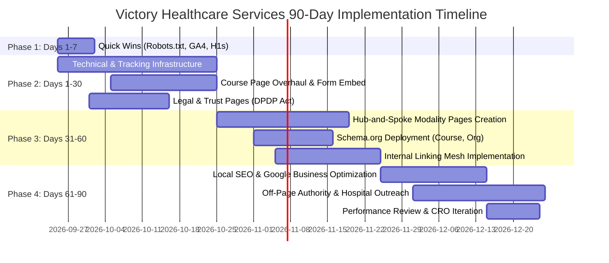
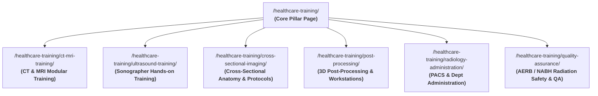

# 30-60-90 Day SEO & Digital Growth Roadmap
**Client Website:** https://victoryhcspl.com/  
**Primary Focus Service:** Healthcare Training (`/healthcare-training/`)  
**Target Market:** India (Bangalore / Pan-India Healthcare Professionals)  
**Audit Date:** September 24, 2026  

---

## 1. Executive Implementation Summary

This phased roadmap prioritizes fixes based on **Impact ÷ Effort**. The site currently suffers from foundational blockers (redirected `robots.txt`, 0 analytics tracking, missing H1s on 90% of pages, no conversion forms on course pages, and zero trust/compliance pages). 

By resolving technical and tracking blockers in the first 30 days, expanding high-intent course content in Days 31–60, and scaling local authority and partnerships in Days 61–90, Victory Healthcare Services can establish a dominant organic presence in India's medical imaging and healthcare training space.



---

## 2. Immediate Quick Wins (Days 1–7: Fast-Track Impact)

*Goal: Fix zero-cost, high-leverage technical and tracking flaws (each under ~2 hours).*

| Task ID | Action Item | Affected Component | Effort | Owner | Verification Method |
|---|---|---|---|---|---|
| **QW-01** | Deploy valid `robots.txt` file returning HTTP 200 with Sitemap directive | Server / Root | S (30m) | Developer | `curl -I https://victoryhcspl.com/robots.txt` (must return 200 text/plain) |
| **QW-02** | Install Google Tag Manager (GTM) & GA4 property across all pages | Global `<head>` | S (1h) | SEO / Dev | Tag Assistant / Real-time events in GA4 |
| **QW-03** | Fix header logo linking to 301-redirected `/home/` URL | Elementor Header | S (15m) | Developer | Verify logo href points to `https://victoryhcspl.com/` |
| **QW-04** | Inject missing <h1> tag on `/healthcare-training/` | Primary Service | S (30m) | Content/Dev | Inspect DOM: `<h1>Comprehensive Healthcare & Medical Imaging Training Programs</h1>` |
| **QW-05** | Fix dummy `#!` links on menu item "Services" to kill crawl loops | Navigation Menu | S (30m) | Developer | Screaming Frog re-crawl confirms 0 `/#!` URLs |
| **QW-06** | Replace auto-scraped meta descriptions on top 10 pages | AIOSEO / Pages | S (1.5h) | Content | Character count 140–160 chars; no breadcrumb scrapings |
| **QW-07** | Fix single-hop redirect for `http://www` (remove 2-hop chain) | Nginx vhost config | S (30m) | Developer | `curl -I http://www.victoryhcspl.com/` (must 301 directly to https://) |
| **QW-08** | Add missing `alt` attributes to primary header logos and banners | Media Library | S (45m) | Content | Browser DevTools confirms `alt='Victory Healthcare Services Logo'` |
| **QW-09** | Update outdated footer copyright year from 2024 to 2026 | Footer Template | S (15m) | Developer | Live footer check |
| **QW-10** | Add WhatsApp click-to-chat conversion trigger in GTM | Chaty Widget | S (45m) | SEO | GA4 Custom Event: `whatsapp_chat_click` |

---

## 3. Phase 1: Days 1–30 (Technical & Conversion Foundation)

*Primary Objective: Ensure 100% crawlability, eliminate security vulnerabilities, establish full attribution tracking, and convert existing traffic.*

### 3.1 Tracking, Analytics & Conversion Setup (Week 1–2)
1. **Google Search Console & Bing Webmaster Tools:**
   - Verify domain property via DNS TXT record in Plesk/Hostinger.
   - Submit clean sitemaps: `https://victoryhcspl.com/sitemap.xml`.
2. **Event & Funnel Tracking:**
   - Configure GA4 enhanced measurement.
   - Implement custom events: `lead_form_submitted`, `whatsapp_click`, `phone_call_click`, `brochure_download`.
3. **Primary Service Page (`/healthcare-training/`) Conversion Injection:**
   - Embed a dedicated Lead Capture Form above the fold:
     - Fields: Name, Phone (+91), Email, Course of Interest (CT/MRI, Ultrasound, Post-Processing, Radiology Admin), Background (Doctor, Radiographer, Technician, Student).
   - Add floating "Quick Admission Enquiry" button on mobile viewports.

### 3.2 Security & Infrastructure Hardening (Week 2–3)
1. **HTTP Security Headers Configuration:**
   - Add the following directives in Nginx configuration:
     ```nginx
     add_header X-Frame-Options "SAMEORIGIN" always;
     add_header X-Content-Type-Options "nosniff" always;
     add_header Referrer-Policy "strict-origin-when-cross-origin" always;
     add_header Permissions-Policy "camera=(), microphone=(), geolocation=()" always;
     ```
2. **Hide Server Footprints:**
   - Configure `server_tokens off;` in Nginx.
   - Disable `X-Powered-By: PleskLin` header via FastCGI / PHP settings (`expose_php = Off`).
3. **Eliminate Redundant Root Script Request:**
   - Audit Autoptimize / WP Fastest Cache concatenation to resolve `REQ: script https://victoryhcspl.com/`.

### 3.3 Legal & Compliance Deployment (Week 3–4)
1. **India DPDP Act 2023 Compliance:**
   - Publish `/privacy-policy/` covering Data Fiduciary details, purpose of collecting enquiry numbers, storage safeguards, and grievance redressal contact.
   - Publish `/terms-and-conditions/` and `/refund-policy/` (admissions cancellation & refund terms).
   - Add a lightweight cookie and data consent notice on all enquiry forms.
2. **Professional Communications:**
   - Provision business email accounts (e.g., `training@victoryhcspl.com`, `admissions@victoryhcspl.com`) to replace the generic `@gmail.com` address.

---

## 4. Phase 2: Days 31–60 (Content Expansion, Modality Hub & E-E-A-T)

*Primary Objective: Build deep topical authority around Medical Imaging and Radiology training in India.*

### 4.1 Architecture & Hub-and-Spoke Expansion (Week 5–7)
Create dedicated modality landing pages linked from `/healthcare-training/`:



Each child course page must include:
- **Target Audience & Prerequisites:** (e.g. B.Sc Medical Imaging Technology, DMRD, DNB, Diploma).
- **Curriculum Outline:** 6–8 module syllabus breakdown with learning objectives.
- **Duration & Batch Formats:** Weekend vs. Weekday, Online theory + Onsite practical hours.
- **Tools & Workstations Covered:** Siemens Syngo, GE AW, Vitrea, PACS integration.
- **Certification & Evaluation:** Assessment criteria and certificate of completion.
- **Dedicated Enquiry Form & Downloadable PDF Syllabus.**

### 4.2 E-E-A-T & Trust Elevation (Week 7–8)
1. **Faculty & Advisory Board Profiles:**
   - Create a dedicated "Course Mentors & Faculty" block on `/healthcare-training/` and child pages.
   - Highlight **Mr. Anto Ramesh Delvi** (30 years experience, ex-Columbia Asia, 300+ imaging officers trained) and **Mr. Vijaya Kumar C** (19+ years experience, Columbia Asia/Manipal).
2. **Structured Data Implementation:**
   - Deploy `EducationalOrganization` schema on the root domain.
   - Deploy `Course` and `CourseInstance` schemas on course landing pages.
   - Deploy `FAQPage` schema on `/healthcare-training/` (5–8 real FAQs).
3. **Internal Linking Mesh Execution:**
   - Implement the 20 internal linking rules mapped in `07_internal_linking_plan.csv`.

---

## 5. Phase 3: Days 61–90 (Local Authority, Off-Page & Scale)

*Primary Objective: Dominate local search in Bangalore/Karnataka, acquire institutional backlinks, and scale enquiries.*

### 5.1 Local SEO Domination (Week 9–10)
1. **Google Business Profile (GBP) Optimization:**
   - Claim or optimize Victory Healthcare Services GBP listing.
   - Set Primary Category: *Training Centre* / *Educational Institution*; Secondary: *Medical Technology Service*, *Corporate Training Program*.
   - Ensure 100% NAP consistency with site: `The Ledge Apartment, B 108 B Block, Jakkur, Yelahanka, Bangalore 560-064` (or specify dedicated training facility address).
   - Add services, high-resolution lab photos, and weekly Google Updates.
2. **Indian Directory Citations:**
   - Build consistent citations on Justdial, Sulekha, IndiaMART, YellowPages India, and Indian education portals (Shiksha, CollegeDunia paramedical listings).
3. **Student Reviews Program:**
   - Systematize post-training feedback to gather 15–25 authentic Google reviews from past trainees and hospital participants.

### 5.2 Off-Page Authority & Strategic Partnerships (Week 10–12)
1. **Hospital & Diagnostic Chain Collaborations:**
   - Highlight existing client networks (e.g., Radblox, teleradiology partners) with co-branded training announcements.
2. **Industry Mentions & Digital PR:**
   - Publish thought leadership articles by Anto Ramesh Delvi on platforms like Healthcare Radius, Express Healthcare India, and LinkedIn Articles regarding "Bridging the Paramedical Skill Gap in Indian Radiology".
3. **Education & Career Resources:**
   - Publish career guides on the blog: "How to Become a Certified CT/MRI Technologist in India", "Radiology Technologist Salary & Career Scope in Bangalore".

---

## 6. RACI Accountability Matrix

| Initiative / Deliverable | Responsible (R) | Accountable (A) | Consulted (C) | Informed (I) |
|---|---|---|---|---|
| robots.txt & Nginx Headers | Developer | Tech Lead | SEO Consultant | Client |
| GTM, GA4 & GSC Verification | SEO Consultant | Tech Lead | Developer | Client |
| Primary Service Page Content & H1 | Content Writer | SEO Consultant | Subject Matter Expert (Anto Delvi) | Client |
| Course Landing Pages Creation | Content Writer | SEO Consultant | Faculty | Developer |
| Lead Form Injection & CRO | UI/UX Designer | Tech Lead | Developer | Client |
| Privacy Policy & DPDP Alignment | Content / Legal | Client | Legal Counsel | SEO Consultant |
| Schema.org JSON-LD Integration | Developer | SEO Consultant | Content | Client |
| Google Business Profile & Citations | Local SEO Exec | SEO Consultant | Client | Operations |

---

## 7. Milestone Review & Measurement Criteria

| Timeframe | Key Deliverables Completed | Success Metric / Milestone |
|---|---|---|
| **Day 30** | QW-01 to QW-10 deployed; GA4 live; Security headers active; Enquiry form on `/healthcare-training/` | 100% Crawlability; 0 301 crawl traps; Form conversion tracking verified |
| **Day 60** | 6 Child Modality Course pages live; E-E-A-T faculty bios live; Schema validated | Initial keyword impressions for "CT MRI training", "medical imaging courses" in GSC |
| **Day 90** | GBP verified & optimized; 20+ citations built; Internal linking complete; Blog engine active | First-page rankings for local imaging training queries; 20–40 qualified monthly admissions enquiries |
