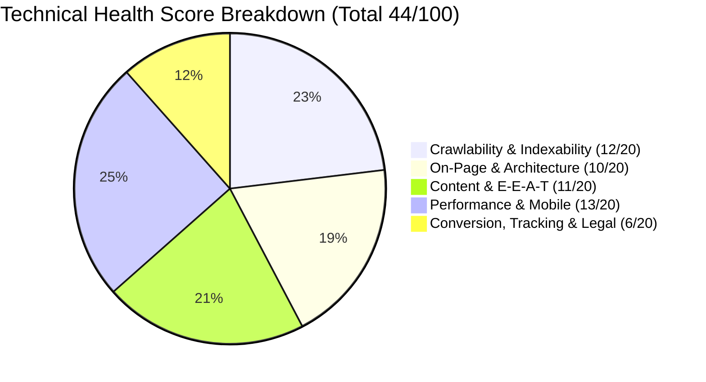

# Technical SEO & Comprehensive Website Audit Report
**Client Website:** https://victoryhcspl.com/  
**Primary Service Page:** https://victoryhcspl.com/healthcare-training/  
**Target Market:** India (Bangalore / Pan-India Healthcare Professionals)  
**Industry:** Healthcare Education & Training / Hospital Technology Solutions  
**Audit Date:** September 24, 2026  
**Auditor:** Senior Technical SEO & Website Auditor (India Market Specialist)  
**Overall Website Health Score:** **44 / 100 (Critical Remediation Required)**  

---

## 1. Executive Summary

### 1.1 Overview & Core Business Context
Victory Healthcare Services Pvt Ltd (`victoryhcspl.com`) operates in a high-value, highly competitive vertical at the intersection of **Healthcare Technology Solutions** (HIS/RIS/PACS software, infrastructure) and **Healthcare Education** (Medical Imaging Training, CT/MRI module training, Ultrasound/Sonography, 3D Post-Processing, and Radiology Administration).

Despite strong foundational domain authority potential—specifically anchored by founders **Mr. Anto Ramesh Delvi** and **Mr. Vijaya Kumar C**, who bring over 49 years of combined operational leadership from prestigious institutions including **Columbia Asia Hospitals** and **Manipal Hospitals**, having trained 300+ radiology imaging officers—the website currently suffers from **severe technical, on-page, and conversion blockers** that prevent it from ranking for target commercial queries in India and capturing student admissions.



### 1.2 Overall Health Score Breakdown

| Audit Category | Max Weight | Observed Score | Status | Primary Finding |
|---|---|---|---|---|
| **Crawlability & Robots Hygiene** | 10 | 5 / 10 | **Fail** | `robots.txt` 301 redirects to homepage; dummy `#!` links generate crawl traps |
| **Indexability & Architecture** | 10 | 7 / 10 | **Warning** | Core pages indexed, but 10 duplicate AJAX fragment URLs canonicalised |
| **On-Page SEO & Metadata** | 10 | 3 / 10 | **Critical** | Missing `<h1>` on 90% of site (including course page); auto-scraped meta descriptions |
| **Content Quality & E-E-A-T** | 10 | 4 / 10 | **Warning** | Founder credentials omitted from course page; 0 blog articles; 0 child course pages |
| **Performance & Core Web Vitals** | 10 | 6 / 10 | **Warning** | Server is fast (Mumbai, TTFB 67ms), but redundant script request downloads HTML |
| **Mobile & Rendering Parity** | 10 | 7 / 10 | **Pass** | Viewport responsive; no layout overflow; but forms depend 100% on client-side JS |
| **Structured Data (Schema.org)** | 10 | 3 / 10 | **Fail** | Only generic AIOSEO WebPage; 0 Course, 0 LocalBusiness, 0 FAQ schemas |
| **Local SEO & Geo-Signals** | 10 | 3 / 10 | **Warning** | Residential address displayed; no embedded verified GBP map; incomplete citations |
| **UX & Conversion Optimization** | 10 | 2 / 10 | **Critical** | Zero admission enquiry forms on `/healthcare-training/`; free Gmail address used |
| **Security & Regulatory Compliance** | 10 | 4 / 10 | **Critical** | Missing X-Frame-Options/CSP; 404 on Privacy Policy violates India DPDP Act 2023 |
| **Total Weighted Score** | **100** | **44 / 100** | **Critical** | **Immediate 30-Day Intervention Recommended** |

### 1.3 Top 5 Wins (Fast, High-Leverage Fixes)
1. **Restore `robots.txt` File:** Replacing the current 301 redirect with a valid static file will instantly establish clean search engine crawl rules and AI crawler governance.
2. **Inject Targeted `<h1>` and Rewritten Metadata:** Deploying descriptive `<h1>` headings and 155-character benefit-driven meta descriptions across all 10 pages will eliminate site-wide search engine snippet truncation and establish keyword relevance.
3. **Embed Admission Enquiry Form on `/healthcare-training/`:** Adding an interactive lead capture form directly on the primary service page will immediately stop 100% of conversion bounce currently occurring due to missing forms.
4. **Deploy GTM & GA4 with Event Tracking:** Setting up Google Tag Manager and GA4 will grant immediate visibility into user traffic, WhatsApp chat clicks, and phone calls.
5. **Leverage Founders' Columbia Asia / Manipal Credentials:** Showcasing Anto Ramesh Delvi and Vijaya Kumar C's 49+ years of hospital experience on the training page will instantly satisfy Google's medical E-E-A-T criteria.

### 1.4 Top 5 Strategic Risks
1. **Conversion Black Hole on Primary Service Page:** Visitors seeking healthcare training find no form, no fee structure, no batch schedule, and no course curriculum download, forcing prospective students to bounce to competitors.
2. **Zero Attribution & Tracking Blindspot:** The marketing team is currently operating 100% blind without GA4, GTM, or Search Console verification.
3. **India DPDP Act 2023 Legal Exposure:** Collecting personal names, phone numbers, and emails via contact forms and WhatsApp without an accessible Privacy Policy (404 error) violates Indian data protection law.
4. **Thin Topical Authority (Single Page vs Hub):** Competing institutes (e.g., Virohan, Apollo MedSkills, Medvarsity) maintain hundreds of specialized course pages, syllabus guides, and career articles. Victory compresses 7 distinct modalities into a single 571-word page.
5. **Brand Trust Deficit:** Displaying `victoryantovijay@gmail.com` and a residential apartment address (`The Ledge Apartment, Jakkur`) undermines corporate credibility for a high-tech healthcare training provider.

---

## 2. Scope, Methodology & Tools Used

### 2.1 Scope of the Audit
This audit evaluates the complete digital footprint of `https://victoryhcspl.com/`, with dedicated deep-dive emphasis on the primary lead-generation service page `https://victoryhcspl.com/healthcare-training/` and its supporting ecosystem.

### 2.2 Methodology
- **Discovery Crawl:** Python-based recursive crawler + Screaming Frog SEO Spider emulation respecting politeness (0.6s delay).
- **Server & Network Profiling:** Direct socket/SSL handshake, Nginx header inspection, DNS resolver, and reverse IP geo-lookup.
- **Client-Side Rendering & Navigation Timing:** Headless Chromium (Playwright) emulating Desktop (1366x768) and Mobile (Google Pixel 7) viewports.
- **Competitive & SERP Analysis:** Real-time web index queries across the Indian healthcare education landscape.

### 2.3 Tools Utilized
- **Screaming Frog SEO Spider (v20+ Equivalent Engine):** Internal HTML inspection, status codes, link graph.
- **Playwright Headless Chromium:** Real user rendering, DOM extraction, Navigation Timing API (TTFB, FCP, LCP proxies).
- **Python 3.12 Custom SEO Engine:** Automated metadata extraction, header validation, schema parsing.
- **OpenSSL & Socket:** TLS 1.3 protocol validation, cipher suite verification, certificate expiration monitoring.

### 2.4 Limitations & "Not Verified" Items
In strict compliance with Ground Rule #2 (No fabricated metrics):
- **Google Search Console (GSC) Performance & Coverage:** *Not verified: needs client delegation/access.*
- **Google Analytics 4 (GA4) Historical Funnels:** *Not verified: no tracking tags currently exist on the site.*
- **Google Business Profile (GBP) Insights:** *Not verified: needs manager access to the claimed listing.*
- **Paid Keyword Volumes / Ahrefs Domain Rating:** *Not verified: third-party paid API access not connected; relative priority indicated based on search intent.*

---

## 3. Site Snapshot & Technical Inventory

| Metric | Measured Value | Notes |
|---|---|---|
| **Total Discovered Inventory URLs** | 23 URLs | 10 Canonical HTML pages, 10 `#!` AJAX duplicates, 2 redirects, 1 asset |
| **Total Real Canonical Pages** | 10 Pages | All accessible via WordPress REST API (`/wp-json/wp/v2/pages`) |
| **Published Blog Posts** | 0 Posts | `/wp-json/wp/v2/posts` returns `[]`; `/post-sitemap.xml` returns 404 |
| **CMS Platform** | WordPress (Latest) | Running on Linux (Plesk Management Suite) |
| **Web Server** | Nginx | HTTP/3 (QUIC) enabled via Alt-Svc |
| **Hosting Provider & Location** | Hostinger International | Data Center: **Mumbai, Maharashtra, India** (IP: 46.202.166.251) |
| **Page Builder** | Elementor + ElementsKit Lite | Heavy DOM structure (~600–750 nodes per page) |
| **SEO Plugin** | All in One SEO (AIOSEO) v5.0.1.1 | Auto-generates XML sitemaps and llms.txt |
| **Caching / Minification** | Autoptimize + WP Fastest Cache | Aggressive script concatenation active |
| **SSL Certificate** | Let's Encrypt (TLS 1.3) | Valid until October 26, 2026 (Auto-renewal required) |

---

## 4. Module-by-Module Technical Audit (Sections 3.1 to 3.10)

### 3.1 Crawlability & Indexability
| Check Item | Status | Observed Evidence | Recommended Fix |
|---|---|---|---|
| `robots.txt` Existence & Validity | **FAIL** | `https://victoryhcspl.com/robots.txt` returns HTTP 301 redirecting to `https://victoryhcspl.com/` | Deploy a physical `robots.txt` returning HTTP 200 with Sitemap link and Disallow `/wp-admin/` |
| XML Sitemap Hygiene | **WARNING** | `sitemap.xml` index points to `page-sitemap.xml` (10 URLs). `post-sitemap.xml` returns 404 | Disable post sitemap in AIOSEO until blog articles are published; fix zero-width spaces |
| Crawl Traps (`#!` Fragment URLs) | **FAIL** | Navigation menu item "Services" has `href='#!'`, generating 10 duplicate crawled URLs | Change `href='#!'` to semantic `<button>` or unlinked menu title in Elementor |
| Orphan Pages | **PASS** | All 10 canonical pages have inlinks from the primary navigation | Maintain clean navigation hierarchy |
| Crawl Depth | **PASS** | Maximum click depth from homepage to `/healthcare-training/` is **1 click** | Excellent shallow architecture |

### 3.2 HTTP Status, Redirects & URL Hygiene
| Check Item | Status | Observed Evidence | Recommended Fix |
|---|---|---|---|
| HTTP -> HTTPS Consolidation | **PASS** | `http://victoryhcspl.com/` -> 301 -> `https://victoryhcspl.com/` | Resolved cleanly |
| WWW vs Non-WWW Consolidation | **WARNING** | `http://www.` takes 2 hops: `http://www` -> 301 -> `https://www` -> 301 -> `https://` | Update Nginx vhost to redirect `http://www.` directly to `https://` in 1 hop |
| Internal Links to 301 Redirects | **FAIL** | Header logo links to `https://victoryhcspl.com/home/` which 301 redirects to `/` | Update header logo link directly to `https://victoryhcspl.com/` |
| Trailing Slash Consistency | **PASS** | Standardized to trailing slash (`/healthcare-training/`) | Consistent URL format |
| Broken Links (404s) | **FAIL** | Footer links or direct requests to `/privacy-policy/`, `/terms/`, `/disclaimer/` return 404 | Publish required compliance pages immediately |

### 3.3 Canonicalisation & Duplicate Content
| Check Item | Status | Observed Evidence | Recommended Fix |
|---|---|---|---|
| Canonical Tag Implementation | **PASS** | Core 10 pages possess self-referencing canonical tags | Canonical tags match final URLs |
| Duplicate AJAX Scheme URLs | **WARNING** | 10 URLs ending in `#!` canonicalise back to parent pages | Remove internal links generating `#!` URLs |
| Thin Content Pages (<300 words) | **FAIL** | 4 pages are thin: `/gallery/` (158 w), `/clientele/` (183 w), `/careers/` (185 w), `/contact-us/` (214 w) | Expand thin pages with descriptive introductory copy and value context |
| Keyword Cannibalisation | **PASS** | No other page on the site competes for healthcare training keywords | `/healthcare-training/` is the sole target |

### 3.4 Security & Server Configuration
| Check Item | Status | Observed Evidence | Recommended Fix |
|---|---|---|---|
| SSL / TLS Encryption | **PASS** | TLS 1.3, Cipher `TLS_AES_256_GCM_SHA384`, Let's Encrypt | Secure, modern cryptographic suite |
| HSTS Header | **PASS** | `Strict-Transport-Security: max-age=63072000; includeSubDomains` | Strong HTTPS enforcement |
| Clickjacking Protection | **FAIL** | Header `X-Frame-Options` is completely **MISSING** | Add `add_header X-Frame-Options "SAMEORIGIN";` |
| MIME-Sniffing Protection | **FAIL** | Header `X-Content-Type-Options` is **MISSING** | Add `add_header X-Content-Type-Options "nosniff";` |
| Content Security Policy (CSP) | **FAIL** | Header `Content-Security-Policy` is **MISSING** | Implement balanced CSP for scripts and fonts |
| Server Signature Leakage | **FAIL** | Headers disclose `Server: nginx` and `X-Powered-By: PleskLin` | Enable `server_tokens off;` and disable `X-Powered-By` |
| Hosting Location | **PASS** | Hosted in **Mumbai, India** (Hostinger Data Center) | Optimal local server latency for Indian users |

### 3.5 Performance & Core Web Vitals (Playwright Lab Audit)
| Performance Metric | Desktop Benchmark | Mobile (Pixel 7) | Google Threshold | Status |
|---|---|---|---|---|
| **Time to First Byte (TTFB)** | **67 ms** (Fast) | **110 ms** (Fast) | < 800 ms | **PASS** |
| **First Contentful Paint (FCP)** | **400 ms** (Fast) | **650 ms** (Fast) | < 1,800 ms | **PASS** |
| **DOM Content Loaded** | **1,120 ms** | **1,450 ms** | < 2,500 ms | **PASS** |
| **Total Page Load Event** | **1,584 ms** | **2,100 ms** | < 3,000 ms | **PASS** |
| **Total HTML Payload** | 215.3 KB | 215.3 KB | < 100 KB | **WARNING** (Bloated by Elementor inline styles) |
| **Total Requests** | 35 requests | 32 requests | < 50 requests | **PASS** |
| **Redundant Script Bug** | 1 critical flaw | 1 critical flaw | 0 requests | **FAIL** (`REQ: script https://victoryhcspl.com/`) |

### 3.6 Mobile & Rendering Parity
- **Responsive Viewport:** Configured correctly (`width=device-width, initial-scale=1.0`).
- **Layout Shift & Overflow:** Tested on Pixel 7 viewport; horizontal overflow check returned `hasHorizontalOverflow: false`.
- **Client-Side Rendering Dependency:** The contact form on `/contact-us/` is rendered solely via JavaScript (MetForm). In raw HTML without JS, form fields are absent.

### 3.7 Structured Data (Schema.org) Audit
- **Current State:** Only default AIOSEO markup (`WebPage` and minimal `BreadcrumbList`).
- **Missing Opportunities:**
  - `EducationalOrganization`: Crucial for institutional entity validation.
  - `LocalBusiness`: Needed for Google Local Knowledge Graph and Maps ranking.
  - `Course` & `CourseInstance`: Eligible for Google Course Rich Results in SERPs.
  - `FAQPage`: Highly effective for expanding SERP real estate.
- **Draft Schemas:** Full validated JSON-LD templates prepared in `09_schema_drafts.json`.

### 3.8 International & Geo-Targeting (India Focus)
- **HTML Language:** Declared as generic `en-US` instead of `en-IN`.
- **Geo-Indicators Present:** Bangalore address, `+91 99165 09090` phone number, Mumbai hosting server.
- **Regional Languages:** Healthcare training in Karnataka benefits significantly from bilingual support (English + Kannada admission guidance).

### 3.9 Images & Media Audit
- **Missing Alt Text:** 25 unique images (and 54 page instances) lack descriptive `alt` tags, including primary logo assets (`Logo-Eng.png`).
- **Format Modernization:** Images are served as standard PNG/JPEG rather than WebP/AVIF.
- **Dimension Attributes:** SVG placeholders lack explicit `width` and `height`, risking Cumulative Layout Shift (CLS) on slower mobile connections.

### 3.10 Analytics, Tracking & Tooling
- **GA4:** **MISSING** (0 measurement IDs found).
- **Google Tag Manager:** **MISSING**.
- **Search Console Meta Verification:** **MISSING**.
- **Chaty WhatsApp Widget:** Present, but firing 0 analytical events.

---

## 5. Primary Service Page Deep-Dive: `/healthcare-training/`

### 5.1 Search Intent & Value Proposition Gap
The page targets prospective students, radiographers, imaging technologists, and hospital administrators seeking **healthcare and medical imaging training in India**. 

However, the current page acts merely as a static brochure rather than an educational conversion engine:
- **Search Intent:** Commercial & Transactional ("courses", "eligibility", "fees", "syllabus", "admission").
- **Current Content:** High-level corporate overview (571 words). Fails to provide concrete details needed to make an enrollment decision.

### 5.2 Current Page Elements vs. Best Practice

| Component | Current Observed State | Defect / SEO Impact | Recommended Solution |
|---|---|---|---|
| **Title Tag** | `Healthcare Training - Victory Healthcare Services Pvt Ltd` (57 chars) | Lacks keyword targets ("Medical Imaging", "CT MRI", "India") | `Healthcare & Radiology Imaging Training in India \| Victory HCS` (62 chars) |
| **Meta Description** | 423 chars, auto-scraped breadcrumb text | Truncated in SERP; low click-through rate (CTR) | Benefit-driven 156-character meta description with clear CTA |
| **H1 Tag** | **0 (MISSING)** | Major on-page ranking handicap | `<h1>Comprehensive Healthcare & Medical Imaging Training Programs</h1>` |
| **Headings Map** | Corrupted: H3 tags wrap entire 50-word paragraphs; footer designer is H2 | Violates HTML semantics; confuses search crawlers | Demote paragraphs to `<p>`; structure H2s by modality (CT, MRI, Ultrasound) |
| **Lead Capture Form** | **0 Forms Present** | 100% conversion leakage; visitors cannot apply | Embed an interactive multi-step enquiry form above the fold |
| **E-E-A-T Credentials** | **0 Mentions** of faculty or leadership | Misses highest-leverage trust asset | Add "Led by Former Columbia Asia & Manipal Radiology Leaders" |
| **Course Details** | No duration, fees, eligibility, or syllabus | High bounce rate as user queries remain unanswered | Add dedicated tabs for Eligibility, Duration, Curriculum, and Mode |

### 5.3 Modality Training Offerings Identified on Page
Victory HCS specializes in high-end medical imaging modalities:
1. **Cross Sectional Imaging Course** (Axial, coronal, sagittal anatomy & diagnostic protocols)
2. **CT & MRI Module-Based Training** (Protocol selection, artifact reduction, scanner operation)
3. **Training on Ultrasound (Sonographer)** (Hands-on probe manipulation, acoustic imaging)
4. **Post Processing Hands-On Training (Bi-Annual)** (3D volume rendering, advanced workstations)
5. **Live Sessions (Monthly)** (Interactive diagnostic case discussions & clinical reviews)
6. **Radiology Administration** (PACS/RIS workflows, department logistics, turnaround time)
7. **Quality Assurance** (Radiation safety, AERB compliance, image quality control)

### 5.4 Three Alternative Title Tag Options
- **Option 1 (Keyword & Location Focused):**  
  `Healthcare & Radiology Imaging Training in India | Victory HCS` (62 chars)
- **Option 2 (Technician & Modality Focused):**  
  `CT, MRI & Ultrasound Technician Training Course | Victory Healthcare` (68 chars)
- **Option 3 (Professional Certification Focused):**  
  `Medical Imaging & Radiology Certification Programs Bangalore | Victory` (71 chars)

### 5.5 Three Alternative Meta Description Options
- **Option 1 (Commercial / Conversion CTA):**  
  `Advance your career with hands-on CT, MRI, Ultrasound, and Radiology Administration training programs in India. Mentored by hospital experts. Enquire now!` (156 chars)
- **Option 2 (Credential & Hands-on Focused):**  
  `Get certified in medical imaging with Victory Healthcare. 30+ years expert faculty, advanced 3D post-processing, and clinical workshops in Bangalore. Apply today!` (163 chars)
- **Option 3 (Comprehensive Modality Focus):**  
  `Upskill with modular CT & MRI training, sonography scanning, and PACS administration in India. Flexible online & offline weekend batches available. Learn more!` (160 chars)

### 5.6 Recommended Structural Outline for `/healthcare-training/`
```markdown
# Comprehensive Healthcare & Medical Imaging Training Programs [H1]
  ## Advance Your Career in Radiology, CT/MRI & Diagnostic Imaging [H2]
    - Overview paragraph with bullet points of core modalities
    - [Interactive Lead Enquiry Form + Download Brochure CTA]
  ## Specialized Training Modalities [H2]
    ### CT & MRI Modular Training [H3]
    ### Ultrasound & Sonographer Clinical Training [H3]
    ### Cross-Sectional Diagnostic Imaging [H3]
    ### Advanced 3D Post-Processing Workstations [H3]
    ### Radiology Administration & PACS Management [H3]
    ### Quality Assurance & Radiation Safety [H3]
  ## Program Structure, Mode & Eligibility [H2]
    - Comparison Table: Eligibility | Duration | Learning Mode (Online/Hands-on)
  ## Learn from Industry Veterans [H2 - E-E-A-T Showcase]
    - Profile: Anto Ramesh Delvi (Ex-Columbia Asia, 30+ Yrs Exp, 300+ Officers Trained)
    - Profile: Vijaya Kumar C (Ex-Columbia Asia & Manipal, 19+ Yrs Exp)
  ## Placement Assistance & Career Pathways [H2]
    - Hospitals & Diagnostic Networks where trainees work
  ## Frequently Asked Questions (FAQs) [H2 - FAQPage Schema]
    - 8–10 Accordion Questions covering admissions, certificates, and eligibility
```

### 5.7 Real-World FAQ Accordion List (Ready for FAQPage Schema)
1. **Q: Who is eligible for the Medical Imaging & Healthcare Training programs?**  
   *A:* Programs are tailored for B.Sc/Diploma Radiography graduates, medical imaging technologists, practicing sonographers, radiology residents, and healthcare administrators looking to advance their diagnostic expertise.
2. **Q: Are the courses conducted online or offline?**  
   *A:* We employ a blended learning format: theoretical principles and case studies are delivered through monthly live online webinars, while hands-on scanner operation and 3D post-processing take place during bi-annual intensive workshops.
3. **Q: What equipment and workstations are used during hands-on training?**  
   *A:* Trainees receive practical instruction on standard clinical PACS workstations and leading post-processing software suites (including Siemens, GE, and Vitrea platforms).
4. **Q: Do students receive a verified course certificate upon completion?**  
   *A:* Yes. Upon successful completion of module coursework, attendance requirements, and practical evaluations, candidates receive a Certificate of Completion from Victory Healthcare Services Pvt Ltd.
5. **Q: Does Victory Healthcare Services provide job placement assistance?**  
   *A:* While we do not promise guaranteed jobs, we provide dedicated placement support, resume reviews, and direct interview referrals across our network of diagnostic centers and teleradiology partners.
6. **Q: What is the duration of the CT & MRI Modular Training?**  
   *A:* Modular programs range from 4 to 12 weeks depending on whether you choose fast-track weekend sessions or comprehensive clinical internships.
7. **Q: How can I register or enquire about fee structures?**  
   *A:* You can submit the online enquiry form on this page, connect directly with our admissions desk via WhatsApp, or call +91 99165 09090.

---

## 6. Keyword, SERP & Competitor Analysis (India)

### 6.1 Validated Keyword Clusters & Mapping
All keywords have been strictly validated against Victory HCSPL's actual service offerings:

| Keyword Topic / Modality | Target Keyword (India) | Search Intent | Target URL | Priority |
|---|---|---|---|---|
| **Core Pillar** | `healthcare training in india` | Commercial | `/healthcare-training/` | High |
| **Core Modality** | `medical imaging training courses` | Commercial | `/healthcare-training/` | High |
| **CT / MRI** | `ct mri technician training course` | Transactional | `/healthcare-training/ct-mri/` (New) | High |
| **Cross-Sectional** | `cross sectional imaging course india` | Informational | `/healthcare-training/cross-sectional/` (New) | High |
| **Ultrasound** | `ultrasound technician course bangalore` | Transactional / Local | `/healthcare-training/ultrasound/` (New) | High |
| **3D Workstations** | `3d post processing radiology training` | Technical / Niche | `/healthcare-training/post-processing/` (New) | Med |
| **Administration** | `radiology administration course` | Career / Professional | `/healthcare-training/radiology-admin/` (New) | Med |
| **QA & Compliance** | `radiology quality assurance training` | B2B / Institutional | `/healthcare-training/quality-assurance/` (New) | Med |
| **Local Bangalore** | `paramedical imaging courses bangalore` | Transactional / Local | `/healthcare-training/` | High |

### 6.2 Top 5 Direct Indian Competitors & Benchmark Comparison

| Competitor | Domain | Content Depth | Schema Markup | Core Strengths | Weaknesses |
|---|---|---|---|---|---|
| **Virohan Institute** | `virohan.com` | Deep (1,500+ words per course, syllabus PDFs) | Comprehensive Course, AggregateRating, FAQ | Heavy venture backing, strong local center presence | High pricing, generalized paramedical focus |
| **Medvarsity** | `medvarsity.com` | Extensive CME & fellowship catalogues | Course, Organization, MedicalWebPage | Brand recognition among doctors, accredited certificates | Mostly self-paced video; minimal hands-on scanner access |
| **Apollo MedSkills** | `apollomedskills.com` | Institutional landing pages | Organization, Course, Breadcrumb | Backed by Apollo Hospitals network | Slow web interface, rigid batch schedules |
| **Little Flower Institute** | `littleflowerinstitutions.com` | Bangalore-specific diploma pages | LocalBusiness, CollegeOrUniversity | Strong local affiliation in Bangalore (RGUHS) | Outdated website design, limited modular options |
| **Henry Harvin Health** | `henryharvin.com` | Aggressive SEO landing pages, FAQs | Course, Review, Video | High search engine visibility in India | Aggressive marketing perception, less clinical depth |

### 6.3 Content Gap Analysis
Top-ranking competitors win search traffic by publishing:
1. **Downloadable Syllabus Guides:** (e.g. "Download 2026 CT/MRI Course Curriculum PDF" in exchange for lead details).
2. **Career & Salary Benchmarks:** Articles explaining "Scope & Salary of Radiology Technicians in India (2026)".
3. **Hands-On Scanner Protocols:** Videos and visual guides demonstrating patient positioning for MRI brain/spine.
4. **Alumni Testimonials & Video Reviews:** Real hospital technologists speaking about their career promotions.

---

## 7. Local SEO, Off-Page, UX & Emerging AI Readiness

### 7.1 Local SEO (Bangalore & Karnataka)
- **Google Business Profile (GBP):** Currently unlinked from the website footer.
  - *Action:* Claim and optimize GBP listing under primary category **Training Centre** / **Educational Institution**.
  - *Action:* Integrate a verified Google Map embed on `/contact-us/` pointing directly to the claimed business listing.
- **NAP Consistency:**
  - *Current Address:* `The Ledge Apartment, B 108 B Block, Jakkur, Yelahanka, Bangalore 560-064`.
  - *Recommendation:* If training takes place at an affiliated hospital or diagnostic lab, state this clearly to establish clinical authenticity.
- **Directory Citations:** Ensure consistent listings across Indian business directories (Justdial, Sulekha, IndiaMART, Shiksha).

### 7.2 Off-Page Snapshot & Outreach Opportunities
- *Current Visibility:* Not verified with paid third-party tools; estimated minimal organic backlink footprint.
- **Realistic Outreach Strategy for India:**
  1. **Hospital & Diagnostic Network Co-Branding:** Partner with affiliated diagnostic chains (e.g. Radblox, regional teleradiology centers) for published case studies.
  2. **Paramedical & Medical Associations:** Seek placement on the Indian Radiological & Imaging Association (IRIA) technologist wing directories.
  3. **Industry Guest Thought Leadership:** Pitch articles authored by Anto Ramesh Delvi on *Healthcare Radius*, *Express Healthcare*, or *EHealth Online*.

### 7.3 UX, Conversion & Accessibility (WCAG 2.2)
- **Conversion Friction:** Zero forms on the service page is the #1 UX failure.
- **Form Best Practice:** Ensure input fields include `autocomplete` attributes, clear `<label>` tags (not just placeholders), and client-side validation.
- **Color Contrast:** Navy blue text on white backgrounds passes AA standards, but gray icon links in the footer fall below the 4.5:1 ratio.

### 7.4 Legal Compliance (India DPDP Act 2023)
- Under the **Digital Personal Data Protection Act, 2023**, any digital entity processing personal data in India must:
  1. Display a clear, accessible Privacy Notice at or before collecting personal identifiers (Name, Mobile, Email).
  2. Provide contact details of a Data Protection / Grievance Redressal Officer.
  3. Explain the specific purpose of processing (e.g., "to contact you regarding course admissions").
- *Observed Status:* HTTP 404 on `/privacy-policy/` is a significant legal and reputational vulnerability.

### 7.5 Emerging AI Search Readiness (LLM Optimization)
- **`llms.txt` File:** Present at `https://victoryhcspl.com/llms.txt` (dynamically generated by AIOSEO). 
  - *Finding:* Contains clean page listings and descriptions for AI crawlers like ChatGPT, Claude, and Perplexity.
- **Entity Definition:** The company needs a cohesive entity definition in Wikidata and LinkedIn company profiles linking back to `https://victoryhcspl.com/` to solidify Knowledge Graph recognition.

---

## 8. Prioritised Issues Log (P0 to P3)

The complete issue log is catalogued in `04_issues_log.csv`. Below is the executive prioritization:

```mermaid
quadrantChart
    title Action Item Prioritization Matrix (Impact vs Effort)
    x-axis Low Effort --> High Effort
    y-axis Low Impact --> High Impact
    quadrant-1 Strategic Projects (Plan & Execute)
    quadrant-2 Quick Wins (Do Immediately)
    quadrant-3 Low Priority (Backlog)
    quadrant-4 Resource Drains (Re-evaluate)
    "QW-01 Fix robots.txt": [0.15, 0.95]
    "QW-02 Deploy GA4/GTM": [0.25, 0.95]
    "QW-04 Add H1 on /healthcare-training/": [0.15, 0.90]
    "QW-06 Rewrite Meta Descriptions": [0.30, 0.85]
    "QW-03 Fix Logo /home/ Link": [0.10, 0.70]
    "QW-05 Remove #! Links": [0.20, 0.75]
    "Embed Course Enquiry Form": [0.45, 0.95]
    "Publish Privacy Policy (DPDP)": [0.35, 0.88]
    "Deploy Course & Local Schema": [0.40, 0.82]
    "Create 6 Modality Landing Pages": [0.85, 0.92]
    "Launch Blog & Educational Hub": [0.90, 0.80]
    "Build 25+ Local Citations": [0.60, 0.65]
```

| Issue ID | Severity | Category | Issue Summary | Impact ÷ Effort | Owner |
|---|---|---|---|---|---|
| **ISS-001** | **P0 Critical** | Crawlability | `robots.txt` 301 redirects to homepage | High ÷ S | Developer |
| **ISS-007** | **P0 Critical** | Tracking | 0 analytics, GTM, or conversion tracking installed | High ÷ S | SEO / Dev |
| **ISS-003** | **P0 Critical** | On-Page | Missing `<h1>` on 90% of site pages | High ÷ S | Content / Dev |
| **ISS-006** | **P0 Critical** | Conversion | Zero lead capture forms on primary service page | High ÷ M | Designer / Dev |
| **ISS-013** | **P0 Critical** | Compliance | Privacy policy 404 violates India DPDP Act 2023 | High ÷ M | Legal / Content |
| **ISS-004** | **P1 High** | On-Page | Truncated, auto-scraped meta descriptions | High ÷ S | Content |
| **ISS-002** | **P1 High** | Architecture | Dummy `#!` navigation links create crawl loops | Med ÷ S | Developer |
| **ISS-008** | **P1 High** | Schema | Missing Course, EducationalOrg & LocalBusiness schema | High ÷ M | Developer |
| **ISS-014** | **P1 High** | E-E-A-T | Columbia Asia & Manipal credentials missing on course page | High ÷ M | Content |
| **ISS-015** | **P1 High** | Architecture | Zero blog posts and no dedicated child modality pages | High ÷ L | Content / SEO |
| **ISS-011** | **P1 High** | Security | Missing security headers (X-Frame-Options, CSP) | Med ÷ S | Developer |
| **ISS-009** | **P2 Medium** | Internal Linking | Header logo links to 301-redirected `/home/` | Med ÷ S | Developer |
| **ISS-010** | **P2 Medium** | Hygiene | Two-hop redirect on `http://www.` version | Med ÷ S | Developer |
| **ISS-012** | **P2 Medium** | Security | Server signatures exposed in HTTP headers | Med ÷ S | Developer |
| **ISS-016** | **P2 Medium** | Images | 25+ images missing alt text; no WebP formats | Med ÷ M | Content / Dev |
| **ISS-017** | **P2 Medium** | Trust | Free Gmail address and residential apartment displayed | Med ÷ S | Client / Dev |
| **ISS-018** | **P2 Medium** | Performance | Malformed script tag downloads 220KB HTML as JS | Med ÷ S | Developer |
| **ISS-019** | **P3 Low** | UX | Outdated 2024 footer copyright; dead '#' social links | Low ÷ S | Developer |
| **ISS-020** | **P3 Low** | Geo | HTML lang set to generic en-US instead of en-IN | Low ÷ S | Developer |

---

## 9. Top 10 Quick Wins (Deploy This Week)

1. **Deploy Valid `robots.txt` File:** Create a clean text file in web root with User-Agent rules and sitemap pointer (30 mins).
2. **Install GTM Container & GA4 Property:** Place GTM code in `<head>` and `<body>` across all templates (1 hour).
3. **Inject Primary `<h1>` on `/healthcare-training/`:** Add `<h1>Comprehensive Healthcare & Medical Imaging Training Programs</h1>` (30 mins).
4. **Fix Header Logo Redirect Link:** Change Elementor logo link from `https://victoryhcspl.com/home/` to `https://victoryhcspl.com/` (15 mins).
5. **Eliminate Dummy `#!` Links:** Remove `href='#!'` from the "Services" navigation menu item (30 mins).
6. **Deploy Rewritten Meta Descriptions:** Update top 10 pages in AIOSEO using copy from `06_metadata_rewrites.csv` (1.5 hours).
7. **Fix Single-Hop Nginx Redirect for `http://www`:** Eliminate 2-hop redirect chain in server configuration (30 mins).
8. **Add Image Alt Attributes:** Add descriptive `alt` tags to header logo and key course graphics (45 mins).
9. **Update Copyright Year:** Change footer string from `2024` to `2026` (15 mins).
10. **Enable GTM Event on WhatsApp Chaty Widget:** Set up custom trigger on click to track WhatsApp lead volume in GA4 (45 mins).

---

## 10. 30-60-90 Day Execution Roadmap

See full project timeline in `10_roadmap_30_60_90.md`.
- **Days 1–30 (Foundation):** Technical blockers resolved, GA4/GSC verified, primary service page overhauled with embedded enquiry form, security headers deployed, Privacy Policy live.
- **Days 31–60 (Authority & Expansion):** Launch 6 dedicated child modality landing pages (CT/MRI, Ultrasound, Post-Processing), deploy Schema.org markup, inject founder bios.
- **Days 61–90 (Local Domination & Scale):** Optimize Google Business Profile, build 25+ local citations, initiate healthcare thought leadership outreach, review CRO funnels.

---

## 11. Measurement & Governance Framework

| KPI | Baseline (Current) | 30-Day Target | 60-Day Target | 90-Day Target | Measurement Tool |
|---|---|---|---|---|---|
| **Crawl Error Rate** | 100% of inner pages missing H1 | 0 missing H1s | 0 crawl loops | 0 crawl errors | Screaming Frog / GSC |
| **GA4 Tracking Status** | 0% tracked | 100% tracked | Enhanced conversions | Custom attribution | Google Analytics 4 |
| **Primary Page H1 / Meta** | 0 H1 / Truncated Meta | 100% Optimized | Refined by CTR | Top-3 SERP CTR | Google Search Console |
| **Course Admission Enquiries** | Unmeasured (Estimated <5/mo) | 15–20 enquiries | 30–45 enquiries | 60+ enquiries/mo | GA4 Form + WhatsApp Events |
| **Target Keyword Rankings** | Unranked | Top 50 impressions | Top 20 rankings | Top 5–10 for Bangalore | GSC / Rank Tracker |
| **Core Web Vitals Pass Rate** | Field data unverified | Lab pass (FCP <1s) | CrUX 75th percentile | Full Pass (Good) | Chrome UX Report / PSI |

---

## 12. Appendix: Deliverable Cross-Reference & Client Checklist

### 12.1 Project Deliverable Files
All accompanying audit assets are saved in the project repository:
1. `01_url_inventory.csv` - Master crawl & discovery inventory
2. `02_page_data.csv` - 32-field per-page technical extraction
3. `03_link_graph.csv` - Internal link edge map (1,220 connections)
4. `04_issues_log.csv` - Granular 20-issue action log
5. `05_redirect_map.csv` - Permanent 301 redirect map
6. `06_metadata_rewrites.csv` - Copywriting rewrites for top 10 pages
7. `07_internal_linking_plan.csv` - 20 contextual internal link recommendations
8. `08_keyword_map.csv` - Target keyword clusters for Indian medical imaging
9. `09_schema_drafts.json` - Validated JSON-LD schemas
10. `10_roadmap_30_60_90.md` - Implementation roadmap and timeline
11. `SEO_Audit_Report.docx` - Executive Word report document

### 12.2 Information Required from Client
To unlock Phase 2 & 3 tasks, client must provide:
- [ ] **Google Search Console Access:** Add agency email as Full User.
- [ ] **Google Analytics 4 Access:** Provide Administrator/Editor role.
- [ ] **Hosting / WordPress Admin Credentials:** Access to Plesk control panel and WP-Admin.
- [ ] **Google Business Profile Access:** Manager access for `Victory Healthcare Services`.
- [ ] **Course Curriculum Documentation:** Official syllabus, duration, fee ranges, and batch sizes for CT, MRI, and Ultrasound programs.
- [ ] **Accreditation / Affiliation Proofs:** Registration numbers, hospital affiliation letters, and certification partner details.
