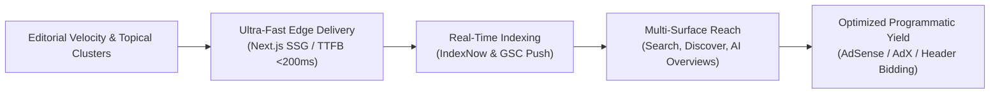

# Digital Publishing, Programmatic Monetization & Content Growth Playbook

This playbook establishes the architectural guidelines for media publishers, news portals, and content-driven growth properties. It outlines how to maximize organic discovery (Google Search, Google Discover, Google News), achieve sub-200ms Core Web Vitals, and optimize programmatic advertising yield (Google AdSense, AdX, Prebid Header Bidding).

---

## 1. The Modern Publishing Engine

Digital publishing properties rely on high-velocity organic indexing paired with high-viewability programmatic monetization. To succeed in modern generative search environments, publishers must balance editorial velocity with technical infrastructure.



---

## 2. Organic Reach & Rapid Indexing Architecture

### 1. Real-Time IndexNow Integration
Publishers cannot wait days for Google or Bing to crawl breaking content:
- **Instant Ping**: Trigger IndexNow API pings on every article publish/update event.
- **Automated XML Sitemaps**: Maintain dedicated dynamic sitemaps segmented into:
  - `news-sitemap.xml` (Articles published in the last 48 hours for Google News).
  - `sitemap-articles.xml` (Evergreen library indexed by publication date).
  - `sitemap-categories.xml` (Topical hub taxonomy).

### 2. Topical Hub & Spoke Architecture
Publishing authority is built through tight contextual clustering:
- **Pillar Hub**: Authoritative category landing pages (e.g., `/sports/`, `/local-news/`, `/finance/`).
- **Spoke Articles**: Time-sensitive or in-depth reports linking back to the parent hub with descriptive anchor text.
- **Entity Linking**: Explicitly link recurring entities (organizations, politicians, companies) to internal tag archives and external Wikipedia/Wikidata authorities.

### 3. Google Discover Optimization
Google Discover drives massive traffic spikes for publishing properties. Key factors:
- **High-Resolution Images**: Lead image width ≥ 1200px, aspect ratio 16:9, encoded in WebP/AVIF.
- **`max-image-preview:large`**: Enforce `<meta name="robots" content="max-image-preview:large">` on all article templates.
- **Engagement Hooks**: Informative, intrigue-driven headlines that answer user questions without bait-and-switch deception.

---

## 3. Core Web Vitals & Technical Infrastructure

Page speed directly impacts both organic ranking and programmatic ad revenue:

| Metric | Target | Optimization Tactic |
| :--- | :--- | :--- |
| **LCP (Largest Contentful Paint)** | < 1.8s | Preload hero article images; serve responsive WebP with `fetchpriority="high"`. |
| **FID / INP (Interaction to Next Paint)** | < 150ms | Minimize heavy third-party JavaScript; defer non-critical tracking tags. |
| **CLS (Cumulative Layout Shift)** | < 0.05 | Reserve explicit aspect-ratio containers for all ad units and embedded media. |
| **TTFB (Time to First Byte)** | < 200ms | Deploy Next.js Static Site Generation (SSG) cached across global Cloudflare / Vercel edges. |

---

## 4. Programmatic Yield & Ad Layout Architecture

Programmatic monetization requires balancing viewability scores with user reading experience:

```
[ Header Navigation ]
  ↓
[ Top Leaderboard / Billboard (970x250 or 728x90) ] - Reserved CSS container
  ↓
[ Article Title & Byline (Schema: NewsArticle / Author) ]
  ↓
[ Hero Image (1200px WebP) ]
  ↓
[ Article Body Paragraphs 1 - 3 ]
  ↓
[ In-Article High-Impact Unit 1 (300x250 / Fluid) ] - 50%+ Viewability threshold
  ↓
[ Article Body Paragraphs 4 - 6 ]
  ↓
[ In-Article High-Impact Unit 2 (Sticky Sidebar 300x600) ]
  ↓
[ Related Articles & Topical Cluster Links ]
  ↓
[ Sticky Anchor / Bottom Sticky Unit (Mobile 320x50 / 300x50) ]
```

### 3 Rules for Maximizing AdSense / AdX RPM:
1. **Ad Viewability ≥ 70%**: Ad networks pay significantly higher CPMs when impressions are visible for ≥ 1 continuous second. Never load ad units off-screen without lazy loading.
2. **Layout Shift Immunity**: Always hardcode container heights (e.g. `min-height: 250px`) so ads popping in do not shift page text, which triggers Google ranking penalties.
3. **Smart Refreshing**: For long-form editorial content, implement viewable ad refreshing (refreshing after 30 seconds of active viewport exposure).

---

## 5. Structured Data for Media: Schema JSON-LD

Every news or publishing article must output complete `NewsArticle` or `Article` JSON-LD:

```json
{
  "@context": "https://schema.org",
  "@type": "NewsArticle",
  "headline": "Article Headline Here",
  "image": [
    "https://example.com/images/16x9/lead.webp"
  ],
  "datePublished": "2026-10-27T08:00:00+00:00",
  "dateModified": "2026-10-27T09:30:00+00:00",
  "author": [{
    "@type": "Person",
    "name": "Journalist Name",
    "url": "https://example.com/authors/journalist-name"
  }],
  "publisher": {
    "@type": "NewsMediaOrganization",
    "name": "Publishing Network",
    "url": "https://example.com",
    "logo": {
      "@type": "ImageObject",
      "url": "https://example.com/logo.png"
    }
  },
  "mainEntityOfPage": {
    "@type": "WebPage",
    "@id": "https://example.com/articles/slug"
  }
}
```
