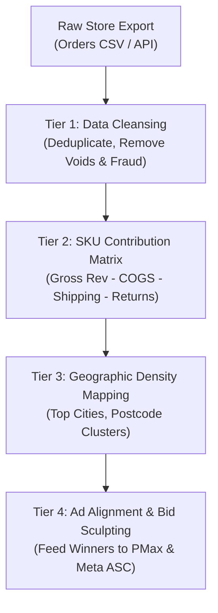

# E-Commerce Order & SKU Forensics Playbook

This playbook establishes the standard operating methodology for connecting front-end ad spend to back-end e-commerce store reality (Shopify / WooCommerce / BigCommerce). It bridges ad clicks with actual inventory, SKU-level contribution margins, repeat purchase velocity, and geographical order density.

---

## 1. The Disconnect: Ad Manager Metrics vs. Store Bank Account

Ad platforms (Meta, Google, TikTok) routinely report inflated ROAS by claiming credit for:
- View-through conversions that would have occurred organically.
- Low-margin clearance items that drive revenue but destroy net profitability.
- Cancelled, fraud-flagged, or refunded orders that never settle.

**The Golden Principle**: Never scale an ad campaign based solely on platform-reported ROAS. Scale only when validated against **Net Settled Cash Flow and SKU Contribution Margin**.

---

## 2. The 4-Tier Order Forensic Methodology

### Tier 1: Store Data Cleansing & Reconciliation
Extract store orders and clean the dataset:
- **Net Out Returns & Cancellations**: Filter out orders marked `refunded`, `voided`, or `cancelled`.
- **Deduplicate Multi-Line Items**: Group by `Order ID` to calculate true Basket Size (Items Per Order).
- **Match Canonical SKUs**: Normalize product variants (e.g., "Molar Stick - Green" and "Molar Stick - Blue" mapped to parent SKU "Dog Toothbrush Chew Toy").

### Tier 2: SKU-Level Contribution Margin Analysis
Every product must be classified into one of four margin buckets:

$$\text{Contribution Margin (£/\$)} = \text{Selling Price} - \text{COGS} - \text{Shipping/Fulfillment} - \text{Payment Gateway Fee (2.9% + 30¢)}$$
$$\text{Max Allowable CPA} = \text{Contribution Margin} \times 0.65$$

| Classification | Contribution Margin | Reorder Rate | Strategic Directive |
| :--- | :--- | :--- | :--- |
| **Hero Driver (Anchor)** | High (>55%) | High (>20% in 90d) | **Scale Front-End Spend**. Can tolerate lower ROAS (1.8x) due to strong LTV back-end. |
| **High-AOV Cash Generator** | High (>60%) | Low (<5%) | **Scale with Exact Match & Shopping**. Target ROAS ≥ 3.5x. |
| **Impulse Add-On** | Moderate (40%–50%) | N/A | **Post-Purchase Upsell / Bundle Only**. Never run standalone cold ads. |
| **Margin Drain (Loss Leader)** | Low (<30%) | Low | **Exclude from Ad Feeds immediately**. |

### Tier 3: Geographic Order Density & Postcode Clustering
Analyze order distribution by city and postal district:
- **Density Index**: Identify the top 5 cities producing >40% of net store revenue (e.g., London SW15/SW17/E11, Bristol BS14/BS11/BS5).
- **Regional Bid Modifiers**:
  - In Google Ads Search/Shopping: Apply a **+15% to +25% geo-bid adjustment** to high-converting metropolitan hubs.
  - In Meta Ads: When scaling CBO prospecting, test state/county breakout ad sets for top-performing postcodes.

### Tier 4: Cross-Platform SKU Alignment
Directly sync store winners into ad channels:
- Tag top revenue SKUs with `custom_label_0: "HERO_WINNER"` in Google Merchant Center.
- Build Meta Advantage+ Catalog product sets containing only products with >10 settled store orders and <5% return rate.

---

## 3. Real-World Field Benchmark: Pet Mode UK Case Study

Forensic analysis of Pet Mode UK's store data (`all_orders.csv` across 64+ SKU variants and UK postcodes):

1. **#1 Revenue Driver**: *Dog Toothbrush Molar Stick Dental Chew Toy*
   - 64 units sold across 56 orders (£1,042.89 net revenue, 0 refunds, AOV £16.30).
   - Directly validated the success of the `BLUE TOOTHBRUSH` Meta ad campaign (6 purchases, £30.64 CPA).
2. **High-Ticket Outlier**: *Smart Automatic Anti-Barking Collar*
   - 15 units sold (£369.63 net revenue, AOV £24.64, 0 refunds).
3. **Geographic Concentration**:
   - **London (Greater London)** captured **35 orders and £800.91 net revenue** (Top postcodes: SW15, SW17, E11).
   - **Bristol** captured **6 orders and £161.98 net revenue** (Top postcodes: BS14, BS11, BS5).
4. **Execution Decision**: Excluded elevated beds from cold Facebook Reels and reallocated budget to Molar Stick bundles targeted at London/Bristol mature pet owners.
