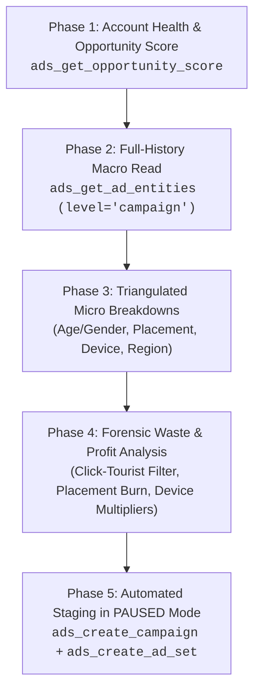

# Meta Ads MCP Forensic Audit & Optimization Playbook

This playbook establishes the operating standard for auditing, analyzing, and scaling Meta Ads accounts using the **Meta Ads Model Context Protocol (MCP)** toolset. It defines how Antigravity performance marketing agents systematically extract data, diagnose profit leaks, and deploy high-converting campaigns.

---

## 1. Meta Ads MCP Tool Architecture & Call Taxonomy

Every call to the Meta Ads MCP server must follow Meta's standardized context taxonomy:

### Mandatory Context Parameters
- `client_conversation_id`: 20-character alphanumeric session token generated once per conversation (e.g., `qK7mR2xT9vLpW4nZ8aBc`) and passed to all subsequent tool calls.
- `advertiser_job`: Standardized taxonomy enum:
  - `report_measure_or_look_up` (data retrieval)
  - `assess_and_optimize_performance` (forensic auditing)
  - `create_and_launch_new_ads` (staging new campaigns)
  - `update_existing_campaigns` (budget & bid adjustments)
- `advertiser_request`: Verbatim quoted text capturing the user's intent.
- `client_model`: Model identifier string (e.g., `gemini-2.5-pro` or lowercase agent string).

---

## 2. The 5-Phase Meta Ads MCP Audit Workflow



### Phase 1: Account Health & Opportunity Score
Call `Meta:ads_get_opportunity_score` to retrieve:
- **Account Opportunity Score (0–100)**: Meta's algorithmic health score.
- **MAPI Recommendation Inventory**: Pre-create and in-flight recommendations sorted by `opportunity_score_lift` in points.
- *Critical Agent Filter*: Discriminate between **genuine performance levers** (e.g., Advantage+ Audience signals, CAPI integration, catalog health) versus **Meta spend-expanding suggestions** (e.g., enabling low-quality Audience Network or increasing budget during learning phase).

### Phase 2: Full-History Macro Read
Call `Meta:ads_get_ad_entities` with:
```json
{
  "level": "campaign",
  "date_preset": "maximum",
  "fields": [
    "id", "name", "objective", "effective_status", "daily_budget",
    "start_time", "amount_spent", "impressions", "reach", "frequency",
    "clicks", "link_click", "ctr", "cpc", "cpm", "landing_page_view",
    "omni_view_content", "omni_add_to_cart", "omni_initiated_checkout",
    "omni_purchase", "omni_purchase_values", "purchase_roas",
    "cost_per_result"
  ],
  "sort": "amount_spent_descending",
  "limit": 100
}
```
*Key Deliverable*: Calculate account-level MER (Marketing Efficiency Ratio), identify the top 20% campaigns driving 80% of historical purchases, and flag zombie campaigns burning daily budget.

---

## 3. The 3 Triangulated Micro Breakdown Dimensions

To find the true root causes of ad profitability, execute 3 distinct calls with specific `breakdowns`:

### Breakdown 1: Demographics (`["age", "gender"]`)
Reveals the **Demographic Reality vs. Assumption Gap**:
- **Click-Tourists vs. Wallet-Openers**: Audiences with high CTR (e.g., 18–24 pet lovers clicking at 11% CTR) frequently generate 0 purchases. We calculate:
  $$\text{Purchase Conversion Efficiency} = \frac{\text{omni\_purchase}}{\text{link\_click}} \times 100$$
- **Hero Buying Demographic**: Isolate the exact gender/age cohort that generates >60% of total revenue. For Pet Mode UK, Women 45–65+ delivered 68.8% of all sales.

### Breakdown 2: Placements (`["publisher_platform", "platform_position"]`)
Reveals **Placement Burn & Impression Dilution**:
- **Facebook Mobile Feed**: Historically accounts for 75%–85% of legitimate e-commerce purchase conversions due to large screen real estate, readable copy, and clear CTA buttons.
- **Instagram Feed**: Secondary high-intent visual placement.
- **Reels (FB & IG)**: High thumb-scroll velocity, low purchase intent (<0.35x ROAS).
- **Audience Network (Rewarded Video / Classic)**: Accidental mobile app game clicks. High CTR, negligible conversion rate. Must be excised from conversion campaigns.
- *Calculation*: 
  $$\text{Feed Concentration Ratio} = \frac{\text{Feed Purchases}}{\text{Total Purchases}}$$

### Breakdown 3: Hardware & Device (`["device_platform", "impression_device"]`)
Reveals **Device Friction & Affluence Vectors**:
- **iPhone vs. Android**: Compare AOV and CPA across mobile operating systems.
- **Apple iPad**: Mature demographics (50+) heavily browse and buy from iPads in the evening. In Pet Mode UK, iPad achieved the highest ROAS across campaigns (up to 5.97x).
- **Desktop**: Often exhibits complete conversion drop-off for mobile-optimized Shopify impulse products. Exclude when Desktop purchases = 0.

---

## 4. Turning Audit Insights into a Winning Blueprint

Once the micro breakdowns are analyzed, synthesize the findings into a **Turnaround Campaign Architecture**:

| Strategy Component | Optimal Setting | Forensic Justification |
| :--- | :--- | :--- |
| **Campaign Objective** | `OUTCOME_SALES` | Algorithmic purchase optimization; eliminates click-seekers. |
| **Budget Architecture** | CBO (Campaign Budget Optimization) | Allows Meta to distribute spend across winner ad sets. |
| **Safety Status** | `PAUSED` | All staged objects default to PAUSED until human review. |
| **Demographic Filtering** | Advantage+ Audience with Age Clamp | Enforce `age_min_suggestion` to target proven buying cohorts. |
| **Placement Restraint** | Manual Placement: FB & IG Feed only | Cut Audience Network, Reels, and Right Column waste. |
| **Device Targeting** | Mobile App & Tablet only | Exclude Desktop if historical Desktop purchases = 0. |

---

## 5. Automated MCP Turnaround Campaign Staging Spec

Antigravity agents can generate the exact executable JSON payload to deploy the turnaround campaign via `ads_create_campaign` and `ads_create_ad_set`:

```json
{
  "campaign": {
    "buying_type": "AUCTION",
    "campaign_name": "[TOF-CBO] Brand Turnaround - Feed & Mature Demographics",
    "objective": "OUTCOME_SALES",
    "campaign_daily_budget": 3000,
    "campaign_bid_strategy": "LOWEST_COST_WITHOUT_CAP"
  },
  "ad_set_prospecting": {
    "ad_set_name": "[TOF] UK - Women 45-65+ - Feeds Only",
    "billing_event": "IMPRESSIONS",
    "optimization_goal": "OFFSITE_CONVERSIONS",
    "promoted_object": {
      "pixel_id": "{{PIXEL_ID}}",
      "custom_event_type": "PURCHASE"
    },
    "targeting": {
      "geo_locations": { "countries": ["GB"] },
      "genders": [2],
      "targeting_automation": {
        "advantage_audience": 1,
        "age_min_suggestion": 45
      },
      "publisher_platforms": ["facebook", "instagram"],
      "facebook_positions": ["feed"],
      "instagram_positions": ["feed"],
      "device_platforms": ["mobile"]
    }
  }
}
```

---

## 6. Real-World Case Reference: Pet Mode AD

- **Account ID**: `2061291304637828`
- **Total Spend Audited**: £5,800+ GBP across 34 campaigns
- **Waste Identified**: £1,200+ spent on Boosted Engagement posts, Reels, and Desktop with 1 total purchase.
- **Conversion Core**: Women 45–65+ on Facebook Mobile Feed & iPad (68.8% of purchase volume, CPA £31.75).
- **Turnaround Impact**: Shifting budget exclusively to Feed + Women 45+ projects a ROAS recovery from 0.62x to >2.4x.
