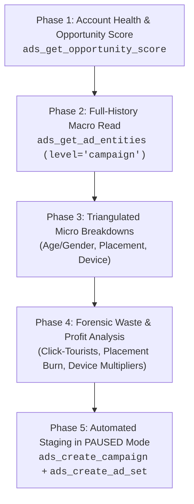

# Meta Ads Architecture & Operational Playbook
# Integrates Full-Funnel Structure & Model Context Protocol (MCP) Forensic Auditing

This playbook establishes the unified operating standard for structuring, executing, auditing, and scaling Meta Ads accounts, integrating the **Meta Ads Model Context Protocol (MCP)** toolset with full-funnel media buying principles.

---

## 1. Full-Funnel Account Architecture

Enforce the canonical 4-campaign structure:

```
+-----------------------------------------------------------------------------+
|                      FULL-FUNNEL ACCOUNT ARCHITECTURE                       |
+-----------------------------------------------------------------------------+
| Campaign 1: [TOF-ASC] Advantage+ Shopping Campaign (CBO)                    |
|   - Goal: Primary volume, purchase velocity, and blended ROAS               |
|   - Targeting: Broad / Algorithmic, 5–10% existing customer cap             |
|   - Safety Status: Always created in PAUSED state                           |
+-----------------------------------------------------------------------------+
| Campaign 2: [TEST-SANDBOX] Dynamic Creative Testing (ABO)                   |
|   - Goal: Concept validation (3 videos/images, 2 primary texts, 2 headlines) |
|   - Graduation Gate: >= 35 conversions at Target CPA -> Promote to TOF-ASC  |
+-----------------------------------------------------------------------------+
| Campaign 3: [MOF/BOF] Warm Engagement & Retargeting (ABO/CBO)               |
|   - Goal: Social engagers (90d), video viewers (50%+), cart abandoners (14d)|
|   - Exclusions: Strict 30-day purchasers list                               |
+-----------------------------------------------------------------------------+
| Campaign 4: [RET-DPA] Dynamic Product Catalog                               |
|   - Goal: Automated SKU carousel cross-sell & browse abandonment            |
+-----------------------------------------------------------------------------+
```

---

## 2. Creative Strategy (Hook-Hold-Offer)

- **0–3s (The Hook)**: Visual pattern interrupt, direct pain agitation, high-contrast typography, or controversial question.
- **3–15s (The Hold)**: Problem agitation, mechanism of action, demonstrable proof of claim, or UGC product demonstration.
- **15–30s (The Offer)**: Clear call-to-action, bundle savings/incentive, risk reversal guarantee, and scarcity/urgency.

---

## 3. Meta Ads MCP Tool Architecture & Call Taxonomy

Every programmatic call to the Meta Ads MCP server must follow Meta's standardized context taxonomy:

### Mandatory Context Parameters
- `client_conversation_id`: 20-character alphanumeric session token generated once per conversation (e.g. `qK7mR2xT9vLpW4nZ8aBc`).
- `advertiser_job`: Standardized taxonomy enum:
  - `report_measure_or_look_up` (data retrieval)
  - `assess_and_optimize_performance` (forensic auditing)
  - `create_and_launch_new_ads` (staging new campaigns)
  - `update_existing_campaigns` (budget & bid adjustments)
- `advertiser_request`: Verbatim quoted text capturing user intent.
- `client_model`: Model identifier string (`gemini-2.5-pro` or agent model string).

---

## 4. The 5-Phase Meta Ads MCP Audit Workflow



### Phase 1: Account Health & Opportunity Score
Call `Meta:ads_get_opportunity_score` to retrieve Meta's algorithmic health score and MAPI recommendations.
*Critical Filter*: Separate genuine performance levers (Advantage+ audience signals, CAPI integration) from Meta's spend-expanding traps (Audience Network, uncurated broad budget expansion).

### Phase 2: Full-History Macro Read
Call `Meta:ads_get_ad_entities` with `level='campaign'`, `date_preset='maximum'`. Calculate account MER, identify the top 20% campaigns driving 80% of purchases, and isolate zombie campaigns burning daily spend.

### Phase 3: The 3 Triangulated Micro Breakdowns
1. **Demographics (`["age", "gender"]`)**:
   - Detect **Click-Tourists vs. Wallet-Openers**: High CTR cohorts (18-24) frequently produce 0 purchases.
   - Calculate $\text{Purchase Conversion Efficiency} = \frac{\text{omni\_purchase}}{\text{link\_click}} \times 100$.
2. **Placements (`["publisher_platform", "platform_position"]`)**:
   - **Facebook & Instagram Mobile Feed**: Historically accounts for 75%-85% of legitimate e-commerce purchases.
   - **Reels / Stories**: High scroll velocity, low conversion intent without dedicated vertical creative.
   - **Audience Network**: Accidental mobile game clicks. Excised from all conversion campaigns.
3. **Hardware & Device (`["device_platform", "impression_device"]`)**:
   - Isolate iPhone vs Android AOV differences.
   - Evaluate iPad performance for mature demographics (50+). Exclude Desktop if historical Desktop purchases = 0.

---

## 5. Pacing, Bidding & Scaling Guardrails

1. **Safety Creation Gate**: All campaigns, ad sets, and ads are generated strictly in `PAUSED` status.
2. **Budget Pacing Cap**: Scaling is capped at $\le 20\%$ increases every 72 hours per campaign to prevent algorithmic learning phase resets.
3. **Audience Hygiene**: Strict negative exclusions for past 30-day purchasers and existing customer email lists.
4. **Bidding Strategy**: Lowest Cost / Highest Volume for concept testing and initial scaling. Transition to Cost Caps only after achieving a stable baseline of 50+ conversions.
