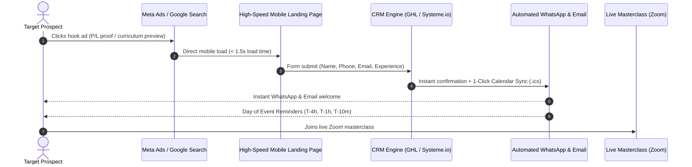

# High-Velocity Lead Generation & Automated Webinar Funnel Playbook
# Integrates Masterclass Acquisition, Automated Attendance Cadence & Reporting Standards

This playbook establishes the operating architecture, media buying strategy, multi-channel reminder cadence, visual KPI reporting, and proposal standards for high-ticket course and webinar funnels.

---

## 1. High-Ticket Course & Webinar Funnel Architecture

---

## 2. Media Buying & Channel Strategy

### Meta Ads (80–85% of Budget)
- **Objective**: Conversions (`CompleteRegistration` or `Lead`).
- **Creative Formats**: 9:16 vertical video reels featuring the founder/trainer speaking directly to camera.
- **Hook Framework**:
  - *Proof / Pattern Interrupt*: Real trade breakdown, live chart analysis, or tangible student outcome.
  - *Relatable Problem*: "Most beginners lose capital because they trade based on emotion rather than a rule-based system..."
  - *Risk Reversal*: "In this free 2-hour live masterclass, I will walk you through my exact step-by-step setup."
- **Targeting**: Broad demographic targeting with regional language affinities. Exclude past registrants and enrolled student lists.

### Google Search (15–20% of Budget)
- **Campaign Type**: Exact match high-intent search terms (`[learn stock trading online]`, `[technical analysis course]`).
- **RSA Strategy**: Highlight live trainer credibility, interactive Q&A, and practical curriculum.

---

## 3. The 4-Stage Automated Attendance Cadence

A lead is worthless if they fail to enter the live room. Enforce this multi-touchpoint reminder cadence:

1. **Instant Confirmation (T = 0)**:
   - Automated WhatsApp message + Email.
   - **Critical Asset**: 1-Click Add to Google Calendar / Apple Calendar link (`.ics`).
2. **Morning of Event (T - 10 hours)**:
   - Key takeaway preview: *"Tonight at 7:30 PM: We break down the 3 core execution setups..."*
3. **Countdown (T - 2 hours & T - 1 hour)**:
   - Short teaser video or PDF workbook download link.
4. **"Doors Open" Final Notice (T - 10 minutes)**:
   - Direct 1-click Zoom room access link via WhatsApp and SMS: *"We are going live right now. Room capacity is limited."*

---

## 4. Benchmark KPIs & Unit Economics

| Metric | Target Benchmark | Guardrail / Warning Threshold |
| :--- | :--- | :--- |
| **Cost Per Lead (CPL)** | ₹75.00 – ₹150.00 ($1.00 – $2.00) | Max CPL: ₹200.00 ($2.50) |
| **Landing Page CVR** | 22% – 35% | CVR < 18% requires headline/form rework |
| **Calendar Sync Rate** | ≥ 30% of registered leads | < 20% indicates low initial intent |
| **Live Room Show-Up Rate** | 25% – 40% of registered leads | < 20% indicates weak reminder cadence |
| **Webinar Close Rate** | 4% – 8% of live attendees | Conversion to paid training program |

---

## 5. Executive Framing & Proposal Architecture

1. **The Lead Thesis**: Always begin with the mutual accountability contract:
   *"We build and run the system that fills your event. You teach and enrol; we deliver the qualified audience."*
2. **Accountability Separation**:
   - **Agency KPIs**: CPL, Total Leads, Calendar Sync Rate, Live Attendees in Zoom.
   - **Client Responsibility**: Live presentation delivery, course curriculum, and sales closing.
3. **Six-Part Document Standard**: Summary & KPI table, automated workflow cards, funnel math projections (Pilot vs Scale), video script production briefs, launch schedule, and commercial terms.
