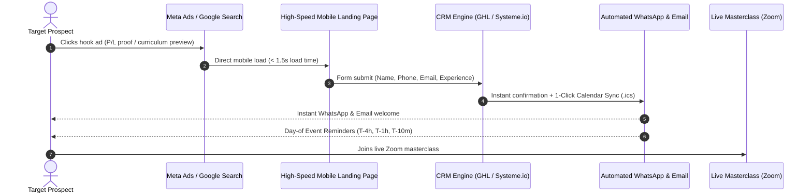

# High-Velocity Lead Generation & Automated Webinar Funnel Playbook
# Proven Masterclass & Course Funnel Architecture Derived from Active Campaigns

## 1. High-Ticket Course & Webinar Funnel Architecture

Acquiring students for high-ticket courses or specialized training programs (trading, coaching, professional certifications) requires an automated, high-velocity lead-to-attendance funnel.

---

## 2. Media Buying & Channel Strategy

### Meta Ads (80–85% of Budget):
- **Objective**: Conversions (CompleteRegistration / Lead).
- **Creative Formats**: 9:16 vertical video reels featuring the founder/trainer speaking directly to camera.
- **Hook Framework**:
  - *Proof/Pattern Interrupt*: Real trade breakdown or live chart analysis.
  - *Relatable Problem*: "Most beginners lose money because they follow random tips..."
  - *Risk Reversal*: "In this free 2-hour live workshop, I’ll show you my exact rule-based system."
- **Targeting**:
  - Broad demographic targeting + regional language affinity.
  - Exclude past attendees and current student lists.

### Google Search (15–20% of Budget):
- **Campaign Type**: Exact match high-intent search (e.g., `[learn stock trading online]`, `[price action course]`).
- **RSA Copy**: Highlight live trainer credibility, regional language instruction, and verified curriculum.

---

## 3. The 4-Stage Automated Attendance Cadence

A lead is worthless if they fail to show up in the live room. Enforce this multi-touchpoint reminder sequence:

1. **Instant Confirmation (T = 0)**:
   - Automated WhatsApp message + Email.
   - **Critical Asset**: 1-Click Add to Google Calendar / Apple Calendar link (`.ics`).
2. **Morning of Event (T - 10 hours)**:
   - Preview of 3 key takeaways: *"Tonight at 7:30 PM: We are breaking down the 3 entry rules..."*
3. **Countdown (T - 2 hours & T - 1 hour)**:
   - Short teaser video or PDF checklist download.
4. **"Doors Open" Final Notice (T - 10 minutes)**:
   - Direct 1-click Zoom access link via WhatsApp and SMS: *"We are going live right now. Room fills at 100 participants."*

---

## 4. Key Performance Indicators & Benchmark Targets

| Metric | Target Benchmark | Guardrail / Warning Threshold |
| :--- | :--- | :--- |
| **Cost Per Lead (CPL)** | ₹75.00 – ₹150.00 ($1.00 – $2.00) | Max CPL: ₹200.00 ($2.50) |
| **Landing Page CVR** | 22% – 35% | CVR < 18% requires copy/form rework |
| **Calendar Sync Rate** | ≥ 30% of registered leads | < 20% indicates low initial intent |
| **Live Room Show-Up Rate** | 25% – 40% of registered leads | < 20% indicates weak reminder cadence |
| **Webinar Close Rate** | 4% – 8% of live attendees | Handled by admissions/counseling team |
