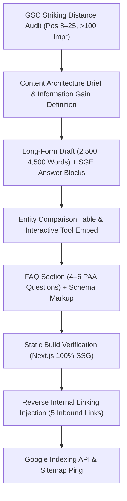

# Content Production & SERP Dominance SOP
**Version:** 4.0.0 (DMP & Paid Media World Integrated)  
**Scope:** Standard Operating Procedure for researching, architecting, drafting, and optimizing content for Top 3 SERP and Google AI Overview citations.

---

## 1. Operating Rules for Content Production

1. **Information Gain Anchor Required:** Every published guide must introduce net-new data, proprietary formulas, reproducible code/scripts, or verified account metrics not found in current top 10 search results.
2. **SGE / AEO Direct Answer Rule:** The lead paragraph or the section immediately beneath every H2 must contain a 45–55 word direct, factual definition/answer block formatted for AI snippet extraction.
3. **Structured Entity Tables:** All platform comparisons, metrics, and benchmarks must be rendered in semantic HTML `<table>` blocks with clear `<th>` attributes.
4. **Interactive Dwell-Time Hook:** Cross-reference and link to relevant internal calculators (`/marketing-calculators/`), audits (`/free-audit/`), or widgets to drive high user engagement.
5. **Rule of 5x5 Link Mesh:** Every new piece must include 5 contextual outbound links to PMW resources and receive 5 inbound contextual links injected into existing relevant posts.
6. **Machine-Readable E-E-A-T:** Every post must be coupled with `TechArticle` / `BlogPosting` + `BreadcrumbList` + `Author` JSON-LD schema.

---

## 2. Execution Workflow

See full blueprint: [content-writing-workflow-sop.md](file:///C:/Users/test/.gemini/antigravity/scratch/paidmediaworld/docs/content-writing-workflow-sop.md)
