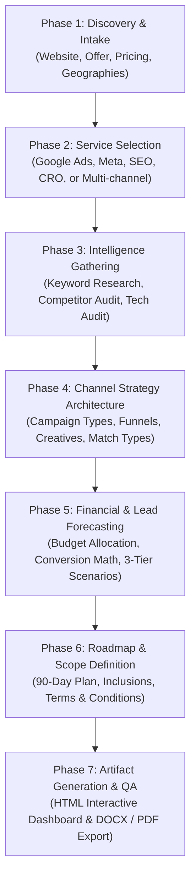
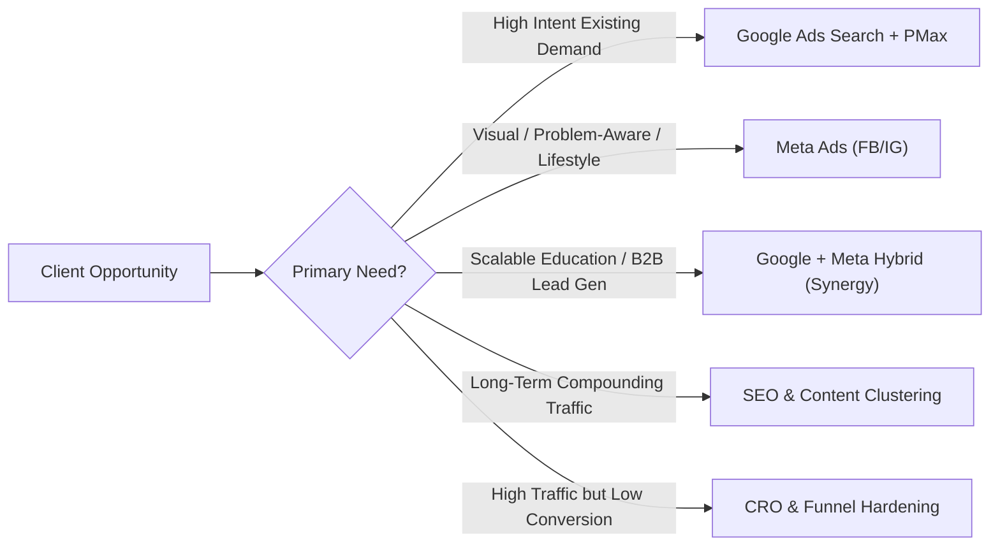
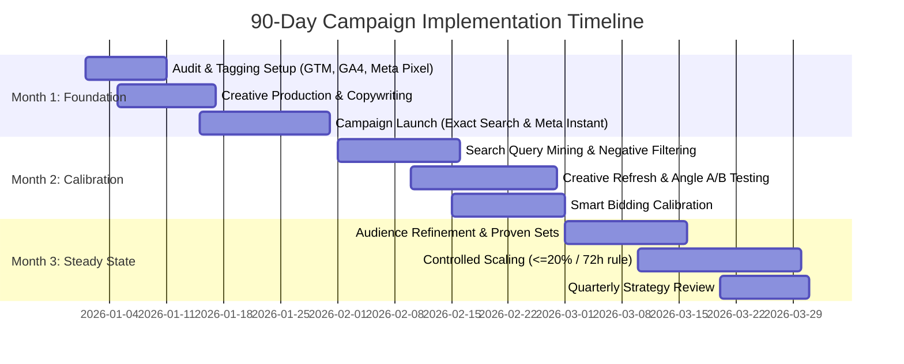

# Digital Marketing Proposal Preparation Workflow & Playbook
**TechnoExponent Standard Operating Procedure (SOP)**  
*Version 2.0 | Production Framework for Agency Proposal Architecture*

---

## 1. Executive Overview & Purpose

This playbook establishes the standardized, repeatable methodology for researching, structuring, modeling, and generating high-converting digital marketing proposals at TechnoExponent. Whether proposing a single channel (Google Ads, Meta Ads, SEO) or a multi-channel performance marketing engine, this workflow ensures every proposal is:
- **Evidence-Based:** Rooted in verified client data, live keyword metrics, and direct competitor intelligence.
- **Financially Modeled:** Backed by transparent, math-verified 3-tier forecasting (Conservative, Expected, Aggressive) with realistic CPL, CPA, and ROAS projections.
- **Visually & Technically Elite:** Delivered via our proven Interactive Web Dashboard format (with responsive design, sticky navigation, SVG gauges, and print-to-PDF stylesheets) or the CMMI Level-5 A4 Executive Deck format.
- **Legally & Operationally Guardrailed:** Protecting agency scope with clear deliverable boundaries, billing protocols, and discontinuation policies.

---

## 2. Reference Library: Real Proposals in `data/Proposal/`

The agency repository contains 11 production proposals across diverse markets and service configurations. All new proposals must adhere to these battle-tested standards:

| Client & File | Market & Industry | Core Services Proposed | Retainer & Pricing Structure | Key Strategic Lesson |
| :--- | :--- | :--- | :--- | :--- |
| **Doncaster Cellars** `Doncaster_Cellars_Digital_Marketing_Proposal.docx` | Australia (Melbourne) Retail / Liquor | Google Local Ads (Search/Maps) + GBP + Social | **A$600** Google Ads + **A$300** Social. Bundled: **A$970 / mo** (12% saving). | Real-time, near-me local intent capture; alcohol advertising certification protocol. |
| **Unit Keeper** `Digital_Marketing_Proposal_Unit_Keeper_Techno_Exponent.docx` | Canada (National) Property Management SaaS | Google Ads + SEO (LinkedIn ABM optional) | **$600** Google Ads + **$500** SEO. Total: **$1,100 CAD / mo**. | Walkthrough & free trial lead gen; transparent payback reality check against LTV. |
| **The Vellure House** `Vellure_House_Digital_Marketing_Proposal.pdf` | US / Global Influencer & Marketplace | Meta Ads vs. Foundation-First (Per-channel menu) | **$598** (Foundation) vs **$798** (Meta-Led) vs **$1,446 USD** (Full Funnel). | Per-channel price menu; tackles client vs. agency channel priority disagreements. |
| **House of D'Amaya** `House_of_Damaya_Performance_Marketing_Proposal.pdf` | India / Global Luxury Demi-Fine Jewellery | Performance Marketing + CRO + Organic Social | Phased: Foundation (Mo 1-2) -> Calibration (Mo 3-4) -> Early Scale (Mo 5-6). | 16-page full funnel D2C e-commerce modeling; avoids premature revenue promises. |
| **Hacia Atherton (Scale Code)** `Digital Marketing Proposal - Hacia Atherton (Scale Code) - Techno Exponent.docx` | Australia / Global Executive Coaching & ABM | Enterprise Digital Authority + LinkedIn ABM | Tiered Executive ABM Retainer. | High-ticket B2B positioning; founder IP ownership and "Blind$pot" authority capture. |
| **Guardian One** `Guardian-One-Digital-Marketing-Proposal.docx` | UK B2B SQL Database Compliance | LinkedIn ABM + Technical SEO | **£800** LinkedIn + **£600** SEO. Total: **£1,400 / mo**. | Niche B2B regulatory trigger targeting; 16,000 UK account ICP database. |
| **Flycket** `Flycket_Enterprise_Growth_Proposal_Techno_Exponent_1.docx` | UK Hospitality SaaS | Content Marketing, Social & LinkedIn ABM | Multi-tier SaaS Enterprise Retainer. | Multi-stakeholder buying committees in hospitality; POS integration lock-in. |
| **New Royal Cab Lethbridge** `New_Royal_Cab_Lethbridge_Digital_Marketing_Proposal.docx` | Canada (Alberta) Transportation / Taxi | Google Search Ads + Local Trust | High-margin airport transfers ($150-$250) vs low-margin city rides ($15). | Pivot away from saturated low-ticket rides to uncontested airport/corporate transfers. |
| **Rose Hunters Matchmaking** `Rose_Hunters_Matchmaking_Digital_Marketing_Proposal.docx` | UK Executive Matchmaking | Local SEO, GBP + Google Search Ads | Phased Foundation & Local Dominance. | Clinical hypnotherapy founder authority vs. generic Tinder-fatigue market. |
| **Zenos Smart Technology** `Digital_Marketing_Proposal_Zenos_Smart_Technology_Techno_Exponent.docx` | UK Luxury Home Automation | SEO + AEO/GEO + Paid Search | Lean 4-channel foundation. | High-ticket residential project acquisition; architectural & HNW targeting. |
| **Styllizeofficiel** `Styllizeofficiel_Personal_Branding_Proposal (1).docx` | Global Personal Branding | Executive Positioning & Social Authority | Strategic Authority Retainer. | Thought leadership and digital footprint hygiene. |

---

## 3. Phase 1: Client Discovery & Intake

Before writing a single slide or HTML line, conduct a 15-minute diagnostic audit of the client’s digital footprint:

### 1.1 Digital Asset Inspection Checklist
| Audit Dimension | Key Data Points to Extract | Source / Method |
| :--- | :--- | :--- |
| **Domain & Tech Stack** | CMS (Shopify, WordPress, Duda, Odoo, Custom), tracking scripts (GTM, GA4, Meta Pixel), PageSpeed score. | BuiltWith / Wappalyzer, PageSpeed Insights, Network inspect. |
| **Product / Service Matrix** | Core offers, high-margin hero products/courses, subscription models, pricing tiers, payment options. | Client website navigation, pricing tables, checkout flow. |
| **Target Geography & Audience** | Primary operating territory (metro vs. national vs. international), B2B vs. B2C vs. high-intent professional. | Contact info, footer addresses, shipping/service boundaries, language selectors. |
| **Unique Selling Proposition (USP)** | Accreditations, years in business, pass rates, guarantees, proprietary frameworks, founder credentials. | "About Us", case studies, testimonials, compliance statements. |
| **Current Conversion Funnel** | Form simplicity, booking calendar integration, live chat, lead magnets, phone CTAs, cart checkout friction. | Live testing of contact/enrolment flow. |

---

## 3. Phase 2: Service Selection Decision Matrix

Align client business models, ticket size, and market dynamics to the optimal service mix:

### Service-Specific Proposal Requirements

#### Scenario A: Google Ads (Search, Shopping/PMax, LSAs, YouTube)
- **Best For:** Bottom-funnel capture, urgent problem solving, high-intent local services, e-commerce product search.
- **Mandatory Proposal Modules:**
  1. *Search Intent Mapping:* Categorizing high-intent transactional queries vs. informational queries.
  2. *Keyword Matrix:* Search volume, keyword difficulty, intent type, estimated CPC, competition index.
  3. *Campaign Architecture:* Exact match ad groups, phrase match exploration, negative keyword library strategy, brand defense ad group.
  4. *Asset & Extension Strategy:* Callouts, sitelinks, structured snippets, call extensions, location assets.
  5. *Bid Strategy Evolution:* Start with Manual CPC / Enhanced CPC during the learning phase, transitioning to Max Conversions with tCPA/tROAS after 30+ conversion events.

#### Scenario B: Meta Ads (Facebook & Instagram)
- **Best For:** Visual products, impulse purchases, diaspora/expat communities, educational course enrollment, career change storytelling, retargeting.
- **Mandatory Proposal Modules:**
  1. *Audience Segmentation:* Top-of-Funnel (Broad demographics, interest clusters, Lookalike 1-3%), Middle-of-Funnel (video viewers, social page engagers), Bottom-of-Funnel (website visitors 30-180 days, cart abandoners, lead form drop-offs).
  2. *Creative Architecture & Formats:* Hook-Hold-CTA framework, UGC video reels, static carousel breakdowns, student/client testimonials, Before-vs-After narratives.
  3. *Lead Capture Mechanism:* Facebook Instant Forms (zero friction, auto-filled fields) vs. dedicated high-converting custom landing pages.
  4. *Tracking Infrastructure:* Meta Conversions API (CAPI) server-side integration via GTM to counter iOS privacy/cookie degradation.

#### Scenario C: Performance Marketing (Google Ads + Meta Ads Integrated) — *Recommended Default*
- **Best For:** 80% of growth clients (e.g., OBA Nursing Academy, RVA Choice, The Chair People). Google captures high-intent searches; Meta nurtures prospects, builds social proof, and drives low-cost lead volume.
- **Mandatory Proposal Modules:**
  - Integrated budget split (typically 60-70% Google for high-intent capture + 30-40% Meta for demand gen & remarketing).
  - Cross-channel retargeting loop (Google clicks retargeted on Instagram/Facebook feeds).
  - Blended CPL and customer acquisition cost (CAC) forecasting.

#### Scenario D: Search Engine Optimization (SEO) & Content
- **Best For:** Sustainable organic growth, reducing reliance on paid ad auctions, building domain authority.
- **Mandatory Proposal Modules:**
  - Technical crawl audit snapshot (Indexability, Core Web Vitals, Schema markup, SSL, mobile friendliness).
  - On-page content gap analysis & keyword target mapping.
  - Backlink profile audit & DA gap vs. top 3 competitors.
  - 30-60-90 Day SEO execution roadmap (Technical fixes -> Content expansion -> Authority building).

---

## 4. Phase 3: Market & Competitor Intelligence Gathering

A proposal wins when the prospective client sees that TechnoExponent already knows their competitors better than they do.

### 4.1 Keyword Research Protocol
1. **Identify Primary Seed Keywords:** Product/service core terms + modifiers (e.g., `nclex prep australia`, `oba nursing course`, `ahpra registration pathway`).
2. **Classify by Commercial Intent:**
   - *Transactional (90-95% priority):* `buy nclex course`, `best oba training australia`, `enrol nursing osce course`.
   - *Commercial Investigation (80-89% priority):* `oba nursing course fees`, `best nclex rn prep australia`, `osce training reviews`.
   - *Informational (Upper funnel, SEO/blog):* `how to register with ahpra as international nurse`, `what is stream b nursing`.
3. **Record Realistic Metrics:** Search Volume (local territory), Keyword Difficulty (0-100), Estimated CPC (in local currency: AUD, USD, GBP), and Competition level.

### 4.2 Competitor Audit Protocol
Analyze 4 to 5 direct competitors across:
- **Organic Footprint:** Estimated monthly organic traffic, domain authority (DA), top ranking organic terms.
- **Paid Advertising Posture:** Active on Google Ads? Running Google Screened / Local Services Ads? Running Meta Ads (check Meta Ad Library for active creatives, video styles, and hooks)?
- **Landing Page Strengths & Weaknesses:** Fast load vs slow? Direct form vs hidden contact page? Trust badges and student/customer testimonials visible above the fold?

---

## 5. Phase 4: Financial Modeling & Forecasting

Never give a single speculative number. Always present a verified **3-Tier Scenario Model**:

### 5.1 The Core Performance Math Formulas
$$\text{Estimated Clicks} = \frac{\text{Monthly Ad Spend}}{\text{Average Blended CPC}}$$
$$\text{Expected Leads / Conversions} = \text{Estimated Clicks} \times \text{Conversion Rate (CVR)}$$
$$\text{Cost Per Lead (CPL)} = \frac{\text{Monthly Ad Spend}}{\text{Expected Leads}}$$
$$\text{Estimated New Customers} = \text{Expected Leads} \times \text{Sales Close Rate}$$
$$\text{Gross Revenue Generated} = \text{Estimated New Customers} \times \text{Average Customer Value / LTV}$$
$$\text{Estimated ROAS} = \frac{\text{Gross Revenue Generated}}{\text{Monthly Ad Spend}}$$

### 5.2 Scenario Parameters & The New Ad Account Cold-Start Rule

> [!IMPORTANT]
> **The New Ad Account Cold-Start Rule:** In brand-new advertising accounts (or accounts without active conversion history), advertising algorithms (Google Smart Bidding and Meta Delivery System) have no pixel data or audience conversion history. Never promise full steady-state results in Month 1!
> - **Month 1 (Learning & Algorithmic Calibration):** Performance operates at **50%–60% of steady state** as the system explores search queries, logs baseline conversion actions, and populates negative keyword lists. Cost per Lead is highest in Month 1.
> - **Month 2 (Data Calibration & Optimization):** Performance reaches **80%–85% of steady state** as non-converting queries are eliminated, ad relevance scores improve, and winning creative angles emerge.
> - **Month 3 (Steady-State Optimization):** Performance reaches **100% steady state** with stable, optimized Cost per Lead.

| Scenario Tier | CTR Benchmark | Conversion Rate (CVR) | Sales Close Rate | Purpose & Expectation |
| :--- | :--- | :--- | :--- | :--- |
| **Conservative** | Low end (2.5% - 3.5% Search, 0.8% Meta) | 3.5% - 4.8% (Landing Page), 4.0% (Instant Form) | 12% - 18% | Stress-test minimum guaranteed return during initial learning phase. |
| **Base Case (Target)** | Industry median (4.0% - 5.5% Search, 1.2% - 1.6% Meta) | 5.0% - 6.5% (Landing Page), 5.5% - 7.5% (Instant Form) | 18% - 22% | Realistic, high-confidence working target after 30–60 days of data calibration. |
| **Optimistic** | Top quartile (6.0%+ Search, 2.0%+ Meta) | 7.0% - 9.0%+ (CRO optimized) | 24% - 28%+ | High scale with mature negative lists, winning ad creatives, and seasoned pixel data. |

### 5.3 Tracking Infrastructure Standard (Client-Side Deployment)

Proposals must specify a standard, reliable client-side tracking deployment unless server-side infrastructure is explicitly contracted:
1. **Google Tag Manager (GTM):** Container installed across the website to manage all tracking tags without modifying site source code.
2. **Google Analytics 4 (GA4):** Configured with custom event tracking (`form_submit`, `brochure_download`, `phone_click`, `checkout_start`).
3. **Google Ads Conversion & Remarketing Tags:** Configured through GTM to track lead generation and build remarketing audiences.
4. **Meta Pixel (Browser-Based):** Installed via GTM to track standard conversion events (`Lead`, `ViewContent`, `Contact`, `InitiateCheckout`).
*(Note: Do not promise server-side tracking, server-side CAPI, or cloud server containers unless a dedicated DevOps/cloud infrastructure retainer is scoped).*

---

## 6. Phase 5: Implementation Roadmap & Milestones

Standardize proposals on a structured **90-Day Implementation Timeline**:

- **Month 1: Foundation & Alpha Launch**
  - Implement full client-side conversion tracking (Google Tag Manager, GA4 custom events, Google Ads Conversion Tags, Meta Pixel).
  - Build negative keyword master lists (preventing wasteful spend on irrelevant queries or job seeker searches).
  - Launch core Alpha campaigns: Google Exact Search + Meta Instant Lead Forms.
- **Month 2: Data Calibration & Optimization**
  - Mine search term reports weekly to identify emerging high-intent phrases and prune negative search terms.
  - A/B test ad copies, headlines, and creative angles (e.g., Testimonial vs. Curriculum breakdown).
  - Fine-tune bids as ad relevance scores establish.
- **Month 3: Steady State & Controlled Scaling**
  - Consolidate proven ad groups and transition mature campaigns to smart bidding (Target CPA bounds).
  - Scale winning ad sets following budget pacing guardrails (≤ 20% budget swing per 72 hours).
  - Review quarterly performance and evaluate international hub expansions.

---

## 7. Phase 6: Deliverables & Terms and Conditions (T&C)

Clear operational boundaries avoid scope creep and protect agency profitability:

### 7.1 Deliverable Boundaries
- **Weekly Progress & Reporting:** Automated live dashboards + bi-weekly strategic sync calls.
- **Creative Development:** Dedicated graphic and video ad creative assets per month (specified count).
- **Campaign Management:** Continuous bid management, search term hygiene, audience pruning, and negative keyword maintenance.

### 7.2 Standard TechnoExponent Proposal Terms
1. **Ad Spend Billing:** All ad spend goes directly onto the client's registered billing method with Google Ads and Meta Ads. TechnoExponent does not float ad budgets.
2. **Setup Window:** Ad campaigns go live within 5 to 7 business days following payment clearance, account access, and asset handover.
3. **Landing Pages:** Landing page recommendations are included. Complete custom website/landing page design and code development outside standard templates are scoped separately.
4. **Software & Tool Subscriptions:** Third-party tool subscriptions (CRM, SMS gateways, email ESPs, dedicated call tracking software) are borne by the client.
5. **Intellectual Property:** The client retains 100% ownership of all ad accounts, custom creatives, audiences, and campaign data.
6. **Discontinuation Policy:** Retainer cancellation operates under standard agency terms:
   - Cancellation within 7 days: 70% refund of management fee (30% retained for setup work).
   - Cancellation within 15 days: 50% refund.
   - Cancellation after 21 days: 0% refund (100% retained).

---

## 8. Phase 7: Document Generation & Design Tokens

Every proposal must be produced adhering strictly to the **TechnoExponent Design System**:

### Color Palette & Typography Tokens
- `--te-blue: #2361a8` (Primary brand blue)
- `--te-dark-blue: #1b365d` (Navy headings & deep accents)
- `--te-cyan: #00aeef` (Action cyan, highlights, borders)
- `--te-bg: #f8fafc` (Clean dashboard slate background)
- `--te-card-bg: #ffffff` (Pure white card surfaces)
- `--te-text: #334155` (Slate readable body copy)
- `--te-heading: #0f172a` (Near-black sharp typography)
- `Font Families:` `'Outfit', sans-serif` for titles/KPI numbers; `'Inter', sans-serif` for body copy and tables.

### Interactive Dashboard Layout Rules
- **Sticky Header:** Client logo + TechnoExponent CMMI-5 trust badge, proposal metadata, and single-click **"Download PDF"** (`window.print()`) button.
- **Sticky Sidebar Navigation:** Clean numbered menu (`1. Business Analysis`, `2. Keyword Research`, etc.) allowing smooth one-click scrolling.
- **Print Optimization (`@media print`):** Sidebar hidden, content expands to 100% width, cards avoid page-break breaks (`page-break-inside: avoid;`), exact color reproduction enforced.

---

## 9. Proposal Preparation Checklist (Sign-Off Gate)

Before presenting the proposal to the client or sales team, verify:
- [ ] Client website, offers, prices, and geographic service locations verified.
- [ ] Minimum 8-12 localized, high-intent keywords identified with search volume & CPC in correct local currency.
- [ ] At least 4 direct competitors audited with specific traffic, rating, and paid ad insights.
- [ ] Google Ads campaign architecture defined (Search, Brand, PMax/Retargeting).
- [ ] Meta Ads funnel defined (TOF Prospecting, MOF Consideration, BOF Retargeting) with creative formats.
- [ ] 3-Tier Forecast Model calculated with transparent math (Clicks, CVR, Leads, CPL, Revenue).
- [ ] 90-Day Implementation roadmap broken into 3 actionable phases.
- [ ] Standard TechnoExponent T&Cs, billing rules, and discontinuation terms included.
- [ ] Responsive UI verified on mobile, tablet, and desktop viewports.
- [ ] "Download PDF" print test conducted to ensure zero awkward page breaks.
