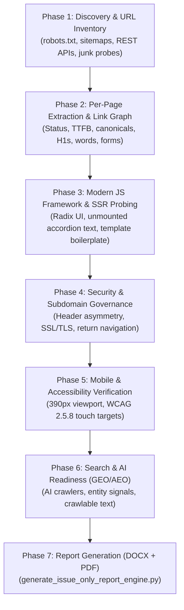

# Comprehensive Technical SEO & Website Audit SOP
**Standard Operating Procedure (SOP) | TechnoExponent Digital Marketing & SEO Practice**  
*Version 2.0 | Production Framework for Evidence-Based Website Audits*

---

## 1. Executive Overview & Purpose

This standard operating procedure operationalizes an evidence-based, field-verified Technical SEO and Conversion Audit protocol for B2B SaaS, lead-generation, healthcare, and e-commerce websites. Whether auditing a traditional WordPress CMS or a modern headless JavaScript framework (Next.js, Nuxt, SvelteKit, React), this workflow ensures that every audit delivered to clients is:
- **Evidence-Backed:** Every finding names the specific URL(s) affected, the observed state, the expected standard, business impact, and priority. No metrics are ever fabricated.
- **Client-Ready & "Issues-Only":** Executive reports are cleanly structured to highlight defects, scope of improvement, immediate fixations, and roadmaps without cluttering the report with unrequested code implementations.
- **Deeply Technical & Modern:** Explicitly tests Server-Side Rendering (SSR) vs. Client Hydration gaps, security header asymmetries across subdomains, mobile touch targets (WCAG 2.5.8), and AI-search crawler permissions.
- **Dual Deliverable Formats:** Compiled into high-fidelity, presentation-grade **PDF** (via Playwright headless Chromium) and editable **DOCX** reports with weighted scorecards, status badges, and dynamic page numbering.



---

## 2. Core Reporting Standard: The "Issues-Only" Executive Report

To maximize executive impact and avoid premature developer disagreements, all client audit deliverables adhere to the **Four Pillars of Executive Reporting**:

### 2.1 Highlight All Issues Only (Zero Solution Code Dumps)
- **Rule:** Never paste raw developer code (e.g., `app/sitemap.ts`, `app/layout.tsx`, Nginx configuration blocks) into the executive client audit report unless explicitly contracted for engineering handoff.
- **Format:** Present each defect in a standardized Issue Card / Callout:
  - `Title`: Precise technical defect (e.g., *Default Next.js 13 Template Description in Production*).
  - `Severity`: **Critical**, **High**, **Medium**, or **Low**.
  - `Affected URLs`: Exact URLs where the defect was observed.
  - `Observed Defect & Impact`: Plain-English explanation of what was found and why it hurts revenue, CTR, or indexing.

### 2.2 Scope of Improvement (5 Strategic Pillars)
Always synthesize domain potential across these 5 dimensions:
1. **Search Visibility & AI Discovery:** Moving from zero/low visibility to Page 1 rankings and AI engine citations (ChatGPT, Perplexity, Google AI Overviews).
2. **Technical Governance & Crawl Hygiene:** Establishing 100% crawl efficiency, valid sitemaps, canonical tags, single-hop redirects, and uniform security headers.
3. **Topical Authority & Content Depth:** Expanding thin brochure sites into authoritative technical hubs with industry-specific landing pages and technical explainers.
4. **Conversion Funnel & Mobile Usability:** Eliminating dead links and "Under Construction" roadblocks, unifying subdomain contact flows, and ensuring WCAG-compliant tap targets.
5. **Brand Authority & E-E-A-T Elevation:** Elevating domain and brand authority through verified physical addresses, executive credentials, enterprise NDA assurances, and legitimate legal policies.

### 2.3 Immediate Fixation Needed (Emergency Priority)
- Isolate the **6 to 9 emergency items** that actively harm brand credibility, user experience, or search indexing right now.
- These represent the "Sprint 1" punch list for the client's internal team or agency onboarding.

### 2.4 What Will Be the Next Step (Strategic 4-Phase Roadmap)
Structure all recommended remediation into a chronological, achievable roadmap:
- **Phase 1: Emergency Technical Cleanup (Days 1–15):** Fix metadata boilerplate, eliminate duplicate H1s, deploy sitemaps, add canonicals, set temporary `noindex, follow` on unfinished drafts, and fix mobile touch targets.
- **Phase 2: Core Solution Content & Trust Architecture (Days 16–45):** Rebuild core service/solution pages (1,000+ words), draft real legal policies, add company trust signals to the footer, and deploy Schema.org structured data.
- **Phase 3: Industry Expansion & B2B Inbound Scaling (Days 46–90):** Launch industry-specific landing pages, build interactive tools/calculators, and pursue high-authority industry backlinks.
- **Phase 4: Field Verification & Authority Rescoring (Days 90+):** Pull live Chrome User Experience Report (CrUX) field data for LCP/INP/CLS, audit mobile usability on real devices, verify AI citations, and re-score the domain out of 100.

---

## 3. The 10-Phase Technical Audit Protocol

### Phase 1: Discovery & URL Inventory
1. **`robots.txt` Probing:** Fetch `https://domain.com/robots.txt`. Record all `Allow`, `Disallow`, and `Sitemap:` directives. Check for bot-specific rules (`GPTBot`, `ClaudeBot`, `PerplexityBot`, `Google-Extended`). Flag if `robots.txt` redirects to the homepage or lacks a sitemap pointer.
2. **Sitemap Discovery:** Probe `/sitemap.xml`, `/sitemap_index.xml`, `/wp-sitemap.xml`, `/page-sitemap.xml`. Recursively expand sub-sitemaps and extract all `<loc>` entries and `<lastmod>` timestamps.
3. **Architecture & CMS Fingerprinting:** Identify whether the site runs WordPress (Elementor, Divi), Shopify, Webflow, or a modern JavaScript framework (Next.js App Router, Nuxt, SvelteKit, Astro).
4. **REST API & Staging Probes:** Test `/wp-json/wp/v2/pages`, `/feed/`, `/?s=`, `/?p=1`, `/.env`, `/.git/config`, `/_next/static/`.
5. **Master Inventory CSV:** Generate `01_url_inventory.csv` tagged as `sitemap-only`, `crawl-only`, or `both`.

### Phase 2: Per-Page Extraction & Link Graph
Crawl up to the cap (default: 500 URLs) and record in `02_page_data.csv`:
- Status code, redirect chain (logging each 301/302/307/308 hop), response time (TTFB), HTML byte size.
- Indexability status, canonical URL (self-referencing / cross-domain / missing), meta robots, `X-Robots-Tag`.
- Title tag (character count + pixel width estimate), meta description (character count).
- Heading outline: count and exact text of all `<h1>` tags, `<h2>`/`<h3>` outlines.
- Main body word count (excluding boilerplate navigation and footer).
- Image metrics: total count, missing `alt` attributes, missing `width`/`height` attributes.
- Conversion indicators: presence of forms, phone numbers (`tel:`), email links (`mailto:`), chat widgets.
- Internal Link Graph: generate `03_link_graph.csv` (source URL -> target URL -> anchor text -> follow/nofollow).

### Phase 3: Modern JS Framework & SSR Auditing
For modern JavaScript web applications (Next.js, React, Vue, SvelteKit):
1. **Template & Starter Boilerplate:** Inspect `<head>` metadata, OpenGraph tags, and page footers for leftover starter boilerplate (e.g. `shadcn/taxonomy`, Create React App defaults).
2. **Server-Side Rendering (SSR) vs. Client Hydration:** Test whether interactive UI components (Radix UI, shadcn, headless UI accordions, tabs, modal dialogs) render their text content into the initial server HTML payload. If closed accordions render as `<div hidden=""></div>` with empty text, crawlers see 0 words of answers.
3. **Ephemeral Staging Asset Leaks:** Inspect `og:image`, canonical tags, and CDN assets to ensure they do not point to temporary branch deployments (e.g. `*.vercel.app`, Netlify previews, or AWS S3 staging buckets).

### Phase 4: Indexability & Directive Governance
1. **Meta Robots Audit:** Check all URLs for `noindex`, `nofollow`, or `noarchive`.
2. **Default Indexability of Placeholder Pages:** Identify any "Under Construction", coming soon, or Latin Lorem Ipsum legal pages that return HTTP 200 without a `noindex` tag. Mandate immediate temporary `noindex, follow` directives until full content is published.
3. **Canonical Hygiene:** Verify self-referencing canonical tags exist across 100% of indexable pages.

### Phase 5: Security & Subdomain Governance
1. **SSL/TLS Protocol:** Verify TLS 1.2+ (TLS 1.3 preferred) and calculate days remaining before certificate expiry.
2. **Security Headers Check:** Inspect `Strict-Transport-Security` (verify `includeSubDomains`), `X-Frame-Options`, `X-Content-Type-Options: nosniff`, `Referrer-Policy`, and `Content-Security-Policy`.
3. **Subdomain Asymmetry:** Verify whether subdomains (e.g. `solutions.domain.com`, `app.domain.com`) have divergent security headers compared to the root domain.
4. **Subdomain Trust & Return Navigation:** Ensure lead capture forms on subdomains have working, prominent links back to the marketing homepage and include consistent branding to avoid triggering phishing red flags with cautious B2B buyers.

### Phase 6: Mobile Usability & Accessibility (WCAG 2.5.8)
1. **Mobile Emulation:** Render pages via Playwright under standard mobile viewports (e.g. iPhone 13, 390×844px).
2. **Touch Target Dimensions:** Measure interactive elements (buttons, tab switchers, form inputs). Flag any button failing the WCAG 2.5.8 standard (minimum 44×44px or 48×48px tap target), such as undersized 24px submit buttons.
3. **Form Accessibility:** Verify explicit `<label>` tags for all input fields and textareas.

### Phase 7: Core Web Vitals (Lab vs. Field CrUX Data)
1. **Lab Synthetic Timing:** Measure TTFB (< 800ms) and FCP (< 1800ms) via Playwright / Lighthouse.
2. **Field Data Clarification:** Explicitly inform clients that fast lab TTFB does not equal a passing Core Web Vitals score. Google evaluates 28-day rolling Chrome User Experience Report (CrUX) field data for LCP, INP, and CLS. Note when zero-traffic domains lack CrUX data, and mandate re-testing at Day 90+.

### Phase 8: Structured Data (Schema.org)
1. Verify presence of valid JSON-LD schemas.
2. Validate standard schema types: `Organization`, `LocalBusiness`, `SoftwareApplication` / `Product`, `BreadcrumbList`, `FAQPage`.
3. Flag any unverified reviews or fabricated `aggregateRating` properties.

### Phase 9: AI-Search Readiness (GEO / AEO) & Entity Signals
1. **AI Crawler Permissions:** Confirm `robots.txt` does not inadvertently block `GPTBot`, `ClaudeBot`, `PerplexityBot`, or `Google-Extended`.
2. **Entity Clarity:** Ensure Organization schema includes authoritative `sameAs` links (LinkedIn, Crunchbase, Wikipedia).
3. **Crawlable Content Volume:** Verify the site contains substantive, direct-answer copy that AI engines can extract and cite in conversational responses.

### Phase 10: Automated Report Generation
1. Compile findings into `audit_data.json`.
2. Run `scripts/generate_issue_only_report_engine.py` to produce both `[Client]_SEO_Audit_Report.docx` and `[Client]_SEO_Audit_Report.pdf`.

---

## 4. Automated Tooling & Scripts Reference

### 4.1 Crawl & Metric Extraction
```bash
python scripts/run_website_audit.py --url "https://example.com/" --service "https://example.com/primary-service/" --country "India" --out "website audit/example.com"
```

### 4.2 Probing Headers, SSR & Mobile Tap Targets
Create a client-specific probe or use the verified templates in `scripts/`:
- `scripts/verify_expanded_checks.py`: Probes `robots.txt`, security headers, exposed dev artifacts (`/.env`, `/.git`), and `meta robots` across all routes.
- `scripts/verify_mobile_a11y.py`: Launches Playwright in mobile viewport (390px) to measure bounding boxes of buttons and audit accordion hydration.

### 4.3 Universal Report Generator
```bash
python scripts/generate_issue_only_report_engine.py --data "website audit/client/audit_data.json" --out "website audit/client" --prefix "Client_SEO_Audit_Report"
```

The script automatically handles:
- Executive Cover Page with Weighted Score Box (`XX / 100`)
- Executive Summary & Baseline Metrics Callout
- 10-Category Technical Health Scorecard Table with Badges (`Critical`, `Warning`, `Pass`)
- Complete Issue Catalog with Callouts
- 5-Pillar Scope of Improvement
- Numbered Immediate Fixation List (Emergency Priority)
- 4-Phase Chronological Roadmap Table
- Pixel-perfect A4 pagination with dynamic header/footer page numbers

---

## 5. Standardized Audit Data Schema (`audit_data.json`)

When preparing audit data for automated generation, structure `audit_data.json` as follows:

```json
{
  "client_name": "Client Brand Name",
  "domain": "https://www.example.com/",
  "primary_service": "https://www.example.com/service/",
  "core_offering": "Core B2B / eCommerce Offering",
  "technology_stack": "Next.js / WordPress on Hosting Provider",
  "audit_date": "Current Date (Live Probed & Verified)",
  "domain_authority_summary": "Moz DA X | Semrush AS X | Organic Traffic: X",
  "health_score": 45,
  "badge_text": "B2B Technical SEO & On-Page Audit",
  "report_title": "SEO & WEBSITE AUDIT REPORT",
  "meta_items": [
    ["Target Website:", "https://www.example.com/"],
    ["Primary Service Page:", "https://www.example.com/service/"],
    ["Core Value Proposition:", "Description of core value"],
    ["Technology Framework:", "Next.js / WordPress / Shopify"],
    ["Audit Verification Date:", "Date of audit"],
    ["Overall Website Health Score:", "45 / 100 (Remediation Required)"]
  ],
  "executive_summary": [
    {"bold_prefix": "Executive Context: ", "text": "..."},
    {"bold_prefix": "Verified Baseline: ", "text": "..."},
    {"bold_prefix": "Live Probed Facts: ", "text": "..."}
  ],
  "scorecard": [
    ["Crawlability & Sitemaps", "10", "2 / 10", "Fail", "Primary defect description"],
    ["Indexability & Canonicals", "10", "4 / 10", "Critical", "Primary defect description"],
    ["On-Page Metadata", "10", "3 / 10", "Critical", "Primary defect description"],
    ["Heading Structure (H1/H2)", "10", "5 / 10", "Warning", "Primary defect description"],
    ["Content Depth & Indexability", "10", "2 / 10", "Critical", "Primary defect description"],
    ["Performance & Speed", "10", "10 / 10", "Pass", "Fast response times"],
    ["Structured Data (Schema)", "10", "0 / 10", "Fail", "Missing JSON-LD"],
    ["E-E-A-T & Trust Signals", "10", "3 / 10", "Critical", "No address or legal policies"],
    ["Security & Architecture", "10", "5 / 10", "Warning", "Missing security headers"],
    ["Mobile & Accessibility", "10", "4 / 10", "Critical", "Undersized buttons"],
    ["TOTAL WEIGHTED SCORE", "100", "45 / 100", "Critical", "Immediate remediation required"]
  ],
  "issues": [
    {
      "title": "Issue Title",
      "severity": "Critical",
      "urls": "https://example.com/page",
      "impact": "Observed defect and its business impact on SEO or conversions."
    }
  ],
  "scope_of_improvement": [
    {"bold_prefix": "1. Search Visibility & AI Discovery: ", "text": "..."},
    {"bold_prefix": "2. Technical Governance & Crawl Hygiene: ", "text": "..."},
    {"bold_prefix": "3. Topical Authority & Content Depth: ", "text": "..."},
    {"bold_prefix": "4. Conversion Funnel & Mobile Usability: ", "text": "..."},
    {"bold_prefix": "5. Brand Authority & E-E-A-T Elevation: ", "text": "..."}
  ],
  "immediate_fixations": [
    "Fix description 1",
    "Fix description 2"
  ],
  "roadmap": [
    {"phase": "Phase 1: Emergency Cleanup\n(Days 1–15)", "objectives": "...", "milestone": "..."},
    {"phase": "Phase 2: Core Solution Content\n(Days 16–45)", "objectives": "...", "milestone": "..."},
    {"phase": "Phase 3: Industry Expansion\n(Days 46–90)", "objectives": "...", "milestone": "..."},
    {"phase": "Phase 4: Field Verification\n(Days 90+)", "objectives": "...", "milestone": "..."}
  ]
}
```

---

## 6. Pre-Delivery Quality Assurance (QA) Checklist

Before delivering the audit reports to the client or account lead, verify:
- [ ] **No Speculative Code Dumps:** Ensure the executive DOCX and PDF do not contain unrequested developer implementation scripts.
- [ ] **Evidence Attached:** Every issue specifies exact `URL(s)`, `Observed Defect`, `Severity`, and `Impact`.
- [ ] **Live Probing Completed:** Header checks, `robots.txt`, and mobile rendering were actually run; no unverified assumptions remain.
- [ ] **File Parity:** Both `.docx` and `.pdf` versions exist in the output directory, have identical content, and render with intact formatting.
- [ ] **Page Numbering:** The PDF correctly shows page numbers (`Page X`) and clean margins without text overlapping table boundaries.
- [ ] **Links Function:** All links to files in markdown summaries use clickable `file://` hyperlinks for easy client access.
